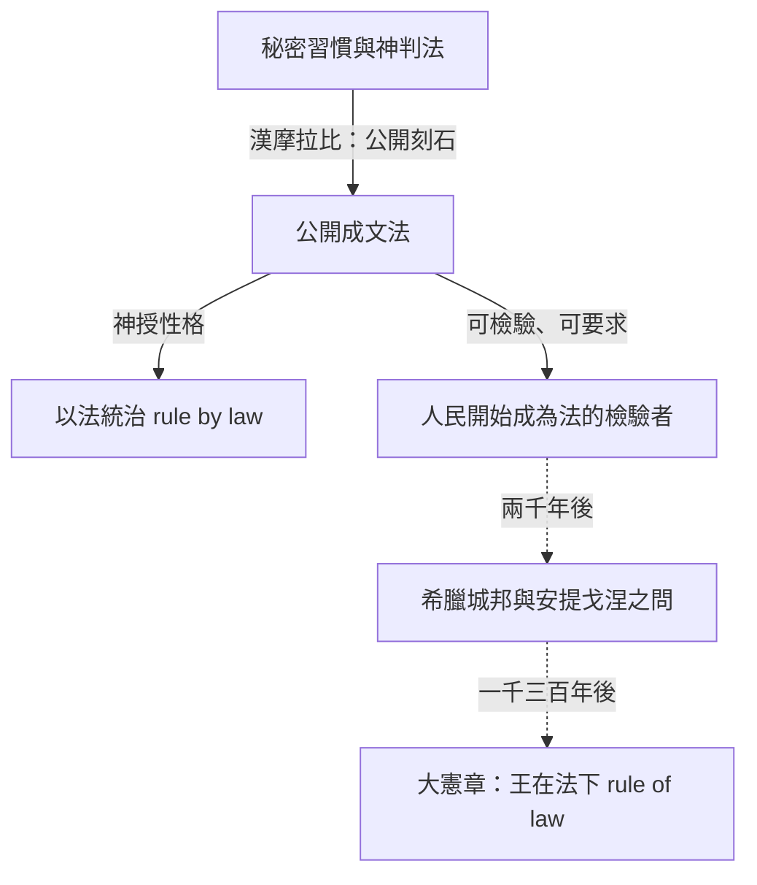

# 1.2 從神諭石柱到公開之法

漢摩拉比把法律刻在石柱上的那一刻，其實做了一件遠比「頒布法典」更重要的事：他讓法律第一次成為可以被觀看、被檢查、被引用的公共物件。這一節，我們細看「公開」兩個字的重量，以及在巴比倫與羅馬之間的三千年裡，公開之法如何萌芽、又如何幾度夭折。

## 保密之法的黑暗時代

要理解漢摩拉比的公開刻石有多革命性，必須先看見它所顛覆的東西。

在最早的社會裡，規則存在於長老與祭司的記憶中。要打官司，你把案子呈給他們，他們心中有一套你完全看不見的規則與判斷標準。這種制度的好處是靈活，壞處是任意：判決取決於審判者此刻的心情、他與你的關係、你獻給他多少祭品。而最致命的是，你無法預測行為的法律後果，也就無法計畫自己的人生。

更早的解決方案是「神判法」（trial by ordeal）：讓神來做決定。巴比倫人使用的一種著名神判是水判——把被告丟進聖河；若神認為他無罪，河水就讓他浮起。漢摩拉比法典第 2 條就規定了水判：被控施術者若「投入河中而沉沒」，控告者可取得其房屋；若河水證明他無罪，則控告者被處死，被告取回房產。神判巧妙地把不可證明的案件外包給了神，也把判決的責任從人身上轉移了出去。

但是神判與秘密規則共享同一個問題：人民面對的是一個不可預測的黑箱。法典的公開，就是要把黑箱打開。

## 公開的三重意義

把 282 條法規刻在公共石柱上，至少完成三件事：

1. 可預期性。人民可以預先知道行為的後果。這正是現代法學的主軸概念之一，十九世紀德國法學家耶林（Rudolf von Jhering）與英國法學家富勒（Lon Fuller）後來將它發展為「法的安全性」與「法治八原則」（其中第一條就是「法律必須是公開且廣為知的」）。
2. 可要求性。人民可以援引法律向官吏要求特定的對待。第 5 條明文規定：法官若作出判決後又改變判決、推翻自己親自蓋印的裁定，應罰銀並從法官席上被驅逐，且不得再審判。立法者漢摩拉比居然立法懲罰法官——這對王權的不可挑戰性，是一個微妙的裂縫。
3. 可檢驗性。法律可以被閱讀、比較、批評、改進。石柱本身就成為「對統治者權力的第一次文字化約束」：你承諾了這些規則，你就要受它拘束。

換句話說，公開刻石把法律從「統治的秘密技術」變成「公共的承諾」。這個小小的轉換，是兩千五百年後《大憲章》、寫入憲法的「罪刑法定原則」、以及今日大巨觀法律時事透明化的精神始祖。

## 神授之法的兩難

但公開之法有一個根本難題：它是誰的法？

石柱頂端的浮雕給出了答案：沙瑪什神授予國王權杖。這個答案解決了「為什麼要遵守」——因為是神說的。但它同時創造了新的問題：如果法律是神的意思，那麼修改法律就等於僭越神；而「解釋法律」的壟斷權，通常被握在神的（聲稱的）代理人手裡，也就是國王與祭司的聯盟。

我們可以用一張極簡的表格來看神授之法的結構：

| 角色 | 在巴比倫世界中的位置 | 對應的現代法學概念 |
|---|---|---|
| 神 | 法的最終來源 | 法的效力基礎 |
| 國王 | 神的代理人、立法者 | 立法權 |
| 祭司/抄寫員 | 解釋與傳抄 | 司法解釋 |
| 人民 | 服從者、被告 | 法的主體（尚未成形） |

注意最後一格：在巴比倫的法觀念中，「人」並不是法律的主體，而是法律作用於的對象。這種「由上而下」的法結構，正是「以法統治」（rule by law）的典型：法律是統治的工具，而非拘束統治者的槓桿。把統治者也放進法律的拘束範圍，也就是「法治」（rule of law），要等到希臘城邦與英格蘭的漫長鬥爭才能誕生。

## 演進的斷裂與再生

美索不達米亞的法律傳統雖然輝煌，卻沒有直接流入後世的歐洲法系。原因在於文明的載體：楔形文字的學習成本極高，只在專門的文士學校中傳授，知識圈子小而封閉。當亞述、新巴比倫王國接連崩潰，這條文字鏈就跟著斷掉。到了公元前一世紀，連波斯帝國的貴族都已不再能閱讀楔形文字。

因此，兩河的法並沒有「被繼承」。但是它的觀念——比例報復、契約責任、公開刻法、法官問責——透過希伯來律法、透過近東普通人民的習俗，暗中傳播，在遙遠的地方開花。這提醒我們：法學的演化不是線性的，而常常是「被遺忘、被重新發明」的螺旋。

下一章，我們將進入古希臘。在那裡，一個劇作家用一齣悲劇，把「國王的法」與「天神之法」的衝突搬上舞台；而這場戲的主角安提戈涅，將成為兩千年後所有良心拒服惡法者的精神祖先。

小結：漢摩拉比的貢獻不在於制定了好法（他的法有明文的階級歧視），而在於創造了「法律應該公開、可預期、可檢驗」這個原型。這個原型在近東沉睡了三千年，卻在下一章的希臘悲劇與羅馬廣場上，第一次被當作政治原則被提出。
