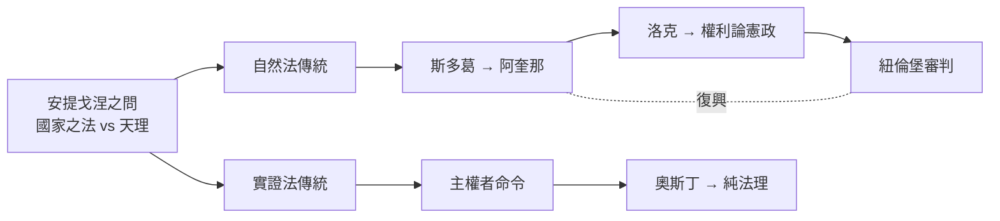

# 2.1 安提戈涅：天理與王法

西元前 441 年前後，雅典的酒神劇場上演了一齣悲劇。觀眾是剛剛戰勝波斯、正沉醉於民主與理性光榮的雅典公民。他們沒想到，這齣戲將在三千年後仍被法學院與政論家引用——因為它提出了法律學上最古老的問題之一：當國家的法律違背更更高的正義時，人民應當服從哪一個？

這齣戲就是索福克勒斯（Sophocles）的《安提戈涅》（Antigone）。

## 劇情：一場對葬禮的禁令

故事發生在底比斯。俄狄浦斯（Oedipus）死後，他的兩個兒子厄特俄克勒斯（Eteocles）與波呂尼刻斯（Polynices）為爭奪王位互相殘殺。新王克瑞翁（Creon）下令：為保衛城邦而死的厄特俄克勒斯以國葬厚葬；引外軍攻城的波呂尼刻斯則陳屍城外，任何人都不得埋葬他——違者處死。

在希臘人的宗教觀中，埋葬死者是神聖義務，不分敵我。死者若不入土，靈魂永不得安息。

安提戈涅是死者的妹妹。她違反克瑞翁的法令，用沙土覆蓋了屍體上的禮儀，被抓個正著。她與克瑞翁對質，說出了整部戲（也是整部法學史）最著名的一段台詞：

> 我不認為你的公告、你這凡人制定的法律，有足夠的力量去推翻眾神那些不成文、不可動搖的規範。它們不在今天或昨天存在，而是永遠存在，無人知道它們何時出現。

克瑞翁不為所動。安提戈涅被關進石墓穴，自縊而死。她的未婚夫、克瑞翁之子海蒙（Haemon）自殺殉情。克瑞翁的妻子也自殺。當克瑞翁意識到自己鑄成大錯時，一切都已不可挽回。

## 這齣戲在法律學上到底問了什麼

表面上這是一齣親情與國家衝突的戲。但從法學的角度，安提戈涅的「不成文的規範」至少可以做三種解讀，每一種都對應後世法學的一條重要路線：

1. 自然法解讀：有些規範來源於人性與神聖秩序，先於並高於任何人類立法。這是後世斯多葛學派、阿奎那、洛克與紐倫堡審判所共用的路線。
2. 良心反抗（civil disobedience）解讀：當國家之法與良知衝突，個人有（甚至有義務）違抗。後世的梭羅、甘地與馬丁路德金恩都會走這條路。
3. 分析法學解讀：克瑞翁的法是有效的法，因為它是主權者制定的（有點像是奧斯丁的看法）；但它是惡法，因而引出「惡法是否為法」的世紀辯論。這條路要到十九世紀才正式成形，但問題的種子就在這裡。

換句話說，安提戈涅之問可以濃縮成一句話：法律的 validity（有效性）與 morality（道德性）是否同一？

## 為什麼是在雅典、在公元前五世紀

《安提戈涅》不是憑空出現的。它的問題意識來自於雅典當時正在進行一場史無前例的制度實驗：民主（dēmokratia）。

西元前 594 年梭倫（Solon）改革，廢除債務奴隸制，按財產而非血緣重新分配政治權利；前 508 年克里斯提尼（Cleisthenes）擴大公民大會；前五世紀中期，五百人議會與陪審法庭（公民可抽籤任職的法官團，動輒數百甚至上千人）成為日常制度。雅典公民經常親自擔任法官，親辯訴訟，親自投票判決。

在這個環境中，「法是什麼」第一次成為日常生活的問題，而不是祭司的專利。智者學派（Sophists）開始主張：法律與道德是人為約定（nomos），而非自然（physis）；普羅塔哥拉（Protagoras）說「人是萬物的尺度」；安提豐（Antiphon）甚至挑釁地指出：許多法律規定與自然真理相違背。整個雅典像一個巨大的哲學法院，而《安提戈涅》正是這個法院中的一件著名案例——只不過被演成悲劇，以死亡作判決。

有趣的是，雅典的制度是「依法統治」的好榜樣，卻仍然踩不到「法治」的門檻：多數公民大會通過的決議也可以很荒謬（著名的西西里遠征、以及一年後公民大會自己也追悔的「六米提德群島屠殺令」）。雅典的教訓其實是：民主本身並不自動產生正義，還需要對權力的拘束——這正是兩千年後大憲章與違憲審查要解决的問題。

## 安提戈涅的悠久旅行

《安提戈涅》之問在歷史上的每一次復活，都對應著一次嚴重的惡法考驗：

* 中世紀：教會法學家以安提戈涅精神對抗世俗君主的任意徵稅。
* 十七世紀：英國的柯克法官以「不成文、不可動搖」的普通法對抗詹姆士一世與查理一世的王權主張——他引用的不是希臘文，而是一種有趣的法律傳統：普通法被認為是「永恆不變的習俗」，恰好是安提戈涅的英格蘭翻版。
* 十九世紀：梭羅（Henry David Thoreau）因反對奴隸制與美墨戰爭拒交人頭稅，寫下《論公民不服從》。
* 二十世紀：納粹德國之後，紐倫堡審判以「在某些案例中，效忠國家之法必須讓位於更高的正義」來為被告定罪。這是安提戈涅的原則第一次（半）正式地成為國際法院的裁判理由。
* 冷戰後：柏林圍牆守衛案、脫逃者案中，德國法院引用自然法否認士兵「只是執行命令」的抗辯。

一雙眼睛在石墓穴中自縊而死於公元前五世紀的底比斯少女，到此時依然在法庭上作證。

## 小結

《安提戈涅》為法學留下了一份珍貴的遺產：它創造出了一個反對國家之法敢於極端的形象，讓「天理與王法」的衝突成為可以再度上演的劇本。下一節，我們將看羅馬人如何替這個問題建立一個龐大而精巧的制度性答案——十二木表法，以及那部最終匯成大陸法系千丈巨流的《民法大全》。

