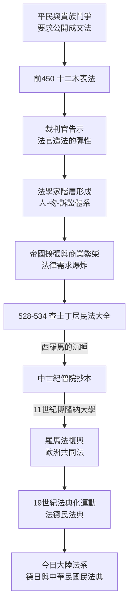

# 2.2 十二木表法與民法大全

安提戈涅提出了問題，羅馬人負責制度化的答案。從西元前 450 年的十塊（最後十二塊）青銅木表，到西元 534 年查士丁尼的《民法大全》，羅馬用將近一千年的時間，把「法」從祭司的祕術變成一門可以學習、可以教授、可以跨越千年傳播的技術。今日的大陸法系（Civil Law），正是這一千年努力的遺產。

## 十二木表法：平民與貴族的合約

羅馬建國初期，法律掌握在貴族祭司團（pontifices）手中。平民（plebs）在訴訟中被喚去、被扣押、被處罰，卻不知道依據什麼規則。西元前 462 年，保民官蓋約·特倫提利·哈爾薩（Gaius Terentilius Harsa）提案：應當制定成文法律，使執政官不得任意行使 power。貴族激烈抵制，接著羅馬連續數年陷入外患與內亂。

西元前 454 年，羅馬派出使節團赴雅典研究梭倫之法（史實記載於李維《建城以來史》）。歸國後，西元前 451 年成立十人委員會（decemviri），暫停其他相關官職，制定出十表，翌年再加兩表，共十二表，在市場中以青銅木表公開展示。

傳說板子是「用木頭刻的、外面貼上青銅」，故稱木表（tabulae）。無論材質如何，原始板子在公元前 390 年高盧人焚燒羅馬時被毀，條文靠學童的背誦與後世作家的摘引流傳。全數條文至今已不可完全還原，但經由西塞羅、蓋烏斯等作家的引用，我們知道它的骨架。

主要內容包括：

* 傳喚與審判程序（第一、二表）：被告若拒不出庭，原告可請證人作保，強制其出庭。
* 債務（第三表）：債務人三十日的寬限期，逾期可被債權人拘提；但仍禁止隨意處死，並允許若干贖回。這是限制債奴最早的立法之一。
* 家父權與繼承（第四、五表）。
* 物權與占有（第六、七表）：界線、通行權、鄰地過失責任。
* 侵權（第八表）：這一表保留了濃厚的同害報復色彩（毀肢可要求同害報復，或以錢贖）。
* 公法與宗教（第九、十表）：禁止收受賄賂判案；禁止在城內火化與埋葬屍體。
* 附加兩表：婚姻、監護、重大犯罪。

幾條後世耳熟能詳的原文，可以看見它的厲害：

> 過失致人損害者，應予賠償。
> 不因思想受罰。（cuius sententia nurus in locum filii adoptaverit...（原文為「不懲罰思想」的概括））

其中「不因思想受罰」素來被認為是法律文明最珍貴的基石之一：你心裡想什麼不構成犯罪，只有你的行為才構成。這條防線在兩千年後的宗教裁判所、蘇聯大清洗中一再被衝破，又一再被重新樹立。

對於平民而言，十二木表的意義在於「知道規則」：成文、公開、可引用。兩千年後，這個程序的目標依然未變——今日各國的官方公報、立法院議事錄、司法院法律資料庫，全都是十二木表的高給版本。

## 羅馬如何把法變成一門「科學」

成文法只是起點。羅馬真正的發明，是「法學家」（juris consultus）與其獨立的解釋傳統。

羅馬的裁判官（praetor）每年就任時發布一道告示（edictum），宣布本年他將採行的訴訟格式與救濟手段。這形成了罗马法律演化的重要機制：裁判官可以創造新訴權、新抗辯，回應商業社會的新需求，而無需修改舊法。這是「用司法不斷更新成文法」的最早原型——與英格蘭法官造法的功能相似，但制度不同。

法學家們則整理裁判官的實踐，撰寫教科書、註釋與問答。屋大維以降，皇帝賦予某些法學家的答覆以官方拘束力（ius respondendi）。到西元二世紀，蓋烏斯（Gaius）寫下了供學習者使用的《法學階梯》（Institutes），首次把法區分為「人、物、訴訟」三個範疇——這個分類法一路用到二十世紀的民法典。

我們抽幾個羅馬法概念看看它有多「現代」：

* res（物）之區分：有體物與無體物。無體物包括債權、繼承權、地上權。智慧財產權的概念結構，在羅馬法中已有原型。
* 占有（possessio）與所有（dominium）之分：事實支配與法律權利，兩者分開保護。這是現代不動產法與租賃法的基石。
* 契約的合意（consensus）：自由意思之合致即產生拘束力，不需特定形式。買賣、租賃、合夥、委任四大合意契約，今日民法債編的骨架仍在沿用。
* 錯誤、詐欺、脅迫：締約意思有瑕疵可使契約無效或撤銷——消費者保護的古老種子。
* 迴避原則：法官不得審理與自己有利害關係的案件（nemo iudex in causa sua）。這是程序正義的第一原則。

羅馬法學家的思考方式也值得注意：他們不喜歡形上學。他們問的是「這個案子的救濟是什麼、如何請求」，而不是「正義是什麼」。這種務實的技術性格，是羅馬法能夠跨越教派、語種與帝國邊界的原因——也埋下了毒品般的風險：當法被純技術化，它就失去了詢問「自己是否正義」的能力。這個風險在一千五百年後的紐倫堡審判中集中引爆。

## 民法大全：一次大整理

西羅馬帝國於西元 476 年滅亡，羅馬法在西部陷入衰退，但在東羅馬（拜占庭）持續存在。西元 528 年，拜占庭皇帝查士丁尼（Justinian I）成立委員會，下令整理全部羅馬法。

該工程只花三年多，產出四部作品：

1. 《民法大全》之《法典》（Codex）：皇帝敕令彙編，去除重複矛盾。
2. 《學說彙纂》（Digesta / Pandectae，533 年）：摘錄歷代主要法學家的學說，共五十卷。這是最偉大的部分——它保存了羅馬法學真正的思想精華。
3. 《法學階梯》（Institutes，533 年）：蓋烏斯式教科書的官方更新版，供新手入門，具有法律效力。
4. 《新律》（Novellae）：查士丁尼晚期的補充敕令。

《學說彙纂》的編纂目標不只是保存，更是「去除中間的法學爭論，直接給出可用的規則」。弔詭的是，它太成功了：因為敕令規定帝國境內不得再對《民法大全》作註釋與爭議，羅馬法學的活潑爭論就此停止。原典又被封存在拜占庭與西羅馬的僧院中，西方直到十一世紀重新發現它，才引發著名的羅馬法復興（下詳）。

## 羅馬法為何能統治一千五百年

一個在公元六世紀完成的法彙編，為什麼能在二十一世紀的德國、法國、日本、中華民國民法典中聽見它的聲音？原因值得用經濟學與制度的視角細看。

1. 標準化降低交易成本。羅馬法提供一套可預測、可計算的契約規則，地中海貿易便於跨城市執行。這與今日國際標準化組織（ISO）降低跨境交易成本的邏輯相同。
2. 教科書體系。羅馬法以人—物—訴訟為骨架的體系教學使得它可以被「學起來」，培養跨城市、跨時代的共同法律人階層。
3. 職業共同體。中世紀義大利博隆那（Bologna）大學於十一世紀以註釋法學派重新發現《民法大全》，形成橫跨歐洲的法學教授—法官—書記官網路。這個共同體讓羅馬法成為歐洲的「共同法」（ius commune），直至各國法典化。
4. 抽象概念的結構。羅馬法發展出的概念工具（法人、代理、占分共有、時效債權、一般契約條款）可以裝載任何社會的新需求，所以可以被移植。這是「法律的模組化」——就像軟體的函式庫，只要介面相容，就能跨平台使用。

後面三點同時告訴我們一個重要祕密：法律之所以能在時空中流通，靠的不只是文字，而是「概念＋教科書＋職業共同體」這個三位一體的基礎設施。這也是為什麼今日文明世界的法學教育，仍以「講授＋註釋＋實證」的模式為主。

## 十二木表與民法大全：前因後果

用一張圖整理這一節的因果鏈：

小結：羅馬的貢獻不是某一部法典，而是把法變成了一門可傳授的技術，從而有可能被繼承、被修改、被移植。這門技術的良好性能一直為人服務；它的肥大症——與正義脫鉤的技術化——則將在第七章造成法學史上最黑暗的時刻。

現在讓我們回到西方，進入第三章。羅馬帝國崩潰後的西歐散落成一地封建小國，法律與血仇、神判混作一團。在這片混沌中，英格蘭的一小群巡迴法官將做出一件誰也沒料到的大事：用自己的判決，一條一條地造出普通法。
