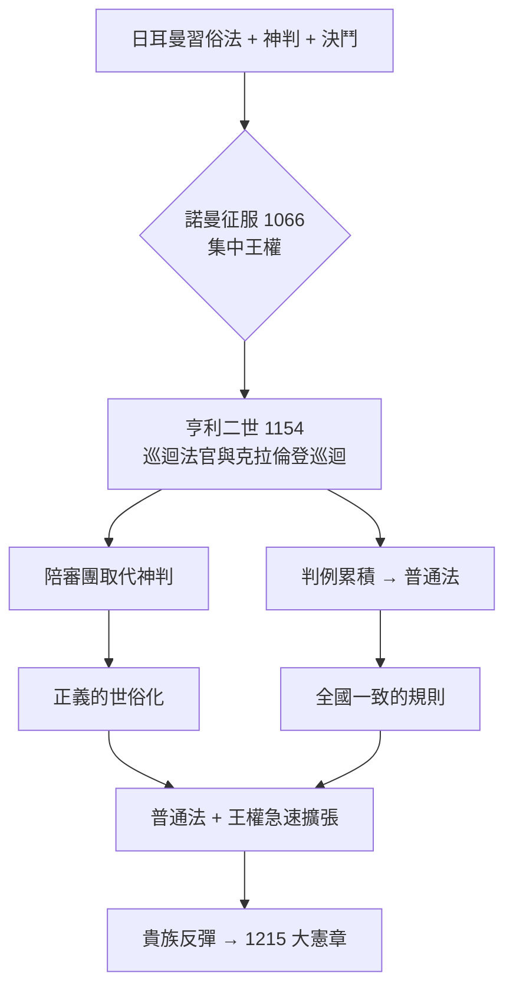

# 3.1 亨利二世與巡迴法官

西元五到十一世紀的西歐，是一個法律上的破碎世界。羅馬的精密法律體制崩潰後，各處出現的是部落習慣法——日耳曼各族的俗法——與基督教會法並行的局面。在地方上，糾紛主要用三種古老手段解決：神判（把人丟進水裡或火沙中，讓神顯示真相）、決鬥（兩造或其代理人打一場，神會讓無罪者獲勝），以及宣誓輔助（被告找十二位親友發誓「我發誓他是清白的」）。如果你口袋裡沒有足夠多的可信親友，或你的體力不如被告，正義常常會轉身嫁給另一個人。

就在這種混沌中，一個法國從英倫海峽南岸登陸的王朝，注定要成為普通法的建構者。

## 安茹帝國與一個母親是諾曼貴族、妻子是法蘭西王后的年輕人

1133 年，亨利（Henry）出生於法國的勒芒。他的父親是安茹伯爵若弗魯瓦，母親是英格蘭國王亨利一世的女兒瑪蒂爾達。結婚後，他的妻子是大名鼎鼎的亞奎坦的艾莉諾，法國路易七世的前王后，帶著大半個法國西南部作為嫁妝。1154 年，亨利二世登基，開創了金雀花王朝（Plantagenet），他的帝國從蘇格蘭邊界延伸到庇里牛斯山，法國國王的直接統治領土反而小得多。

這個帝國的問題正如它的規模：領土龐大、各方習俗不同、封建貴族（包括那些在諾曼征服前後掌握地方司法權的男爵）各自為政。英格蘭本土雖經諾曼人帶入了封建制度與《末日審判書》（1086 年），但司法仍然是地方性的：從諾曼王朝沿襲下來的合議制法院與各郡的郡法院，加上領主法院，規則隨地而變。在約克郡合法的事，在肯特郡可能犯法。

亨利二世的解決方案，本質上是把國王的權威「運輸」到每個地方去。

## 巡迴法官：用腳走出來的法律

1166 年的克拉倫登巡迴（Assize of Clarendon）是這場改革的第一步。亨利二世指派王室法官定期巡迴各郡，與地方的代表共同審理重大案件。巡迴法官做兩件事：

1. 審理刑事重案（謀殺、搶劫、縱火、偽證等），承受地方上的控訴。
2. 解決民間土地與權利之爭，特別是「恢復占有」與「恢復繼承」兩種快速救濟途徑（assize of novel disseisin、assize of mort d'ancestor），讓被趕出土地的人可以快速回復。

這看似只是行政上的巡行，實際上是一場法律革命。因為這些法官不只是地方習慣的記錄者——他們是國王派遣的中央官員，而他們在各地要做的不只是「依規則裁決」，而是要回答一個更深層的問題：這些千差萬別的地方習慣中，什麼是「共同的」、可以被看作對所有英格蘭人一律適用的規則？

他們的討論產生了普通法（common law）這個著名的名字——「普通」的意思就是「通用於全國」。

## 陪審團的誕生

克拉倫登巡迴的另一個關鍵，是把「陪審」報告制度帶到了刑事司法中。

在改革之前，重罪控訴主要靠私人血仇或人數不足且隨時可以收買的「宣誓輔助」。改革之後，每個郡選出若干名在地方上有信用的人，要求他們在法官到來時宣誓「檢舉」（present）本地之重罪與嫌疑者。這批「宣誓報告者」最初是檢舉團，日後演化成大陪審團（grand jury），其職能後來又分裂出「就事實裁決」的小陪審團（petty jury）。

陪審制度的重要性難以估量。它把事實判斷從神判與決鬥轉移到十二名在地鄰人的回答，其進步性至少體現在三處：

1. 事實判斷的世俗化。證據_STANDARD 由「神是否讓你沉下去」變成「你的鄰人怎麼說」，正義從神秘轉為可討論。
2. 社會參與司法。陪審員是社區成員，他們不僅提供事實，還帶入社區的正義意識。程序完成后，社區更傾向於接受判決——這是現代所謂「參與式正義」的古老形式。
3. 司法的可預期性提高。因為判決的人物不再是神祕的祭司或外来的決鬥者，一個共同體的規則與常情得以逐漸累積成判準。

不過，此時的陪審員與我們今日熟知的陪審團還不同：當時的人自己也是證人，他們被假設事先就知道案件真相。要到十三、十四世紀，隨著案件繁雜與地區擴大，才逐漸發展出「抽外來的人聽取證據」的做法，徹底隔離事實認定者與公共知識，演變為今日的陪審制度。

## 判例的海洋：融合出規則

巡迴法官做出判決並不僅止於一地的裁決——他們回到倫敦時會聚在一起討論，使類似案件在各地之間得到一致的處理。法官之間逐漸確立一種默契：對於相同事實，應作相同處理。這樣就形成了後世所謂的判例原則（stare decisis）的前身——「已定之事不敢棄」。

這種「從判决中提煉規則」的法律生產方式，有一個驚人的推論：普通法規則的來源不是任何一部制定法，而是法官的累積智慧。它沒有藍圖，只有演化；它像草莓叢一樣散漫地成長，卻又有一種人工移植難以模仿的靈活——因為每個新規則都是為了回應真實的、帶血的糾紛而產生的。

這也創造了一個為人常忽略的後果：因為普通法規則是在個案中形成的，當新的社會事實出現（例如十五世紀商業匯票、十七世紀股份公司、控制工廠的侵權），法官可以直接調整規則，不必等待立法。這是普通法有驚人適應性的原因，也是它後來在大英帝國殖民地上迅速鋪開的原因。

## 為什麼是英格蘭，而不是法國或德國

一個值得追問的問題：地中海的商業繁榮、修道院的抄本傳統，都在西歐大陸更加繁盛，為什麼「先進的統一法律」是從相對偏遠、農業為主的英格蘭先做出來？

幾個條件值得一看：

* 1066 年的諾曼征服創造了相對集中的王權。諾曼人以少數人力統治整個岛，只能以強王權、統一財產調查與領主效忠制度來維持秩序——這比法國的松散封建更接近中央集權。
* 英吉利海峽的隔絕使英格蘭貴族無法像法國男爵那樣靠險要地形抵抗國王，反而使王權的司法與軍事力量較容易貫穿全島。
* 大陸的羅馬法復興（博隆納）太成功了。大陸諸王一步走向《拿破崙法典》的理性法典化；英格蘭則因為其普通法已經形成、且律師是一個既得利益集團，拒絕接納羅馬法以替換自己的傳統——普通法得以走出一條獨立的演化道路。
* 神判的終結。1215 年第四次拉特朗會議（Fourth Council of the Lateran）禁止神職人員參與神判，神判在各地迅速瓦解。英格蘭因已建立陪審團，反而最早補上這個真空。

## 一個尚未講的伏筆

亨利二世的改革無比成功，但是卻也無可避免地走出一個副產品：王權太大、法院太多、法官都是國王的人。當皇家科密森迅速侵蝕了教會法院與領主法院的權力，貴族開始感受到威脅。亨利二世的兒子約翰王中尤甚——他搶奪女屍遺產、任意罰款、逮捕拒不出庭者、在多佛向法王妥協又失去諾曼地，又與教宗衝突被逐出教會。1215 年的六月，他在泰晤士河畔的倫尼米德草地上，被迫在一份文件上簽字。

那份文件就是《大憲章》（Magna Carta）。它是下一節的主角。

