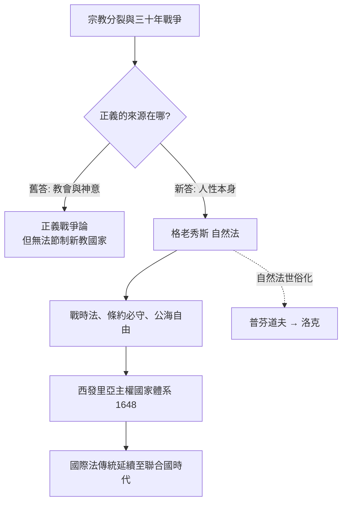

# 4.1 格老秀斯：戰火中的國際法

十七世紀的歐洲，被三場災難撕裂。第一場是宗教：宗教改革帶來天主教與新教陣營的百年火拚；1618 年起的三十年戰爭，最終吞掉德意志地區近三成的人口，屍橫遍野，城鎮化為廢墟。第二場是海權：荷蘭、葡萄牙、英國的船隊在全球爭奪香料與航道，公海上大家互搶互沉，沒有一套大家都承認的規則。第三場是思想：既然基督教分裂了，何以維持共同的正義？

一個荷蘭人替這三場災難，各自建了一座橋。

## 真理的俘虜

胡果·格老秀斯（Hugo Grotius，1583–1645）是個神童。他八歲能作拉丁詩，十一歲入萊頓大學，十五歲取得博士學位，十六歲被隨荷蘭使者團赴法國宮廷，被亨利四世讚為「荷蘭的奇蹟」。他二十出頭擔任荷蘭省檢察長，三十歲時已是荷蘭共和國的實質政治首腦之一。

然後，政治崩塌。

當時荷蘭正因神學爭議陷入內部鬥爭：抗辯派（Arminians）與加爾文派（Calvinists）之間關於預定論的爭執，演成掌權問題。格老秀斯支持前者，與省長奧登巴內維爾特（Oldenbarnevelt）同陣營；1618 年莫里斯親王政變，省長被處死刑，格老秀斯被判終身監禁，關入盧夫斯坦（Loevestein）城堡。

1621 年，奇蹟發生。他的妻子瑪麗亞以「借書還書」為名，用一個大書箱把他藏在書堆裡運出城堡。他化粧成石匠逃往法國，選擇在巴黎流亡。這段越獄已成為荷蘭文化的一個傳奇，魯本斯時代的畫作證據之一是格老秀斯家中仍被保存的那個書櫃。

正是在巴黎流亡期間，他寫下了他一生最重要的著作。

## 《戰爭與和平法》：為無主之地立法

1625 年，《論戰爭與和平法》（De jure belli ac pacis）出版。這本書以系統性態度回答一個基本問題：在沒有世界政府的情況下，國家與國家之間，究竟有沒有法？

在此之前的老答案只有兩種：一種是「戰爭無法」，仗想怎麼打就怎麼打；另一種是「戰爭法即神意」，由教會裁判戰爭正當性（所謂正義戰爭論）。格老秀斯的突破點在於排除了神：

> 就像數學證明的必然性不會因上帝不存在而消失一樣，即使我們（如常被指控的無神論者所說的那樣）假定上帝不存在，或者不管人間之事，這些法依然具有效力。

這段話是法學思想史上最著名的無神思想實驗之一：它把法的根基從神之意志移到人性本身。人是社會動物，有維持社會秩序、遵守承諾、歸還他人所有物的自然傾向；因此自然法存在於人性之中，即使無神也有效。這就是「法的自然基礎」命題。

從這一命題，格老秀斯建立起現代國際法的骨架：

* 戰爭正當的條件：不僅要有正當理由（防衛、取回所有物、懲罰過失），還要有正當程序（宣戰、避免無辜傷害）。
* 戰時法：俘虜應被保護，非戰鬥員不得被屠殺，禁止不必要的殘忍。
* 和平義務：締結之條約必須遵守（pacta sunt servanda，條約必須信守——此後國際法的第一原則）。
* 公海自由：先前他在 1609 年的《海洋自由論》（Mare Liberum）已主張任何國家不得壟斷公海，因為大海本屬全人類共有。這條主張是荷蘭東印度公司向葡萄牙海上霸權挑戰的法律武器，卻意外成為今日聯合國海洋法公約中公海自由原則的祖先。

順帶一提，公海自由論的成立背景很有戲劇性：當時荷蘭一艘船在麻六甲海峽捕獲葡萄牙商船「聖卡塔里娜號」，價值三百萬基爾德。荷蘭法學院被要求出具「捕獲是否合法」的法律意見，年輕的格老秀斯寫出一份名為《捕獲法》的長文，其中一章論海水的公有性，後來抽出來單獨出版——就是《海洋自由論》。換句話說，國際法史上最著名的理論之一，最初是一份幫助跨國公司辯護的法律意見書。今日的科技與思想常從商業爭端中生出，這不是最後一例。

## 從「教廷法」到「萬國法」

格老秀斯的概念定位也值得細看：他所建立的學問，他稱之為 ius gentium（萬國法）——但它與羅馬人所說的「各民族共同之習慣」不同，是一套各主權國家（即使沒有共同政府）應共同遵守的法。這個區分影響深遠：我們今日說的 international law（國際法，邊沁在 1780 年發明這個詞以前，英語世界一直叫 law of nations），其基本概念就是格老秀斯式萬國法。

在他的時代，這套理論並不立刻生效——但它成為了必要工具。三十年戰爭後的天空下，歐洲主權國家需要一套互相往來的規則，而 1648 年的《西發里亞和約》（Treaty of Westphalia）帶來的是主權國家制度至上的新世界格局：每個主權國家互不干涉內政、彼此平等。這個格局既催生需要格老秀斯理論（因為各國平等了，就必須有一套共同規則），又被格老秀斯理論所支撐（因為在沒有至上強權的情況下，自然法成了唯一的規範基礎）。

## 格老秀斯之後

格老秀斯死於 1645 年，在德意志海域的一場漂船上中風去世，身後葬於代爾夫特新教堂，與荷蘭王子、荷蘭最著名的畫家同一個地方安息。他的理論傳給了兩位後繼者：普芬道夫（Pufendorf）把自然法世俗化、系統化，瓦泰勒（Vattel）在十八世紀將之調整為更靈活的國際法體系。

他的影響力在今日隨處可見：《聯合國憲章》對「侵略」的禁令、《日內瓦公約》對戰俘與平民的保護、《海洋法公約》對公海自由的宣示，甚至國際刑事法院對戰爭罪的追訴，都可以追溯到他於巴黎體系地建立的那套基本論證：縱使沒有世界政府，國家之間的正義也不應是野獸的法則。

## 一個必然的下位問題

格老秀斯證明了一件事：法的來源可以是人性本身，不必是神。但是這立刻產生了新問題：如果法來自人性，那麼政治權力的來源是什麼？人們為什麼有義務服從君王？如果君王違背人性之常，人民可以怎麼辦？

接下來的那一位，將用一場英國革命作書寫背景，以「生命、自由、財產」三個詞，回答這些問題。他叫約翰·洛克。

