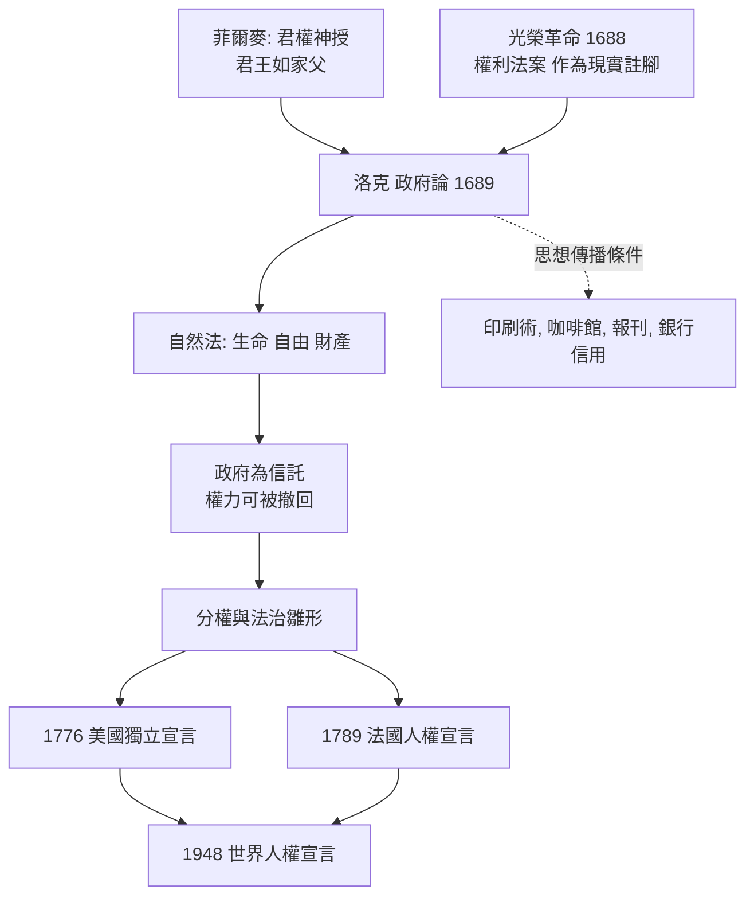

# 4.2 洛克：生命、自由與財產

格老秀斯把法的根基從神移到人性，卻沒有回答一個關鍵問題：既然人人都有自然理性，憑什麼要服從君王？君王的權力是從天上領下，還是從人民手中借來？

1688 年，英格蘭給出了歷史性的答案；1689 年，約翰·洛克（John Locke）給出了理論性的答案。兩者只相隔一年——這不是巧合，這是絕佳的配合。

## 一個親身參與革命的思想家

洛克 1632 年生於英國薩默塞特，父親是清教徒律師，曾加入了反對查理一世的議會軍。洛克在牛津攻讀醫學，結識了科學家羅伯特·波義耳與艾薩克·牛頓——他本人是英國皇家學會的成員，對醫學、氣象、貿易與宗教寬容都有研究。

1666 年，洛克認識了年輕的政治家沙夫茨伯里伯爵（Earl of Shaftesbury），成為其私人醫師與祕書，捲入了輝格黨的核心政治。沙夫茨伯里主張排除信仰天主教的詹姆斯繼位，1683 年因密謀曝光而逃亡荷蘭，因肺炎病死於阿姆斯特丹。洛克則早已在 1683 年也逃往荷蘭，過著用假名生活的日子，英國政府曾要求荷蘭引渡他。

1688 年，光榮革命（Glorious Revolution）爆發：英國議會邀請荷蘭執政威廉三世入英，詹姆斯二世逃亡，議會通過《權利法案》（Bill of Rights 1689），確立議會高於君主的憲政原則。洛克就在這一年隨通航的王后瑪麗一同回到倫敦。

他回國後不久出版《政府論》兩篇（Two Treatises of Government），這本書的寫作時間較早，而出版時間特意地與革命相呼應——它正是光榮革命的理論說明書。

## 《政府論》：駁斥絕對王權的邏輯

《政府論》上篇逐條駁斥菲爾麥（Robert Filmer）的《先祖論》——後者是絕對王權論的代表作，主張君王如家父，權來自上帝。洛克的駁斥並不艱深，但非常致命：如果「父權證成王權」，那麼到底哪一個兒子繼承了亞當的權柄？這個問題本身即顯示了邏輯的荒謬。

真正精彩的是下篇，洛克在此建立了他的理論大廈。

第一步：自然狀態。在國家出現之前，人們活在「自然狀態」中。洛克的自然狀態不同於霍布士的「人人彼此相殺」——它是一個自由的狀態，但不是混亂的狀態：人人只需遵循自然法，而不需向上級請示。自然法的核心命令是：

> 任何人不得侵害他人的生命、健康、自由或財產。

第二步：財產權的自然起源。這是洛克最具創造性的論證。在自然狀態中，萬物共有，但每個人對自己的人身具有所有權；當他把身體的勞動與自然物結合（撿起橡果、開墾荒地），他便把「一部分自己」加進去，因此取得該物的財產權。財產權在國家成立之前即存在。

第三步：國家因契約而生。既然自然狀態下人人可自行執行自然法（這是洛克承認的缺點：無中立裁判、無固定法、無足夠心力執法），人們因此同意組成政治社會，把「執行自然法」的權力交給一個裁判機構。重點來了：

> 人們組成政治社會並服從政府的目的，是為了更好地保障他們的生命、自由與財產。

政府的權力只是「受託的權力」（fiduciary power），它為特定目的而存在，不因為人民的同意而變成絕對。

第四步：革命權。當政府違背其委任、侵犯人民的生命自由財產時，它已自我背棄；人民亦可回復其原初的自由，並重建政府。這就是洛克的革命權理論——不是一種革命的浪漫情懷，而是社會契約的邏輯結論。

## 分權與法治的雛形

洛克在此致函威廉三世的時代，提出政府的三個權力：立法權（legislative，制定法律）、執行權（executive，執行法律）、對外權（federative，外交與戰爭）。他重點為立法權設限：

* 立法權不得專斷，必須依既定、公布的法律進行統治。
* 法律必須是為公共善而立。
* 未經本人同意，不得取走人民之財產（連徵稅也要同意——"no taxation without representation" 的理論根源）。
* 立法權不得自我轉移給他人。

這些版本粗糙，但已經是權力分立與依法治理的完整草案。孟德斯鳩將在四十年後把三權分立精細化，美國憲法將把洛克—孟德斯鳩的學說轉化為制度。

## 知識與制度的並行傳播

洛克的思想之所以能夠改變世界，除了其論證強力，還有一個理由是它的時間點正好卡在印刷、閱讀與知識公共化的時代。《政府論》出版於英國刊物業繁盛時期；當時的咖啡館中，人們邊喝咖啡邊討論政治；報刊開始對政策挑起公開辯論。思想傳播速度，第一次與制度變遷的速度在同一量級上。

洛克本人也活躍於這個傳播生態：他晚年在倫敦參與了英格蘭銀行的創設（1694 年，英格蘭銀行成立，與光榮革命後政府信用的建立配套），他支持「商業、信用、寬容」三者并行的共和國。他死於 1704 年，墓碑上不刻他的官職著作，只寫著：「這裡躺著約翰·洛克……他的作品會告訴你他寫了什麼，比石碑上的讚辭更加誠實。」

## 「生命、自由、財產」的一路放大

洛克的三個詞，在接下來的兩百年中不斷被重新表述、擴展、修正：

* 1776 年，傑弗遜在《獨立宣言》中寫道：「一切人生而平等，被造物主賦予不可讓渡的權利，其中包括生命、自由與追求幸福。」——將「財產」改為「追求幸福」，這是突出人的能動性而非物的滯留權。
* 1789 年，法國《人權和公民權宣言》宣布：「人生而自由，在權利上平等。」私有財產不可侵犯被列為自然權利，但同時宣稱：法律是「公共意志」的表現。
* 1948 年，《世界人權宣言》把洛克式自然權利轉化為國際法語言：人人有生命、自由與人身安全之權，無人可任意剝奪；財產權受保障，但同時須符合法律程序。

這一條權利演化的長河，載於檔案上的每一次修訂，都標示著某個歷史時刻的具體鬥爭。沒有洛克，那些文件仍然可能出現；沒有那些鬥爭，洛克只會是圖書舘裡的名姓。

## 洛克的局限

科學與制度史的一個教訓是：偉人也有時代之迫。洛克為《政府論》辯護的自然狀態與殖民活動有深刻的緊張：他在《政府論》中也支持殖民地的開墾論（「美洲的印第安人沒有把土地用起來」），提出勞動財產論的人，也把勞動財產論用作侵奪原住民土地的論證。他本人曾任貿易委员会委员，亦參與章程殖民奴隸制的《卡羅來納基本法》撰寫。這段歷史提醒我們：思想的價值與思想者的局限必須一併評估，而法的進步，常常是在其自身（而非外部）不斷修正的。

## 小結

格老秀斯回答了「法的來源」，洛克回答了「權力的來源」。兩人合起來，完成了自然法政治理論的基本工程：法在人性中，權在人民手裡。十八世紀的啟蒙者接下這根接力棒，而有一位米蘭的年輕貴族，他將把自然法徹底地落到一件事上——狹窄、陰濕、令人作嘔的刑罰牢房裡，落在一雙無辜的手腕上的鐵環上。

