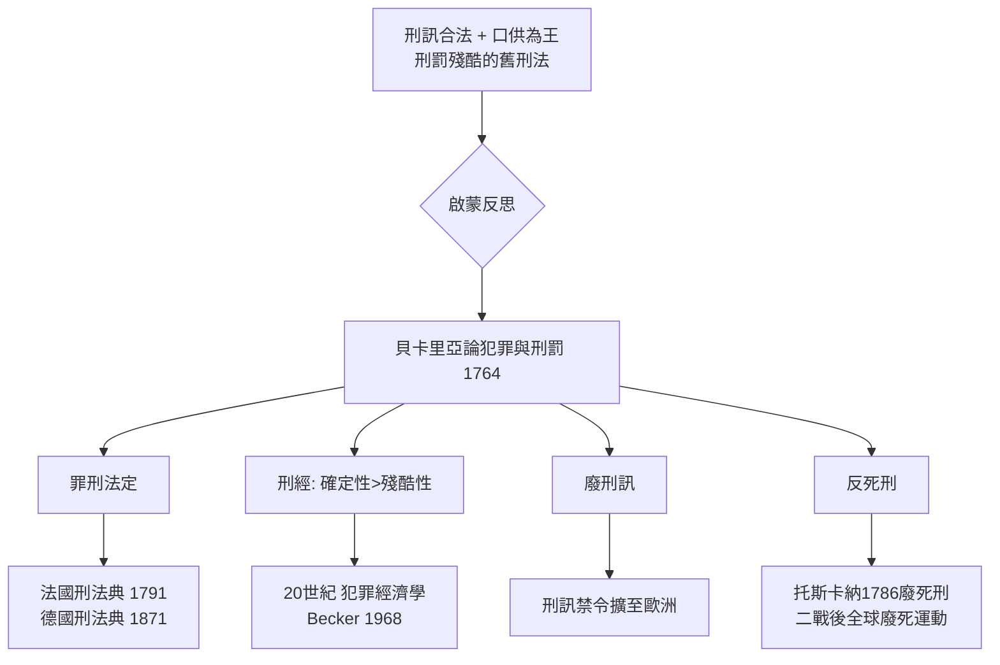

# 5.1 貝卡里亞：一本書改變刑罰史

1764 年春天，米蘭街頭的書店悄悄進了一本薄薄的小冊子。它沒有作者署名（義大利當時的書籍審查令匿名出版成為慣例），只有不到一百頁，書名叫《論犯罪與刑罰》（Dei delitti e delle pene）。

作者是一位二十六歲的米蘭貴族青年，名字叫切薩雷·貝卡里亞（Cesare Beccaria）。他不是法官，不曾在刑事法庭上辯獄；他只是和其他幾個米蘭青年組成一個讀書會，喝了幾年法國啟蒙作家的酒。他們討論經濟、討論蠶絲貿易、討論米蘭監獄裡的殘忍。

這本小冊子，將在兩百年中，成為全歐洲刑法改革者的共同聖經。審判中的刑訊、公開處決的祭典、血肉橫飛的五馬分屍、無止境的酷刑選項——都将從此一步步退入歷史。

## 十八世紀中葉的刑事世界

要理解這本書的顛覆性，先得看它反對的東西。十八世紀的刑法，歐洲各地差異極大，但共同特徵是：刑罰殘酷、程序不透明、罪行模糊。

刑訊逼供（tormentum）在多數國家是合法程序：對拒不招供的被告施以吊刑、烙刑、拉肢刑，以「取得」口供。更荒謬的是理論上的自洽——當時的法律把口供視為「一切證據之王」（regina probationum），被告本人的完整、自願供述，即可構成實質的足夠證據；而刑訊則是「取得」口供的正式手段。換句話說，刑訊不僅合法，而且「正確」。

刑罰方面，死刑之外還有活剝、輪刑、焚身、分屍；越「大」的罪，刑罰越戲劇化。公開處決是國家力量的大典，由群眾觀看，以恐怖威懾犯罪的妄想。如果刑罰的設計完全是「越殘酷越有效」，那麼立法者的責任就只是選擇更多花樣的殘忍。

米蘭所受的哈布斯堡統治，其實在那個年代已相對先進。但貝卡里亞周遭的刑事實踐，足以讓一個有良知的人不吐不快。

## 一位貴族少年的寫作動機

貝卡里亞 1738 年生於米蘭，家世富裕，在帕維亞大學學法律。他的閱讀範圍極廣：孟德斯鳩論分權、盧梭論社會契約、洛克論權利、休謨論因果——這群「法國人與英國人」在十八世紀的米蘭，是地下文化的流行品。

他的成書過程是一個典範的「沙龍產學合作」：米蘭的一群青年（所謂 Accademia dei pugni，「拳擊學派」，因為他們在刊物上筆戰匿名論敵，以拳擊自喻）共同學習、共同辯論，貝卡里亞負責執筆。書中對刑罰均衡的研究（「刑罰與犯罪之比例」）、對刑罰經濟學的觀點（「刑罰的效力在於確定性，而非殘酷性」），都可以在文中直接找到計算式、市場式、政策式的思考方式。這是十八世紀經濟學反思刑事制度的首次系統化。

## 《論犯罪與刑罰》：六個爆炸性主張

這本書的立論以社會契約為基礎，分別攻擊刑罰立法、刑訊程序、處決文化、宗教介入。我們抽出最著名的六個主張。

### 一、罪刑法定：沒有法律明文，就沒有刑罰

> 只有法律才能為犯罪規定刑罰，且這一權力只能由立法者……行使。

這個命題今天看是常識，在當時是革命。在此之前，法官造刑、類推適用、比附援引都合法；貝卡里亞則主張：刑罰必須由事先公布的成文法定，法官造法只是權力的擅用。此即「罪刑法定原則」（nullum crimen, nulla poena sine lege，法無明文規定者不為罪、不處罰）的著名定式。法國革命之後的 1791 年刑法典、法蘭西刑法,德國刑法總則、中國古代所無的近代刑法原則、今日《中華民國刑法》第一條，全都直接受它影響。

### 二、刑罰的比例性：刑罰應與犯罪相稱

殺人與偷竊，不應同刑；刑罰應有一個「反比價」的尺度。更精準的版本是：刑罰之設計，應使犯罪的預期收益低於預期成本——

> 若有兩個產生相同危害的犯罪，其中一個的犯罪動機越大、阻礙越小，其刑罰應越重。

這是邊沁式功利計算的先聲，也是今日犯罪學的理性選擇理論（rational choice theory）的祖先。

###三、刑罰的確定性 > 刑罰的殘酷性

> 刑罰的效應不在嚴厲，而在延續；不在刑罰的程度本身，而在刑罰的必然性。

這是整本書最具實效性的洞見。設想一個有 1% 被抓率、死刑當場處決的制度，與一個有 90% 被抓率、刑期三年的制度——後者的威懾性多半更高。刑罰的威懾力是機率×痛苦程度的期望值：落差再大的殘刑，若遭逢機率極低，仍近乎無用。這個命題在兩百年後被犯罪經濟學家如貝克爾（Gary Becker）用嚴格的期望效用模型重新證明，成為現代刑事政策的計算基礎。

### 四、廢除刑訊

> 刑訊是一種不法手段……人們不能承受的痛苦，會使最堅強的無辜者認罪。

這一論證不只訴諸道德，也訴諸認識論：刑訊是一種以痛苦證明罪責的方法，而痛苦無法在我之所是與人所欲之間找出一個真值。一個怕痛而自承是兇手的無辜者，其口供的本質是什麼？——是刑訊機器的產出，而非本人過去的行為。這個論證直接命中「口供為王」的法律文化，在歐洲多個邦國中被立刻禁止。

### 五、死刑的思想爆破

> 這是一場戰爭……國家反對公民的戰爭。

貝卡里亞認為，人們在社會契約中不會同意交出自己的生命權（這在邏輯上是不可能的：你不可能將生命權讓渡於於你的第一可能目標的對立面）。因此，死刑不是權利的必要延伸，而是大多數人為多數人利益而親手處決少數人的工具；它往往起不到威懾作用（因為刑罰的殘酷易引人殘忍與強作英雄），且不可轉變（一旦處決錯誤，無法挽回）。他主張以長期苦役（有可勾結的、逐日感到的痛）替代死刑——他認為，這比瞬時的死刑，高等之處在於它本身是一個更長更有效的威懾工具。

死刑的第一輪成法改革是托斯卡納大公萊奧波爾多（Leopold）：他於 1786 年廢除死刑，成為有史以來的第一個成文法司法區（哪怕是短暫的）。今日一百多個國家已廢除死刑，人造法律史的每一個里程碑都可回到 1764 年那本小冊子。

### 六、預防重於懲罰

> 製造犯罪的原因，並阻止犯罪，更是立法者更好的目的。

書尾指出，降低犯罪的方法不在刑場，而在「教育、法治、財富的均分、減少貧困」。從這一點看，貝卡里亞也是現代犯罪預防與社會政策刑事學的先驅。

## 一本書的傳播史

這本小冊子的傳播，是十八世紀出版物公共空間（public sphere）的縮影。出版半年時間，譯本出現於法文、英文、德文、荷蘭文、西班牙文、俄文。

伏爾泰為法文版作長篇評註讚譽之：「你這個人道主義者，是世界各國的朋友。」（Voltaire 這樣寫，同時極力貶低當時的犯罪法學家）圖書審查官在一些地區想禁止，卻封不住人手傳抄。俄國女皇凱瑟琳二世在其 1767 年立法指導文件（Наказ）中大段引用此書；托斯卡納於 1786 年依此廢死刑；法國革命者的做法是，把書中每一個主張都變成辯護理由。貝卡里亞本人於 1791 年被法國革命政權邀請赴巴黎，但他（也不想、或不敢）起身前往；他一生未曾再次於刑法主題上發表長文，晚年在米蘭做經濟與教育行政。

## 為什麼是此時、此地

我們再拉遠一點，看這場革命的驅動結構：

1. 經濟：米蘭處在義大利最富庶的倫巴底平原，蠶絲與農業貿易發達；一個「計算人民之福祉」的治理風格（重農主義、重商主義、人口學、統計學）自然傾向於減少無效的暴力，而追求「有用的刑罰」。
2. 政治與法律文化：哈布斯堡統治下的米蘭，部分官員（如菲爾米安伯爵）已在做司法改革，貝卡里亞替他們提供了理論武庫。書出版後若干年，奧地利領土上的刑法改革（死刑範圍縮小、刑訊停止）與《論犯罪與刑罰》的問世同時進行。
3. 思想：啟蒙運動提供了「社會契約＋功利計算＋知識公共化」的框架，使本來存在於各地方良知中的「刑訊不對」的直覺，第一次成為可被論證、可被推廣的系統性主張。
4. 科技與印刷：小冊子的廉價複製、書店—沙龍—譯者—報人的網路，使一本匿名小書得以在兩年內跨越國界。內容只有六十頁反而成為優點——它足短，可全文引用於報刊。

## 小結

貝卡里亞之後，刑法不再只是報復的技術，而成為一門「政策和經濟」加「人道」的學問。他要對付的東西——酷刑、口供為王、血祀式的公開刑罰——在今日文明國家的法典上已幾乎絕跡。法源於神、源於自然、源於契約的漫長辯論，在此後忽而出場、忽而隱匿；但「刑罰必須有用、合法、必要並相稱」這個原則，已經成為不可逆轉的常識。

下一節，我們看這套新思想如何在法國大革命的政治火砲中，被鑄造成一部幾乎接近完美的法律作品——拿破崙法典。
