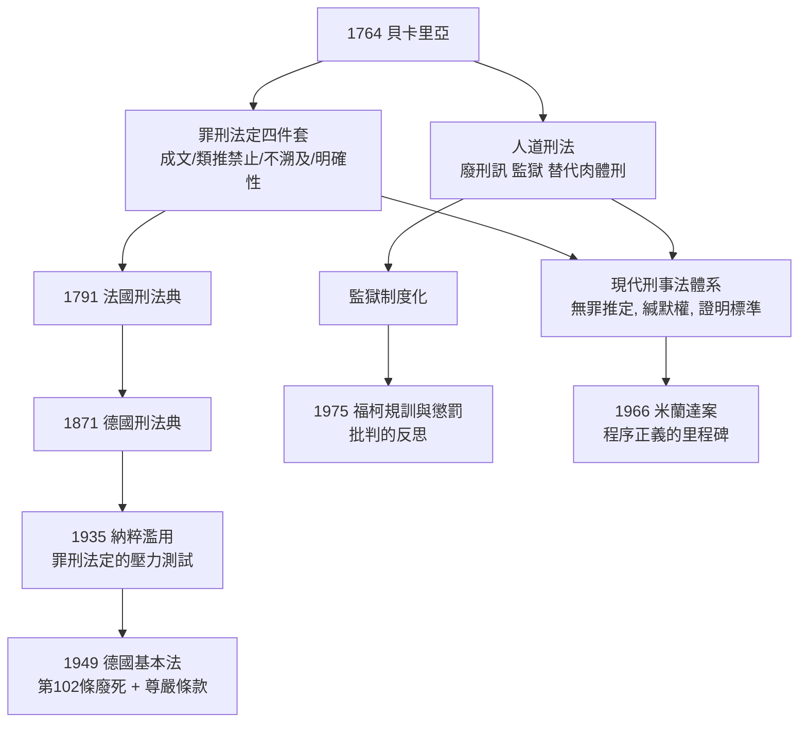

# 5.2 罪刑法定與人道刑法的誕生

貝卡里亞發射了炮彈，落點是兩百年的制度演化。本節追踪「罪刑法定」與「人道刑法」兩大原則，如何從一本小冊子走入各國憲法與刑法，又如何在二十世紀瀕臨失守、再次被重新宣示。

## 罪刑法定的四件套

「法無明文規定者不為罪，法無明文規定者不處罰」（nullum crimen sine lege, nulla poena sine lege）聽起來像一個原則，其實是四個子原則的合體，每一個都有自己的制度意涵：

1. 排斥習慣法作為刑罰依據：刑法必須成文。故意的模糊、道德罪疑（如「違反善良風俗」之類刑罰條款）的濫用，都因明文要求而受限。
2. 排斥類推適用：法官不得把「A 行為定罪」的理由，用去定罪「類似但不相同」的 B 行為。因為人民只能預見法律文字所涵蓋的行為，類推就是事後立法。
3. 排斥溯及既往：行為時不違法的行為，事後不得使其受罰（禁止新法溯及舊行為）。這是人類對「法今定左右昨日」之夢魘最基本的防衛，聯合國人權公約第 15 條、各國憲法皆有明文。
4. 明確性要求：「法律」本身不能是一個空殼——若所謂的法律規定「重罪之刑罰由法院酌定」，仍不保障人民之可預期性。文字必須是一般人可理解、可判斷其界線的。

這四件套的共同思想基礎是：刑罰拘束的是人民基本的自由與生命，因此授予國家刑罰權的那一刻，必須有最大的限定性。它是「人民與國家之契約」在刑法上的形式化。

## 溯及既往的著名案例：從聯邦德國到台灣轉型正義

罪刑法定原則在二十世紀面對一個可怕的反例：納粹德國時期，許多惡行是「當時合法的」（依當時之法律，歧視猶太人之《紐倫堡法案》（1935 Nuremberg Laws）是「合法」的），或依「國民正面法」（如「Volksgesetzgebung」，人民之立法）以追溯方式加罪於反對者。因此，德國戰後的刑法面對兩個相反的要求：一方面，不可用德國當時之法律去追訴納粹罪行（因為依當時法律很多行為都不是罪）；另一方面，也不可用「追溯性立法」去追殺昨日的「合法者」——那正是納粹的技巧。

這一挑戰成為罪刑法定原則最重要的哲學戰場之一。德國聯邦最高法院採取的立場是：納粹「法律」若違背最基本的正義原則，不具法之效力（此即後來著名的 Radbruch 公式，詳見 7.2 節）；因此引用納粹法作為免罪或定罪依據，皆為無效。但這一立場也有其哲學壓力：如果法可以因「不義」而被否認，何時可以、由誰判決？這個問題在本世紀的極端不公法（種族隔離法、鎮壓投票罪、阻礙自由選舉等）中，仍一再被重演。

台灣的白色恐九時期也有類似困境。動員戡亂時期之「叛亂罪」審判與人權侵害，在威權時代是「依法律」進行的；轉型正義要處理的，正是惡法 victims 的回復與制度責任之認定。各國轉型正義（捷克之 lustration 法、南非真相與和解委員會、台灣《促進轉型正義條例》2017）提供了不同於純司法懲罰的制度性答案，其核心仍是在解同一道 1764 年遺留下來的題目：刑罰與法之間的合法/正義/效力的三角關係。

## 人道刑法的制度化旅程

貝卡里亞的另一項遺產——刑罰之人道化——走在更曲折的路上。我們挑幾個里程碑：

* 刑訊之廢除：普魯士 1754、奧地利 1776、法國 1789（革命時全面廢止）、各大邦國在 1780 年代至 19 世紀初相繼廢止。刑訊在歐洲的存在時間遠比我們想的長（西班牙部分地區一直到 1830 年代仍有），但它已死於這一世紀。
* 死刑的退潮：1786 托斯卡納廢死；1848 歐洲革命之後，多國刑法中的死刑範圍大減；二戰後，德國基本法第 102 條（1949）「廢除死刑」成為憲法條款；1965 年英國暫停死刑（1969 廢止）；1981 年法國曾在密特朗總統時期廢死，經巴丹戴爾（Robert Badinter）的著名國會辯論完成；今日全球約三分之二國家在法律或實踐上已廢死。
* 監獄代替肉體刑：這是十八世紀末至十九世紀的一場宏大替換。公開處決與身體烙印逐漸由「有期徒刑」取代；監獄從熱那亞、賓州（賓州制之單人監禁、奧本制之沉默制度）發展出完整的矯正制度。但福柯（Michel Foucault）在《規訓與懲罰》（1975）中提出了一個尖銳的反思：監獄並不是「更人道」，而是規訓的微觀化——公眾的視線退場，國家的視線進場。這一觀點開啟了二十世紀末的法律與社會學批判（詳 9.2）。
* 無罪推定：法國 1789 人權宣言第 9 條宣布「任何人在未被宣告有罪之前，均應推定無罪」。這條原則的實質制度化花了一百多年：舉證責任歸檢察官、合理懷疑（beyond reasonable doubt）的證明標準、被告之緘默權——這些在二十世紀中葉的美國（1966 米蘭達案）才走向普及。

## 刑罰目的論：四種答案

人道刑法的哲學基礎，藏在一個看似簡單的問題裡：刑罰到底是為了什麼？四種經典答案在百多年中彼此競爭、混合，其實就是我們在貝卡里亞與康德、黑格爾之間看到的那條線：

1. 報應論（retribution）：刑罰是對罪行的正義回應（應報），而且僅僅是應報——不得過度（刑罰之上限）、不得因功利而懲罰無罪者。康德是最徹底的報應論者，他甚至主張死刑是對謀殺的唯一應報。
2. 一般預防（general deterrence）：刑罰對全社會起警告作用（貝卡里亞、費爾巴哈的「心理強制說」）。
3. 個別預防/特別預防（special deterrence & rehabilitation）：刑罰對行為人本人起矯治、教育、隔離作用——刑罰應個別化，這是十九世紀末實證犯罪學派（龍勃羅梭、李斯特）的立場，也是二十世紀矯正與假釋制度的理論基礎。
4. 修復式正義（restorative justice）：近年興起的立場，重視修復被告、被害人與社區之關係，而不再把刑罰簡化為國家對個人施加的痛苦。

現代刑法是這四種目的的混合（所謂「兩元論」或「多元目的」），各國法典在少年法、毒品犯、經濟犯罪與兇殺案上採不同的配比。這個配比是政治問題也是經濟問題——矯治制度所費極巨，監獄超收、再犯率高，各國都必須持續測量「哪一種理論在現實中最省錢、最人道、最少再犯」。

## 前因後果

## 小結

罪刑法定與人道刑法，不只是刑法的技術規則，它們是一種文明底線的宣稱：國家的暴力必須被事先、明確、可預期地限定；對人的懲罰必須有可證立的手段與目的。這條底線在 1764 年被一個二十六歲的青年清楚畫出，之後的兩百年間一共被衝擊（法西斯政權之濫刑）、被漂流（冷戰之白色恐怖與政治犯）、被重新釘牢（戰後基本法、國際刑事法院）。

它是法學故事中最頑強的一根樑柱。下一章，我們將把鏡頭拉回大陸法系的立法工程——那個同樣極端、卻以理性而非人道為旗幟的作品：拿破崙法典。
