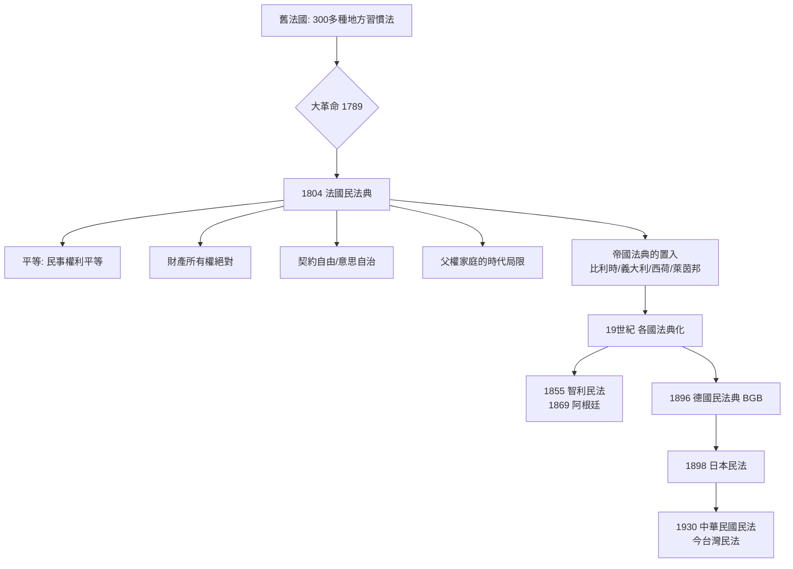

# 6.1 拿破崙法典：理性主義的結晶

1804 年 3 月 21 日，法蘭西第一執政拿破崙·波拿巴（Napoleon Bonaparte）簽署了《法國民法典》（Code civil des Français）。後世稱之為《拿破崙法典》（Code Napoléon）。傳聞拿破崙晚年於聖赫勒拿島流放時曾回顧一生，說道：

> 我真正的榮光不在於我打贏了四十場仗——滑鐵盧之敵會抹掉那一切的記憶。不會被任何事抹掉的、將永存不朽的，是我的民法典。

他不是法律人，也不是哲學家；但這部法典的設計若閉上眼想，你會發現它是一位將軍與一位法務部長合作打造的一件「殖民法器、行政機器、國家的基因碼」。

## 前史：法國法律的巴別塔

在 1789 年革命之前，法國的法律是一場混沌。國家的南部採用羅馬法為主的成文法區，北部則是以習慣法（coutumes）為主的法區——整個法國各地有三百多種地方習慣法。此外，還有皇家敕令、教會法、領主法、行會法各層重疊。伏爾泰曾譏諷：從法國一端到另一端旅行的旅人，換法律的次數比換馬匹的次數還多。

革命者一開始的第一想望是打破這個混亂。1791 年憲法規定應制定一部全國共通之民法；1793、1796，兩度起草失敗。直到 1800 年，第一執政拿破崙設立了四人法典起草委員會：波塔利斯（Portalis）、特隆歇（Tronchet）、比戈·德·普雷阿梅納（Bigot de Préameneux）、馬勒維爾（Maleville）——兩位是老練的南方法學家，兩位是北方法學家，刻意平衡成文法與習慣法兩個傳統。

立法程序值得一看：草案先送交高等法院與橡木參政院討論，而拿破崙本人主持了超過半數的審查會議，時常親上講台——他深愛羅馬法、善於抓準核心爭點，還常反駁法學家。這部法典最成功之處（簡潔、結構、可讀、一以貫之），與這位在戰場上講求衝力的統帥親自審稿有關。

1804 年 3 月 21 日，民法典以 2,281 條全文頒布生效。

## 五條骨幹：它主張了一個什麼樣的國家

民法典的條文看似平常，其實是法國革命三大理念（自由、平等、財產）的民法版。

一、法律面前人人平等（第 8 條）：所有法國人均享有民事權利。封建特權、身分法、貴族差別從此在民法上段裂。這是革命理念的正面化，也是拿破崙推動行政效率與社會動員的基礎。

二、財產權神聖（第 544 條）：所有權是「以最絕對的方式使用與處分其物的權利」（只要不違反法律規定）。農民可以安心購買土地；資本可以成為資產；而封建的領主權利（如什一稅、地主之豁免權）被剷除。拿破崙曾言：「我要的是讓每一個農民，都能躺在他自己的土地之上睡覺。」——這句話有戰略意義：它一方面鞏固小農業主，使他們世代感謝皇帝，另一方面把小農牢牢壓在農地上，法國的農業與社會結構從此奠定。

三、契約自由（第 1134 條）：契約在當事人間有如法律（la convention fait la loi）。締約自由、選擇自由、意思自主（volontarisme）是民法債編的心臟。當資本主義的商業交易需要一種「可計算的規則」時，契約自由不但回答了商業的問題，也把「意思自治」散播到全歐陸。

四、家庭與個人：婚姻民事化（第 203 條起）、離婚制度保留（但 1816 年復辟後被取消，1884 年才重新入法）、親權集中於父。丈夫在家庭中擁有幾乎完全的權威：婦人不能獨立簽約、不能控告丈夫、丈夫對妻子之財產擁有管理與收益權（這要到 1938 年與 1965 年才在法國民法中清除）。法典的平等精神在此被「家庭內的專制」切斷；這是法典最大的時代局限。

五、司法寧靜（法不溯及，法官統一）：法官受法律拘束、不得拒絕裁判（第 4 條），並禁止法官以一般原則裁判（第 5 條：法官不得以其判例創設一般規則）。這條被後世稱為「禁止法官造法」，目的在維持立法至上，確保法律的一致預測性。

## 「一個紅色的信封」：法典的政治功能

民法典不只是法律文字工程，所包含的目光是政治性的。三個層次的用途：

1. 國家整合：法國是當時歐陸最集權的國家之一，但基層司法仍是地方性的。一部全國一體的民法，加上同時建制的司法與行政體系、後來拿破崙擴展的三層級司法組織（治安法官、法院、上诉法院）、法國大學的系統性法學教育，把五百萬農民趕進「同一本法書」的閱讀裡。
2. 徵兵與動員：拿破崙戰爭需要一個有戰鬥力的農軍。民法給予農民財產安全的安心，使他們信任政府之信用而願意決死。這是一個「用民法典換兵源」的契約結構。
3. 帝國的置入：拿破崙把民法典推行至他所征服的每一個省份與附庸國：比利時、萊茵邦、義大利（以各式形態）、西班牙、荷蘭、華沙公國。今日歐洲的大陸法地圖上，德國以外的大多數國家的民法（荷蘭、比利時、義大利、西班牙、葡萄牙、及其南美殖民地）都直接或間接受民法典影響。世界史上，大概只有羅馬法在形 넓은地域的影響，可與此相較。

## 技術的美德：簡明、抽象、但含有致命的空白

民法典的美德與其危險是同一件東西。條文抽象、簡明、以一般原則為主，這使它可以被適用於幾乎所有情況；但代價是大量未答之處。

* 沒有「法人」之一般規則（法人制度到 19 世紀末才補入）。
* 沒有勞動契約之特別規則（「勞雇契約」被描述為「勞務與金錢之租賃」，完全無力面對工業化勞資關係之不對等）。
* 判例之地位被貶低（必須依「法律」，而法律限於 1804 年之編纂）——而十九世紀之資本主義迅速跨越了立法者之想望，使得後來法國最高法院（Cour de cassation）在解釋上創造了法理地位（如十九世紀末之勞工階級「事故雇主責任」之判決發展）。

換句話說，民法典的「立法者万能」之姿態，實際上不是造出了一套固定的法，而是創造了一組「硬核＋開放解釋」的法律網路；最高法院在兩百年間把民法典解讀成一部活的文本。

## 打出鐵律：惡法亦法的哲學感受

拿破崙法典的巨大成功，也催生了一種強烈的人格：法律就是法律。德國的薩維尼反對急於繼受法典；法國的法學家則把法典之權威視作神聖。歐陸的法學，特別是德意志的法學，把「法是一個規範性成文體系，與道德之判斷義務分離」的立場推向極致：奧斯丁、後來的凱爾森（Hans Kelsen）與其純粹法理學（Pure Theory of Law，1934），皆以「法之效力與法之道德價值無關」為起點。這套法實證主義在十九世紀是理性化與國家現代化的重要工具——但它在 1930 年代的德國司法中，在缺乏道德制衡的情況下，竟成為「合法地作惡」的技術手冊。這一節的思想後果，我們在 6.2 與 7.2 中再談。

## 民法典的世界旅行

拿破崙法典的故事並不隨拿破崙帝國之敗亡而結束。它成為十九世紀世界性的制度套件：

* 拉丁美洲的各國民法典（智利 1855（安德烈斯·貝略 Bello 作）、阿根廷 1869（貝維斯 Dalmacio Vélez Sarsfield 作）都以法典為底本。
* 1896/1900 年《德國民法典》（BGB）在設計上不遵循法國民法之樸素原則，而是以較深奧的潘德克頓（Pandekten）法學「支架」重新寫作；但它本身與法國法典交互影響（兩者底流都是羅馬法《學說彙纂》的復興）。
* 1898 年日本民法典（穗積陳重、梅謙次郎、富井政章起草）是德國民法之再轉版；1911/1930 年代的中華民國民法（後成為今日台灣民法）又自日本與德國轉進（所謂「潘德克頓體系」之移植鏈）。
* 各民法的編輯構造（如「總則、債法、物權、親屬、繼承」五編制）在這一鏈條上被制度化。

## 失效與記憶

在法國民法典頒布兩百年後，2004 年法國政府重新舉行慶典。民法典今日仍以（經過十數百次修正）活法形式存在，條文總數今已逾 2,600 條。它是一部不會被「打敗也不會被忘記」的法書——因為它符合拿破崙的讖語：

> 我真正的榮光不在於四十場勝仗——那一切已被滑鐵盧抹去；一切能留下的，是我的民法典。

## 小結

拿破崙民法典是以理性為骨、以革命為魂、以國家整合為目的一件烏托邦工程。它給予了你財產、契約與平等（在男人與非隨從的地位上）；它把「法官僅執行法律」的忌憚寫進了成文條文；它從米蘭到海牙、從東京到布宜諾斯艾利斯被複製。

但「法條至上、法官僅為嘴」的制度哲學，一旦在道德上錯離，就會變成助紂為虐的機器。下一節，我們將看清這一場「法律就是法律」的哲學戰役——邊沁跟奧斯丁的法實證主義：它是什麼，它想跟自然法到底理論什麼，它為什麼在一個世紀後撞上了納粹之牆。
