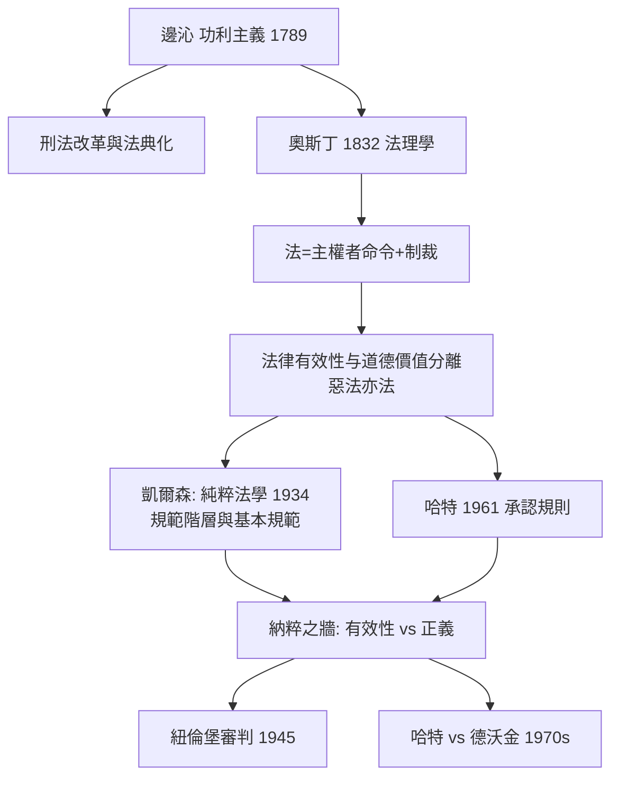

# 6.2 惡法亦法：邊沁、奧斯丁與實證主義

當拿破崙把法典發布到歐陸各地時，海峽對岸的英國出現了一對奇怪的師徒。老的是傑里米·邊沁（Jeremy Bentham），一個終生改革監獄、憲法、濟貧法，死後把自己的遺體做成「自治像」站在倫敦大學走廊裡的怪人；小的是約翰·奧斯丁（John Austin），一個口才不佳、卻在一堂大課上把「法到底是什麼」講得一清二楚的法學家。

他們共同創立了一門學問：法律實證主義（Legal Positivism）。它的核心口號可以濃縮成四個字：惡法亦法。

## 邊沁：以痛與樂度量一切

傑里米·邊沁（1748–1832）是功利主義（utilitarianism）的創立者。他的原則只有一句：

> 趨樂避苦是人的唯一偏好；因此，制度之善，在於最大化全體之總幸福（最大化快樂，最小化痛苦）。

這一原則是一部自然法的否定者。在邊沁看來，自然法是「用納稀無稽的句子去講的瘋話」（nonsense upon stilts——他的著名譏諷，指的是「自然權利」這類概念）；權利不是天上之理性，而是國家之力所創造的物——「自然權利是 hypersensible 的意思」。

但邊沁不只是冷靜之極端；他還是那個世紀的最強刑法改革者。他從貝卡里亞入手，把刑罰的計算化推到精細；他的著名建築想像——全景敞視監獄（Panopticon，中心塔樓可以看見每一間囚犯，而囚犯看不見獄卒）——是刑罰經濟學的極致設計：只要犯人相信自己「可能」被看見，他們就自我監控，成本極低；而這也正好實現貝卡里亞「刑罰之效果在確定性而非殘酷性」的主張。福柯在《規訓與懲罰》中把 panopticon 視為現代規訓社會的原型，這個由功利主義之父造出的建築，成為社會批評者的重要隱喻。

邊沁也是「法典化」的熱烈推動者。他認為，法律要成為可預測之制度，必須被重寫為一部清晰完整之法典；憲法之外的一切，應被重寫為「pannomion」——一個囊括全部制度的法典系統。他並未親身親手造出法典（他的建議被英國議會拒絕），但他的思想在十九世紀的拉丁美洲、希臘、印度（麥考利之法典草案）都有直接輸出，並間接催生了 1859、1861 年的印度刑法典。

尤其值得注意：英語中 international law（國際法）這一詞是他發明的。他說，國家之間的法不叫 law of nations，因為 nations 不是法人；他並且把「國際法」（ius inter gentes）一詞提出，以便與「內國法」相對——這是對格老秀斯傳統的修正。

## 奧斯丁：法是主權者的命令

約翰·奧斯丁（1790–1859）是邊沁之徒。他 1826 年成為倫敦大學（University College London）首位法理學教授，他 1832 年出版《法理學的範圍》（The Province of Jurisprudence Determined）。他的法理學體系簡潔到刀刃：

> 嚴格意義上的法，是主權者對其臣民所發出之命令，並以制裁為後盾。

三個充分的必要條件：法＝主權者之命令＋制裁＋可分析的規則（positive law）。這個定義把神法、自然法、習慣法、國際法都推出「嚴格意義的法」範圍外（它們是 positive morality 或類似的其它範疇），僅留下國家制定法。這個看法被稱為「法實證主義」的著名起點。

為什麼要這樣切？因為奧斯丁想要的功能，是「把法與道德分開，使法成為一門可分析之科學」。他的理由很實在：法學家的工作，是說明「法是什麼」（lex lata），而不是建議「法應當是什麼」（lex ferenda）；一旦把「不道德的法」一概劃出「法」之範圍，法學家就會看不清楚國家究竟在用什麼規則統治人民。

而這一點，正是實證主義最艱難之處。奧斯丁明言：法與其善惡沒有邏輯必然之關聯；因此「惡法亦法」（the existence of law is one thing; its merit or demerit is another）。他憂心的是另一面：如果人們只在法具有道德內涵時才服從，那麼法的存在就會崩垮。但他的公式在後世的情況中，讀起來聽似助虐。

## 「惡法亦法」的戰場：兩個世紀的鐘擺

「法是主權者之命令」與「自然法高於實證法」的衝突，在這兩百年中一波一波地搖擺。

* 美國廢奴運動：逃亡奴隸法（Fugitive Slave Act 1850）是依程序通過的法律。梭羅以「公民不服從」回應（「我們該當成為法律的機器嗎？」），而西奥多·派克（Theodore Parker）則說過：「法有兩種——一種來自上帝的正義，一種來自人的不正義。」梭羅之論—法與正義可以分歧—與奧斯丁之論—兩者為不同範疇—在邏輯上並不矛盾；真正的爭論是：當二者分歧時，我們該做什麼。
* 奈爾遜·曼德拉之受審：1964 年，曼德拉在 Rivonia 審判中說：「我熱愛之南非洲，屬於人民……我為這理想而受審……而若必要，我準備為之而死。」他的抗辯函式頗近於 Antigone：「這些法的正義性，才是問題。」
* 紐倫堡的辯護：納粹戰犯說：「我只是依法行事。」控方卻不得不訴諸「惡法非法」的立場。軍事法庭在 1945–46 年間，以「反人類罪」起訴——這種罪在其行為時，尚未有明文成文的法（nullem crimen 不溯既往）。這是實證法最公開的一次失靈，也是二十世紀最重要的法哲學轉折。

## 奧斯丁傳統的繼承與修正

奧斯丁之後，實證主義並未死於紐倫堡，而是被兩位後人重新設計：

* 漢斯·凱爾森（Hans Kelsen）的「純粹法學」（Pure Theory of Law，1934）：法之效力不是來自主權者的意志，而是一個規範的層級系統——每一規範由上位規範授權，最後在「基本規範（Grundnorm）」上被接受為有效。他把「有效性」與「真實性」分開，把「法學」限定為規範之結構分析；這一理論是二十世紀最重要的法律科學創造，也成為不少國家憲法法院（特别在奧地利與多數拉丁美洲）制度的思想凶手。

* 哈特（H.L.A. Hart）的「承認規則」（rule of recognition，1961 《法的概念》）：法有兩種規則——初級規則（義務性規則）與次級規則（承認規則、改變規則、裁判規則）。法體系是否存在，取決於官員是否在實踐中把承認規則接受為「判準」。這一理論超越了奧斯丁之「命令」模型（它可以說明立法、習慣、連續性），也有一個著名的「最小自然法」成分：任何法體系，都必須至少满足某些人性之必要條件（人的脆弱、資源之有限、善惡之有限利他）。這作為實證主義内部的出走，為後來哈特—富勒與哈特—德沃金之辯論鋪路。

## 實證主義 vs 自然法：到底在爭什麼

外界常以為實證主義者相信「惡法不該遵守」，自然法學者相信「惡法就是非法」。實際的爭点更精細，四個層次：

1. 分析之層次（法是否為法）：奧斯丁／哈特的角度：法的有效性是一個事實問題，不必引用道德。富勒／德沃金的角度：若一個規範嚴重違背正義，它不該被看作法。
2. 遵守之層次（是否該遵守）：幾乎所有理論家都同意「惡法不應被遵守」或者「嚴重不義之法可以不服從」——這一點其實兩邊沒有實質矛盾。
3. 責難之層次（處罰是否正義）：問題在 1945 年出現：行為時「合法」之行為，戰後能否受罰？這不僅是法哲學問題，也是溯及制裁的憲法問題（罪刑法定之反面）。
4. 制度之層次（法官應該怎麼審）：法官是否有義務（或權限）在個案中訴諸道德來決定法是否適用？——這正是 9.1 節中的哈特—德沃金之辯。

## 小結

拿破崙法典與法實證主義，是同一場「現代性」運動的法律與哲學雙面：一方面，法從中世紀的習慣、特權、宗教糾纏中解放出來，成為一個清晰、可預測、可移植的現代技術；另一方面，這一技術的性格使它與道德脫鉤，用力巨大、能力危險。二十世紀的兩場大審判（7.2 紐倫堡、法學內部的哈特—德沃金之辯），都將来到這條裂縫上。

下一章，我們往另一岸走：看美國最高法院如何用一個敗訴的案子，創造出「違憲審查」這套制度，把「王在法下」最終完整地制度化了。

