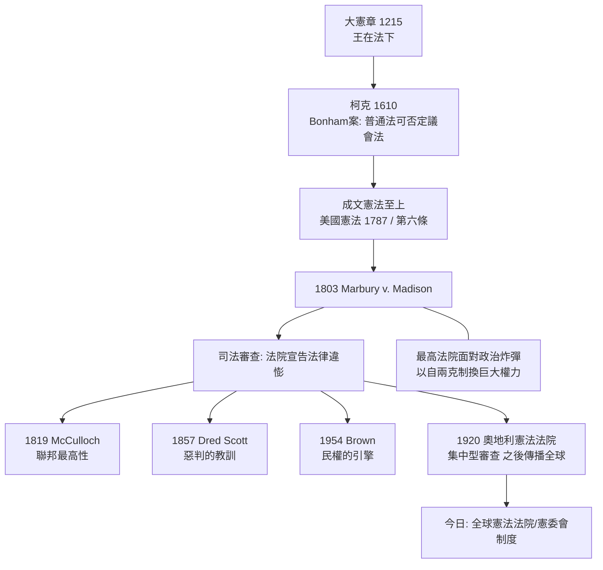

# 7.1 馬伯利訴麥迪遜：小小案子的巨大勝利

1803 年 2 月 24 日，美國聯邦最高法院首席大法官約翰·馬歇爾（John Marshall）宣讀了一項判決。這個案子上訴人輸了，被上訴人贏了，而且判決書的重點幾乎與本案的爭議無關——但它在兩百年後仍被稱為「美國司法史上最重要的一頁」。因為它創造了一件此後任何成文憲法都不曾明文授與的東西：違憲審查權（judicial review）。法院從此有權宣告立法機關通過的法律違憲無效。

## 背景：1800 年的政黨輪替與「午夜任命」

故事要從 1800 年的總統大選說起。傑斐遜（Thomas Jefferson）代表的共和黨（Democrat-Republicans）擊敗了聯邦黨（Federalists）的亞當斯（John Adams）。亞當斯輸了大選，卻還有幾個月的任期。聯邦黨人做了一件當時合法、後世爭議至今的事：在 1801 年 3 月 3 日——傑斐遜就職的前夜——大規模任命官員，特別是 42 位新設立的哥倫比亞特區治安法官（justice of the peace）。參議院整夜通過任命，國務院要蓋印、簽發委任狀（commissions）。這些趕在深夜前簽發的任命，被史上稱為「午夜任命」（midnight appointments）。

但時間不夠了。其中有一份委任狀—— William Marbury 被任命為哥倫比亞特區治安法官——已由亞當斯簽署、密封，卻還沒送達本人。3 月 4 日，傑斐遜就職，命令新國務卿詹姆斯·麥迪遜（James Madison）扣下這批委任狀。Marbury 職位飛了，於是直接向最高法院起訴，依 1789 年《司法法》（Judiciary Act of 1789）第 13 條，請求最高法院發出執行令（writ of mandamus），命令麥迪遜把委任狀交出來。

這是一個政治炸彈。最高法院的法官全是聯邦黨人（首席大法官馬歇爾本人正是在這些「午夜任命」中，被亞當斯在 1801 年 1 月任命為首席大法官的——他此前還兼任國務卿，親手處理過 Marbury 的案子）。如果法院判 Marbury 勝訴，麥迪遜（也就是傑斐遜政府）很可能拒絕執行；法院拿一個沒有軍隊的機關，硬碰掌管軍隊的行政權，一旦命令不被遵守，司法威信將永久掃地。如果法院判 Marbury 敗訴，等於宣告聯邦黨「自己任命自己人」的政治操作違法，聯邦黨的司法威望也受重創。

馬歇爾選了第三條路。

## 判決的三段論

1803 年馬歇爾在 Marbury v. Madison 判決書中作了三步推理：

第一，Marbury 有權取得委任狀。他已被合法任命，扣留委任狀違法；麥迪遜「不交付」是對其法律權利的侵犯。這一段是給政治交代：法院承認 Marbury 的權利，也順手敲打了行政機關。

第二，Marbury 有權得到救濟。「有權利，必有救濟」（ubi jus ibi remedium）：公務員非法侵犯個人法律權利時，法院應提供救濟。這一段確立司法對行政的可審查性。

第三——這一步是歷史性的一跳——但最高法院不能發出這個執行令。因為 Marbury 是直接向最高法院起訴的，這要求最高法院對本案有原始管轄權（original jurisdiction）。馬歇爾檢視美國憲法第三條，發現憲法明文列舉最高法院之原始管轄範圍（涉及外國大使、以州為當事人之案件），並不含治安法官任職糾紛；而 1789 年司法法第 13 條竟授權最高法院對此類案件發出執行令——這是國會擴張了憲法明定的管轄範圍。問題來了：國會的法律與憲法相牴觸時，何者有效？

馬歇爾的回答：

> 显然，違背憲法之法律為無效……解釋法律是司法機關的職責。在具體案件中適用規則的人，必須解釋該規則。若兩個法律互相衝突，法院必須決定何種規則可適用於該案。

一旦法院認定憲法（人民在制憲時的最高意志）優先於普通法律（議會的授權意志），那麼依憲法審查法律的合憲性，就是法院在適用法律時「解釋何者為本案之法」的自然工作。因此：1789 年司法法第 13 條違憲，最高法院即使在實體上同情 Marbury，也無管轄權發出執行令。Marbury 的請求被駁回——他輸掉了他的案子，卻永遠贏得了民意。

## 為什麼是美國、為什麼是 1803

違憲審查聽起來像是成文憲法的必然結果，其實不然。憲法本身並未寫「法院應宣告國會法律違憲」；而世界上其他成文憲法國家，遲至 1920 年奧地利才另行創設憲法法院（凱爾森設計的集中型審查），法國要到 1958 年第五共和才有憲法委員會。美國在 1803 年就啟動分散型（司法附隨審查）制度，有其特定的條件：

1. 成文憲法 + 判例法文化。英格蘭「王在法下」傳統（大憲章之餘緒）與柯克的 Bonham's Case（1610 年，柯克曾宣稱議會法律若違背「共同權利與理性」，普通法可宣告其無效——見 3.2 與 7.1 之思想系譜）提供了觀念基礎；美國建國者把成文憲法視為「更高之法」（supreme law，憲法第六條明文），而習慣於由法院（而非議會）最終解釋規則。
2. 聯邦制。聯邦法與州法、州憲與聯邦憲法疊層衝突，法院必須經常「決定哪一個規則適用」，這使司法介入衝突解決成為日常。
3. 政黨剛成立、制度剛成型的關鍵十年。若联邦党在1801年的政治挫折中能讓司法自保並擴權，那麼「司法審查」就有機會被寫進先例。馬歇爾的操作之所以成功，正因為他判決的是一個 Marbury 案——一個小案子：判 Marbury 敗訴不會 有人流血，判麥迪遜勝訴也不損面子。最高法院用一場自我克制（不發執行令）換來了一项巨大權力。

## 此後兩百年：司法審查如何長成怪獸

馬歇爾只建立了「法院可以宣告法律違憲」的原型。司法審查的實際力量，是九十餘年的先例慢慢累積的：

* 1819 年 McCulloch v. Maryland：確定聯邦法律之最高性，州不得對聯邦銀行課稅（「有課稅之權者，有毀滅之權」）。
* 1857 年 Dred Scott 案：最高法院以司法審查宣告國會禁止奴隸制向西擴散的法律無效——這是司法審查第一次被用於重大議題，卻是一場災難：判決激化南北衝突，內戰因此論戰而提前。歷史上第一次重大違憲審查，竟是一部保護奴隸制的判決。這提醒我們：違憲審查不保證正義，它只是把「何者是更高之法」的解釋權交給了九個人與時代/共識。
* 1937 年新政時代的「憲法革命」：羅斯福的「法院填塞計劃」（court-packing plan）威脅之下，最高法院轉向，放寬經濟立法的審查。
* 1954 年 Brown v. Board of Education：宣告學校種族隔離違憲，司法審查成為民權運動的工具——詳 8.1。
* 1973 年 Roe v. Wade 與 2022 年 Dobbs 案：違憲審查在墮胎議題上的大迴轉，顯示這個制度與法官任命政治深度纏繞。

## 制度性的前因後果

## 小結

Marbury 案的教訓有三層。第一層是制度技術的：以判例而非條文，最高法院為自己寫進了憲法未授的權力；第二層是政治的：司法權的持久公信力，來自「不站隊」的自制——馬歇爾判自己的黨輸，反而贏得永久的權威；第三層是理論的：「法律是什麼」的最終解釋權，被交給了一個既不選舉也不動兵的機關，這件事之所以成立，是因為「憲法高於法律」被所有人（包括輸家）接受了。

但是「接受憲法為最高之法」有一個可怕的暗面：如果一個政權以完全「合法」的方式，通過了違背人類基本正義的法律呢？當法律自身成為屠殺的機器，法院與法學家該怎麼辦？下一節，我們看二十世紀最黑暗的一頁——以及它如何把自然法從墳墓裡重新救出來。
