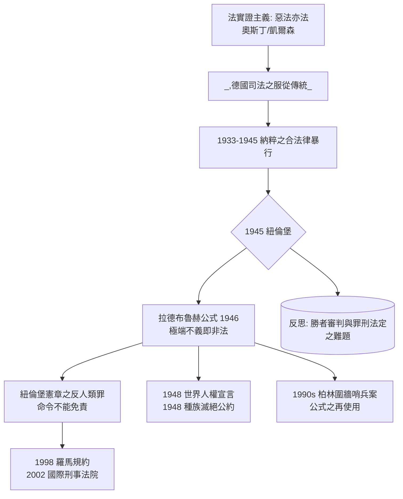

# 7.2 紐倫堡與拉德布魯赫公式

1945 年 11 月 20 日，德國紐倫堡的司法宮（Palace of Justice）法庭開庭。二十一名納粹最高層人士坐在被告席上——戈林、里賓特洛甫、凱特爾、羅森伯格。他們的辯護可以濃縮成一句話，而且這句話在法律邏輯上無懈可擊：

> 我們的行為依德國當時之法律是合法的。我們遵守的是我們的法律。

這一句「依法行事」（Befehl ist Befehl；ich habe nur nach dem Gesetz gehandelt），撞上的是法學兩千年的老問題：惡法是否為法？而它逼出一個尖銳的司法難題：如果它們是法，被告就是無罪；如果它們不是法，那麼以事後之理、溯及地審判昨日的「合法者」，是否符合罪刑法定？

本節的主角，是一位德國法學家——古斯塔夫·拉德布魯赫（Gustav Radbruch）。他在戰前是最溫和的法實證主義者；戰後，他親手寫下著名的三頁短文，把自己先前的學說判了死刑。

## 演法師如何走向監獄：拉德布魯赫的轉身

拉德布魯赫（1878–1949）是海德堡大學法學教授、威瑪共和時期的德國司法部長。戰前的他持經典的法實證主義立場——

> 法之效力，來自其制定程序；即使不義之法，在其效力上仍是法。

這個立場並非道德混亂，而是有清楚的理由：民主國家中，「法是什麼」應由民主程序決定，不應由法官依個人道德恣意推翻；若法官以道德否决法條，就等於是法官造法、寡頭統治。在威瑪時代，這個溫和的立場是守護民主的立場。

1933 年後，納粹政權使這個立場完全失靈：納粹的「法」—雅利安人法、公民剝權法、種族清洗的種種敕令——都依「合法」程序制定（或至少依「法律外觀」）。依拉德布魯赫戰前的立場，這些都是「法」；依其立場所護衛的「效力論」，法官應當適用它們。

更殘酷的是，拉德布魯赫的親人被法西斯波及：他的猶太女兒倫娜特是律師，被剝職與監禁。他本人因「政治不可靠」而被奪教職。他自己面臨一個問題：你的學說，就是使你的女儿成為囚人的機器。

1945 年之後，德國被聯軍占領，納粹戰犯面臨審判。拉德布魯赫在他 1946 年三篇文章（最重要的一篇是〈法定性與超法之法〉Gesetzliches Unrecht und übergesetzliches Recht，法上之不義）中，公開改寫自己的理論。他寫下後世稱為拉德布魯赫公式（Radbruch formula）的三句話：

> 若有法之內容與正義之原則產生不可容忍之矛盾——甚至到「法被否定」之程度——那麼它作為「不正義之法」，必須向正義讓步。

精確的三段公式是：

1. 存在兩種「立法上的不義」（gesetzliches Unrecht）：一種是違正義之法律仍有效（這種情況很少）；一種是「不被承認為法之規範」（不義到無效）。
2. 判準是「不可容忍性」（Unerträglichkeit）：不是普通的不公，而是極端、不可容忍的不公——即「只要有任何尋求正義者的角度，根本無法承認這是法」。
3. 在兩者衝突時，正義優先於法定性。

他又提出判決的實質指引：

> 一種不義若「以極端的程度」凌人，那麼它根本不是法；依此行事者，不能以「我依有效之法而行」作為免責之理由。

## 紐倫堡審判：新罪的立法難題

拉德布魯赫公式給了哲學答案，但審判是司法程序，必須有法律依據。聯軍在 1945 年 8 月制定了《紐倫堡國際軍事法庭憲章》（倫敦憲章），其中第六條界定三種罪：

1. 反和平罪（crimes against peace）：發動侵略戰爭。
2. 戰爭罪（war crimes）：違反戰爭法（格老秀斯以降的傳統，已有既存條約法與習慣法）。
3. 反人類罪（crimes against humanity）：對平民之謀殺、滅絕、奴化……「不論是否違反犯罪行為當地國之內國法」。

「不論是否違反內國法」這一句是全案的樞紐：它明文宣告，德國法不能作為免罪之依據。辯方馬上抗辯：這是溯及性立法（nullum crimen 之違反）、是勝者之正義。檢察官（尤其美國首席檢察官羅伯特·傑克遜，之前是最高法院大法官）與德國法學家部分的答案，正是我們本節的核心：

* 戰爭罪不是新法：它有《海牙公約》與既存之國際習慣法。
* 反和平罪有《巴黎非戰公約》（1928 Kellogg-Briand Pact），該公約之締約國（含德國）已盡棄戰爭作為政策工具。
* 反人類罪的殘酷行為（屠殺）在任何文明內國法中都屬重罪；被告所依賴的「納粹法」，才是真正不存在的法——因為依拉德布魯赫公式，它不是法，而只是被披著法衣的罪行。

1946 年 10 月，判決宣佈：19 名被告中，12 人被判死刑（戈林在行刑前自殺），7 人有期徒俸，3 人無罪。法庭同時確立多個後世國際刑事法的重要原則：命令不能免責（superior orders 不構成完整抗辯）、人道罪不因其為國家政策而免責、領袖集團可因組織罪行受共同審判。

## 紐倫堡的兩面：勝利與反思

紐倫堡審判不是純勝利史，值得誠實細看它的兩面。

正面：它第一次建立國際司法對國家暴力之追訴程序，其原則後來流入《聯合國憲章》、《日內瓦公約》、《防止及懲治滅絕種族罪公約》（1948），在半世紀後結晶為《羅馬規約》（1998）與國際刑事法院（ICC，2002）。前南斯拉夫問題國際刑事法庭（ICTY）、盧安達國際刑事法庭（ICTR）是其直接後繼。

反面與質疑：（一）「勝者審判」的批評是真實的：聯軍自己在德累斯頓的轟炸、廣島與長崎的核爆、蘇聯在波蘭卡廷的屠殺，都不在被告席上。（二）司法程序的時間壓力與證據選擇，使某些辯護未被完整審理。（三）判決書本身在哲學上並未完整解決「溯及性」難題：法庭以「公約已存在」之理由，把問題部分地化作技術問題，而真正的公式是德國戰後司法自己做的事。

## 德国戰後司法：把公式用起來

德國戰後的法院，在追訴親自執行邊牆案與東德逃兵射殺案的時候，把拉德布魯赫公式重新用了一遍——但時間已是二十世紀末。

柏林圍牆哨兵案（柏林聯邦憲法法院及歐洲人權法院之柏林牆案系列判決，1992–2001）：1989 年柏林圍牆倒塌前幾年，東德士兵Chris Gueffroy、Peter Fechter等試圖跨越邊牆時被射殺。統一後，德國法院追訴這些哨兵。辯護理由與紐倫堡辯護一模一樣：依東德邊境法（Grenzgesetz）與上級命令，「射殺越牆者是合法的」。德國聯邦最高法院與歐洲人權法院的裁決是：不僅東德之法違背國際人權之基本準則（自不准許射殺試圖越境之平民），該法依拉德布魯赫公式「欠缺著因極端不義而完全喪失法之強制力」；上級之命令不減免其罪，而人仍需由其自身之良心判斷（Richter mit menschlichem Gesicht，「以人的面貌行使其法官之職」）。這也是歐洲人權法院後來承認之標準：德國司法之判法與歐洲人權公約之罪刑法定不衝突。

## 前因後果：一條往復的長河

## 小結

「惡法亦法」與「龻法非法」的兩千年辯論，在 1945 年後不再只是書房之爭，而成為文明崩塌後的重建工具。拉德布魯赫的公式提供了法治的自律條件：法之效力，本身即受基本正義的約束；當一個規則墮落到「不可容忍」，它就喪失了要求服從的力量——這是安提戈涅在公元前五世紀在石墓穴中自縊時說過的話，在二十世紀被寫成了司法準則。

但這個公式在某種意義上代表著法學的自省，不是一次勝利。戰後成立的世界人權體系——「使國家的暴力永遠不能再被合法化」的企圖——才是真正的反擊。下一節，我們看 1948 年《世界人權宣言》如何誕生，以及 1966 年那個叫米蘭達的墨西哥移民青年，怎麼在亞利桑那州的沙地上，用一個口供的故事，讓程序正義被釘進全世界警察的口中。
