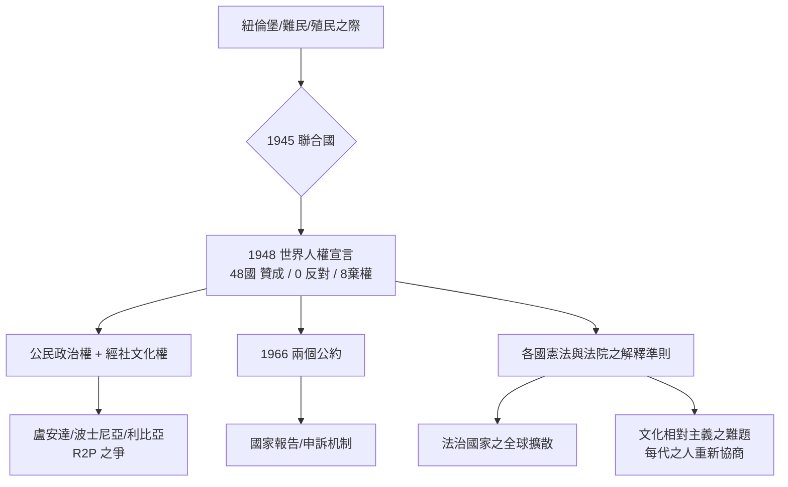

# 8.1 世界人權宣言

1948 年 12 月 10 日凌晨，巴黎夏樂宮（Palais de Chaillot）的會議廳裡，聯合國大會以四十八票贊成、零票反對、八票棄權，通過了一份只有三十條的文件：《世界人權宣言》（Universal Declaration of Human Rights, UDHR）。

它不是條約，不具binding force——聯合國大會的決議在技術上只是「建議」。但七十八年後回望，這份「沒有拘束力」的文件，大概是二十世紀被引用最多的法律文本。今日幾乎所有國家的憲法、全球的人權條約體系、乃至開發中國家的購買機票與婚姻登記，在規範的族譜上都能回溯到那三十條。

## 為什麼是 1948

三則近年歷史是它的產房。

第一，納粹之牆的教訓。前節已述：紐倫堡審判揭露：一個國家可以用「合法」的手段做滅絕（人類史上規模之最）。法學界之共識是：必須在國家主權之上，建立一組「任何立法者都不可超越的底線」。如果這些底線只存在於哲學著作中（自然法的失靈正是在威脅每個人），就必須寫下來、公布出來。

第二，難民。戰爭使二戰結束時，總另有數千萬人流離失所。們我甚至是在無國的狀態下的「法外之人」——如英法猶太裔法哲學家阿倫特（Hannah Arendt）於失去國籍而後的論文所寫：失去國籍的人，失去的是「右」的權利（the right to have rights）。任何只由民族國家所保障之權利，在民族國家崩壞時都失效，因此必須有「不因國籍而取消」的基本權利。

第三，殖民。非裔、亞裔之代表在聯合國新興成立之際，主張「權利宣言」不能只保護歐洲人。宣言的起草，終究走出了白人精英的世界，也是理性化之革命的全球階段。

## 起草的十八個月：人與文件的旅程

新成立的聯合國人權委員會（UN Commission on Human Rights，1946 年成立）成員十八人，主席是美國的第一夫人艾蓮諾·羅斯福（Eleanor Roosevelt）；起草委員會主席是黎巴嫩的哲學家與外交家馬立克（Charles Malik）；副主席是中國的外交官張彭春（P. C. Chang，南開學校創辦人之一張伯苓之弟、哥倫比亞大學哲學博士，曾任清華大學教授、戲劇教育家）；法國的法學家與法官卡桑（René Cassin）為主要起草者之一，常被稱為「宣言的主廚」。

多文化起草的過程，導致宣言的語言必須是「能被各文明同時接受」的語言。著名的一個例子：第一條談到人應以什麼精神相待時，法文起草版用了「fraternité」（兄弟之情），張彭春建議融入中文的概念「仁」（ren，二人相處之道）——最終文本寫作 "in a spirit of brotherhood"，成為權利文本中罕見的「德性語言」。宣言之「尊嚴」（dignity）與「良心」（conscience）字眼的取捨，也折衷了不同宗教代表之意見。

起草過程中的各項協商偏重了一項很重要的決定：權利清單不只是歐美的「公民與政治權利」（言論、集會、司法保障），也包含經濟、社會、文化權（勞動、社會保險、居住、教育）。這就是宣言第 22 到 27 條的由來。1948 年，這種作法是妥協；今日仍然在法律學界設有重要分流（civil-political rights vs. socio-economic rights 之辯），我們在 9.1 的德沃金部分將再遇到它。

## 三十條：寫了什麼

宣言的骨架簡單卻有力：

* 第 1 條：人人生而自由，在尊嚴和權利上一律平等；賦有理性和良心，應以兄弟關係的精神相對待。
* 第 2 條：禁止歧視（不因種族、膚色、性別、語言、宗教、政治、國籍、財產、出生等而有所區別）。
* 第 3–11 條：生命、自由與安全；奴隸制禁止；禁止酷刑；人格權、無罪推定、不得任意逮捕——這些是司法權程序（貝卡里亞、米蘭達之前身）。
* 第 12–17 條：私生活、遷徙、居留、婚姻、財產、思想良心宗教之自由。
* 第 18–21 條：意見與表達、集會結社、參政——現代民主之底座。
* 第 22–27 條：社會保障、工作、同工同酬、休息與休假、生活水準、教育、文化生活與著作權。
* 第 28–30 條：國際秩序之社會權利之義務、權利之限制、國家或人之義務（不得以偽權行事）。

在法學結構上，宣言本身不直接成為法院之判準；但它的兩個路徑使它成為活的法。第一，把權利動條約化：1966 年的那兩種公約（Civil and Political Rights; Economic, Social and Cultural Rights）最終制定了 manifest binding obligations，並設立國家報告與申訴之機制（多數國家批准）。第二，使它成為各國憲法與法院判決之「解釋準則」——在多國，大法官在解釋基本權時，以宣言為整合全球法之參照（法學界所謂「世界化之判例」）。

## 宣言之後的進程與難題

悦納成文的人權法並不等於權利被實踐。這個體系之成就是我制度性的：全球有憲法權利的國家比例由 1945 年極少，到今日接近全部；國際人權條約至此達近百年、群體上百份。但這個體系的兩個深層難題，不僅未解，反而以新的形式復活：

其一，主權與人權的打架。人權之本質在限制國家之內政；而國家仍然是國際社會的掌權者。當族裔清洗在盧安達、波士尼亞、敘利亞發生，「人道干預」（humanitarian intervention）與其後的「保護責任」（Responsibility to Protect, R2P, 2005）確實指出：主權之義務在於保護其人民，若其失靈則國際社會得介入。但這個學說的每一例操作（科索沃 1999、利比亞 2011）都逃不掉「以人權之名行強權之實」的懷疑。

其二，普遍主義與文化相對主義。宣言起草時已協調了這一條線（1993 年維也納世界人權大會重申「人權之普遍性，其基礎是文化多元」）；但女權、亞洲價值論、宗教法（如某些伊斯蘭國家對女性權利或宗教自由的保留）之爭議，一直存在於條約之保留與報告中。這也提醒我們：普遍性不是由字面解讀而成，而是由經年不斷的跨文化對話真實建成的。

## 小結

世界人權宣言把此前兩千年逐步發現的每一個原則——公開之法、納稅同意、正當程序、罪刑法定、無罪推定、廢酷刑、廢奴隸——匯聚成一份「任何立法者皆不得穿越」的清單，並把它寫成全球共同語言。但它仍然只是文字。使它變成可用之程序，需要法院、需要警察、需要監獄中的人民保有實質之權利。下一節涉及一個非常好的例子是：一個來自墨西哥之農工，出現即他無意說過的一句話——「我有權保持沉默」——在 1966 年被美國最高法院經由程序正義，成為全境警察對每名被捕者必說的通例。

