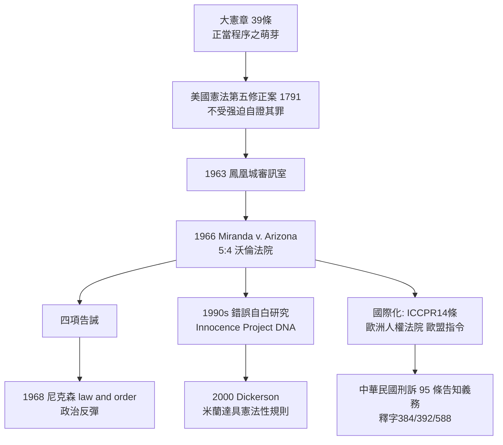

# 8.2 米蘭達告誡：你有權保持沉默

> 「你有權保持沉默。你所說的一切，都將成為呈堂證供。……」

這段告誡的原文，出自 1966 年 6 月 13 日美國聯邦最高法院的判決 Miranda v. Arizona（米蘭達訴亞利桑那州案）。它的主角不是法官，不是哲學家，而是一個有前科的墨西哥裔勞工；判決的背景不是偉大革命，而是一間污染的審訊室。法學史上少數如此具有戲劇性的案例之一，把「程序正義」（procedural justice）從抽象原則，變成了全世界警察口中的十四字套語。

## 案發：鳳凰城，1963 年 3 月

厄內斯托·米蘭達（Ernesto Miranda，1941–1976）出生於墨西哥邊境小鎮，從小輟學，多次進出矯正機構。1963 年 3 月 13 日凌晨，他在鳳凰城被捕，罪名是綁架與強姦：十天前，一名十八歲的少女在市中心提款與回家途中被一名男子捆綁強暴，被害人描述的車與嫌疑人線索通往米蘭達。

警察把他帶進一間沒有窗戶的審訊室，兩小時後，米蘭達簽字承認罪行。他簽的名叫一份「自白書」，文件上方的例行文句宣示：簽署者「自願、無威迫或強制地作此自白」，且「認知其有法律上權利」。但是——警察從未告訴他，他可以不講話，也沒有為他安排律師。米蘭達本人是個智商近九十的青年，第五次與第九次年級的不足學籍，他大概並不明白什麼是憲法第五修正案與第六修正案。

他的自白成為審判中的唯一關鍵證據。1964 年初審，亞利桑那州法院基础於自白判他有罪，刑期二十至三十年。而上訴的路，才剛剛在開始。

## 無名的律師與一個州護衛之 SOS

整個案件的轉折點，是一個公設辯護律師。米蘭達貧窮、無英語背景，審判中亞利桑那州指派的辯護人 Alvin Moore 為他代為受審——但 Moore 只在開庭幾天才見到當事人。米蘭達之上訴於亞利桑那州最高法院被判敗訴後，美國民權聯盟（ACLU）鳳凰城分會的幾位律師主動接案；最終接手的是在邦法院辯護經驗豐富之鳳凰城律師約翰·弗林（John J. Flynn），他帶著同事一同為此案無償辯護。

弗林的訴論策略非常有力，但這樣說可能低估了它：他沒有要求「最高法院重審米蘭達是否有罪」，而是提出一個更廣的憲法問題：警察在未告訴被告其權利的情況下取得的「自願」自白，是否依憲法第五修正案（不受强迫自證其罪）而不得採用？

1966 年 3 月，最高法院聽取辯論。首席大法官厄爾·沃倫（Earl Warren，他曾主政 Brown v. Board of Education）起草判決。法院以 5 比 4 的多數宣判：警察監所審訊即是「固有的強制」（inherently coercive）環境；在此環境下取得的自白，除非警察在使用之前已清楚告知嫌疑人：（一）有保持沉默之權；（二）其所言將在法庭上被用為證據；（三）有律師陪伴之權且在其問答過程中有權得律師在場（且若貧窮，政府將為其指派）；（四）可隨時中止審訊——否則自白不得作為控訴證據。這四項之合體，就是「米蘭達告誡」（Miranda warnings）。

判決結果：米蘭達的原有自白不可作為證據；本案發回重審（重審中，檢方另以被害人之證言與女友之證據定罪，米蘭達獲得較輕刑期；1972 年獲假釋）。

## 兩個模型：正確地問「權利在哪裡」

米蘭達案站在一個跨越時代的思想路口。兩種理論在此對決：

一台「實體正義」的模型：刑事程序的功能，是最大化找到真正的犯人。自白若是真實的（米蘭達確實有罪），程序的小錯並不傷害正義；「排除真相」的裁判制度，只會讓壞人自由。

另一台是「程序正義」模型：國家之刑罰權，是今日最高度危險之公權力；「審訊室」是全公民都可能被關進去的黑箱。如果不以程序約束警察，無辜者之自白（假自白、錯記自白）不僅可能，而且有系統性地發生。程序正義的價值，不在於它總是判對，而在於它使「濫權」無利可圖、使錯誤可被檢查——這一思想一直回溯到大憲章之第 39 條。

沃倫法院選了第二種。判詞的措辭直透：「如果我們不要求這些程序……則這個偉大的社會契約就已被濫用。」

## 反應：「你放走兇手」與「你保護了所有人」

判決當日，群起反對。鳳凰城警察之主管在一則廣播中痛斥其「阻礙執法」；奧克塔維比切（Raymond Nimmer）之《國家評論》以《你也可以成為兇手》為主題刊出一個整批罵；許多州檢察長抗論其「使犯罪增加」。民調顯示多數美国人反對判決。這個判決的政治代價，就可以在 1968 年總統大選中看出：尼克森（Richard Nixon）以「法律與秩序」（law and order）為主軸，獲得多数票。米蘭達成為六零年代之保守主義之魔鬼。

但 Data 半个世紀後的實證思想，卻常常站在華倫一邊：以心理學研究（如1990年代以 Kleinig、Kassin 等學者對警察審訊技巧與假自白之研究）為基礎者，指出：被監所、一連數小時重覆審訊、缺乏法律知識者，錯認自身之罪並非罕見；受理自白者之刑責率，在英美之一案之追訴中有顯著比例（如英國 the Guildford Four、Birmingham Six 與 Cameron Todd Willingham 之被處刑，皆涉及錯誤自白或證據信任）。美國的「無辜者」（Innocence Project）用 DNA 證據在 1989 年後帮助逾 375 人獲釋後，確認錯誤自白是錯案之重要原因之一。米蘭達告誡，成為防制這一類錯案的結構條件。

## 復審的世紀：米蘭達被削損、被限定、又被永存

法院接下來的五十年間，米蘭達之規則被幾個案件削減與調整：

* 1984 年 New York v. Quarles：公共安全之例外（在警察搜槍之現場，得先問「槍在哪」而不需先告誡）。
* 1986 年 Michigan v. LaFave等：違反程序之效果：是「全部排除」還是「僅排除自白」（derivative evidence）？最高法院採較寬鬆之態度。
* 2000 年 Dickerson v. United States：國會曾於 1968 年（以 18 U.S.C. § 3501）設法推翻米蘭達；最高法院在 Dickerson 中宣布：米蘭達規則已為憲法性規則，國會不得立法廢除。首席大法官倫奎斯特（Rehnquist——他本人長期反對米蘭達）執筆，判決維持米蘭達。這是「以判例造成的法，只有法院可以改」的現形，也是兩種法律觀（立法至上／判例自立）在美國憲政內部的和解。
* 2004 年 Missouri v. Seibert：警方先故意不告知、取得自白，再以「合法米蘭達」重新問（double interrogation）——法院拒絕這一策略。

## 米蘭達之謎：為何全世界都會背它

一個美國判決，如何成為世界文明的共同遵循？有幾個原因。

其一，司法之全球化。1966 年後，被告權利之程序保障成為國際人權標準（聯合國公民權利公約第 14 條：《公民與政治權利國際公約》確認任何受刑事指控者之「不被强迫自證其罪」；犯罪嫌疑人之律師在場權）。歐洲人權法院在 1990 與 2008 之一系列判決確認此原則。歐盟於 2010 年之《刑事程序指令》（Procedural rights directives）更直接規定偵訊中之告知義務，內容與米蘭達基本相同。

其二，電影與電視。好萊塢的警政劇（Dragnet、Law & Order）無限制地播出那几句話——它成為文化性的浮度語言，也司法之全球標籤。實證地看：判決主要為一個國家之警察之程序改變而作，卻成為文化上的「程序正義之商標」。中華民國刑事訴訟法第 95 條（訊問前應告知犯罪嫌疑人得保持緘默、得選任辯護人、得請求調查有利之證據）——即所謂「刑事訴訟法第一五五之一條之告知義務」——其源流，亦直接地與米蘭達案之程序正義相連；大法官釋字第 384、392、588 號解釋，正视了主題之「人身自由、程序正義」原則（如大法官釋字第 582 號：被告之緘默權，及違反告知之法律效果）。

其三，米蘭達不保護「真正的犯人」。它的保護對象是「每一個可能被警察談話之平民」。在一個現代國家，這其實是每一個人——也是為什麼它具有公民教育之功能：那十四字告誡，是國家在官方意義上親口教育每個公民：「國家的權力是有界的。」

## 前因後果

## 小結

米蘭達案的深刻教訓，不在「該不該放走一個兇手」，而在它重新定義了「正義」之內涵：一個不僅確定「誰做了什麼」，而且要求「以何種程序、在何種保障下確定」的法官式正義。程序正義從此作為一個獨立於實體正義的價值而存在——即使我們知道有罪，我們仍必須遵守我們的程序法。

這個思想的極端力量，要到七十多年後的哈特—德沃金之辯論中，才推向高潮：若法律不只是一套清楚的「規則」，而是包含一次次的「原則」權衡——法院之角色將不再是「機器之嘴」，而是「正義之口」。下一章，法學史上最漫長、最精彩、最美麗的一場思想辯論。
