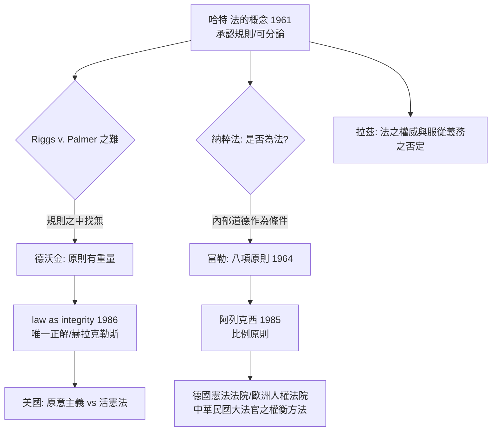

# 9.1 哈特與德沃金的大論辯

1961 年，牛津大學法哲學教授赫伯特·哈特（H.L.A. Hart）出版《法的概念》（The Concept of Law）。他宣布了一個看似平淡的命題：法是一套規則，其效力來源於一條「承認規則」；法與道德在概念上是可分的。

十幾年後，一個哲学出身、牛津求學後轉往紐約任教（耶魯、紐約大學）的年輕學者——羅納德·德沃金（Ronald Dworkin）——不斷向這套理論投石。他說：法不只是一套規則；法律推理包含「原則」（principles），而原則有重量、有道德內容；因此，法與道德不是可分的，法官也遠不只是規則的機器。

這場辯論延續了三十多年，橫跨《法的概念》修訂版、無數專文與波士頓大學的著名對辯（哈特在 1977 年的回應文章〈美國法學中的德沃金〉）。它是二十世紀法理學最富思想性的一場論戰，被拉茲（Joseph Raz）、佩里（Stephen Perry）、菲尼（Neil MacCormick）等一批後繼者反覆殖民；它同時決定了此後法官造法、原則解釋、違憲審查之整個法思想界的地形。

## 第一回合： Riggs v. Palmer 與「原則」

德沃金的 critique 從一個不起眼的舊案子開始：Riggs v. Palmer（紐約州法院，1889 年）。案情：弗蘭克·帕爾默（Frank Palmer）為了提早拿到遺產而毒殺了自己的祖父。按遺囑法與紐約州之實定法，「遺囑應按其文字被執行」，帕爾默是合法繼承人。法院卻拒絕讓他繼承，理由是一條未被寫在任何法典裡的法理：「任何人不得因其自己的不當行為而取得利益」（no one shall be permitted to profit by his own wrong）。

哈特式的法規則論在此有了難處：法官用的不是法典中的規則——它沒有官方來源、沒有制定程序；但它確實被法官認為是「法的一部分」；並且它不是哈特所謂的「次級規則」（改變規則、裁判規則），而具有直接之實質拘束力。德沃金總結：在哈特的規則集合之外，存在著「原則」——它們不「存在於」制定法之中，但它是法律論証的內在結構。

哈特的現實處理是承認有「甄別之源」：一個規範若要有效，須能從承認規則中獲得身分判準；德沃金的回答是：Riggs 案中的原則，在紐約州的承認規則裡也找不到明白的位置，卻被用之——這就是區別。

## 第二回合：原則有重量，規則不折衷

德沃金進一步提出原則與規則之結構差異：

* 規則以「全有全無」（all-or-nothing）方式適用：符合則適用，不符合則不適用。速度限制 110 公里，開到 111 就是違法——沒有第三種可能。
  * 原則以「重量」適用：同一案件中可同時存在多個衝突之原則；法官通過衡量（weighing/more weight）決判——如言論自由 vs. 名譽權，在具案情況中有不同之重量。

這一區別有法學上的深遠意涵：若一場判決中有多個原則相爭，那麼判決的說理是否能「機械」地被論證？若不能，法官的裁量是「弱裁量」（尚未有明準則，但要於已存之法律體系內找答案）還是「強裁量」（超岀法律、以立法者之杭伍創造新法）？

德沃金的答案是：法官只有弱裁量；因為法不僅包括規則，還包括原則之整段、整面結構——法官之職是在這個整面結構裡找出「在既有法中最合理之答案」。所以德沃金有他的著名比喻： Hercules（赫拉克勒斯）——一個力大心細、無所不能之法官，能在法體系中讀出至此最能「使法作為整體」（law as integrity，德沃金後期名著 Law's Empire 1986 之核心概念）被建構之解。赫拉克勒斯不是在造法，而是在解作品——他把法當作一個由作家共同寫下的連續長篇小說（chain novel），每一任法官是下一章的作者，必須從前文汲取、並保持整部作品之連貫性。

## 第三回合：富勒與「法之內部道德」

在哈特與德沃金之戰展開的同時，另一位學者向哈特放了另一種箭。朗·富勒（Lon Fuller，1964 之《法之道德性》The Morality of Law）提出：法自身有一種「內部道德」——要造出「法」，至少要滿足八項條件（一般性、公開、不溯及、明確、不矛盾、可為、不變、官方行為與公布之規則相符）。

富勒問的核心問題，其實是納粹問題的逆寫：如果一個政權的「法」違反這八項，那它還是「法」嗎？他的答案是：不能——這些條件不僅是有效性，也是把規則稱為「法」之必要條件。這又與哈特之立場衝突；哈特在 1958 年的〈實證主義與法與道德之分〉中就曾回敬。富勒與哈特的辯論，是哈特—德沃金辯論的先奏；它是「法之道德性是外在標準還是內部結構」的難題。

## 第四回合：以配套的問題收束： 二元論 vs 一元論

哈特與德沃金之衝突，最後被下列的問題簡潔地說明：

1. 「法是什麼」是靠「源自權威之規則集合」來回答（哈特），還是靠「道德上最契合的正義解釋」来回答（德沃金）？
2. 法官之判決是否總有「唯一正解」（德沃金說有；哈特與拉茲說沒有——總有法律未覆蓋之「剩餘範圍」，法官造新法）？
3. 違憲審查之權應由法院持，還是由民主程序判（「判例至上」 vs 「民主至上」）——這一問題亦是德沃金與哈特區分最實用的一面。
4. 「法的效力」與「法之正義」可否同一（德沃金：道德即法論之判準；哈特：法之效力或真實之可分；富勒：內部道德作為條件）。

## 在法庭上的實效：這辯論改變了誰

理論不是書房內之遊戲。哈特—德沃金之辯的下一站，就是在法院裡面：

* 美國最高法院：德沃金本人被認為是法官解釋（esp. 宪法）之「道德讀出」，而美國最高法院大法官 Breyer，斯卡利亞（Scalia）之「原意主義」（originalism，嚴格解讀憲法文字）與「活憲法」主義（living constitutionalism，德沃金式）之辯，是本辯論在司法之翻版。
* 英國法院：英國沒有成文憲法，則德沃金之影響更可觀察：自 1966 年之《實務聲明》（Practice Statement，上議院宣布自己異於前判之權），英國的法官造法、歐洲人權公約之影響（通過 1998 年人權法 Human Rights Act）及成文法解釋之新準則，都上升到了道德原則之地位。
* 歐陸與台灣：德沃金之「原則理論」，與阿列克西（Robert Alexy）之《基本權理論》（Theorie der Grundrechte，1985）——原則為「最佳化命令」、以比例原則（proportionality）權衡——相遇合，成為德國聯邦憲法法院、歐洲人權法院、以及很多後進憲法法院（包括中華民國司法院大法官）實際在用以權衡基本權之分析工具。阿列克西說：比例原則與人之尊嚴，是憲法解釋的共同文法；這一套文字，是德沃金原則論之德語系成果。

## 主要人物與年份整理

| 學者 | 主要作品 | 核心主張 |
|---|---|---|
| 哈特 1907–1992 | 法的概念 1961 | 承認規則；法律與道德在概念上可分；有空缺結構 |
| 富勒 1902–1978 | 法之道德性 1964 | 法之內部道德：八項法治原則 |
| 德沃金 1931–2013 | 認真看待權利 1977, 法律帝國 1986 | 原則之理論；law as integrity；唯一正解 |
| 阿列克西 1945– | 基本權理論 1985 | 原則＝最佳化命令；比例原則之權衡 |
| 拉茲 1939–2024 | 權威之法 1979 | 法之權威性；服從之一般義務之否定 |

## 小結

哈特—德沃金之辯，把「法之本質」重新推回法哲學的中心：法律是一套規則的集合，還是一系列道德計畫的部分（一套原則）？這不是純書房之問，而是「法院應做什麼」「立法與司法之邊界」「人權裁判之方法」的形而上學基礎，其後果在這幾十年來的日常裁判中都感覺得到。而緊接而來的一股浪潮，則要從外部——階級、性別、種族——拿到整個法學之內部結構的核心假設。它們正是下一節的批判法學與女性主義法學。

