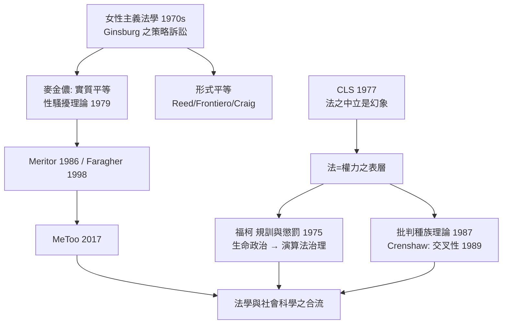

# 9.2 批判法學與女性主義法學

如果說哈特問的是「法是什麼」，批判法學問的是更不客氣的問題：你們所謂中立的「法」，究竟是為誰服務的？如果說德沃金問的是「法律包含多少道德」，女性主義法學問的是：這種「道德」，在歷史上由誰定義、為誰寫下？

二十世紀七十年代的美國，這一連串問題以兩個學術運動的形式爆發：批判法學（Critical Legal Studies, CLS）與女性主義法學（Feminist Jurisprudence）。它們不像哈特—德沃金那樣在舊議題附近重排棋子，而是要掀開整張桌子：法不是一個中立的規則體系，而是政治、經濟與性別權力關係的表層。

## 批判法學：1977 年的春天

1977 年，二十多位左翼法學者在威斯康星州開會，正式成立批判法學會議（Conference on Critical Legal Studies）。核心人物包括哈佛的鄧肯·肯尼迪（Duncan Kennedy）、勞動法學者卡爾·克拉爾曼（Karl Klare），以及巴西裔學者羅伯托·昂格（Roberto Unger）等。他們的論點可以概括為三層：

一、法之「中立性」是政治幻象。所謂「契約自由」，在勞資實質不對等的前提下，是強制力的偽裝；所謂「形式平等」（法律面前人人平等），在階級結構不變的狀況下，只是把真實的支配關係轉入「自願契約」與「合理差別」的名下。這條思路可以追溯到馬克思對法的看法：法反映支配階級的利益，而法語言的「中立性」正是其最重要的工具。

二、法不是一個融貫整體，而是矛盾之「場域」。肯尼迪指出：法律語言結構中存在著固有的根本矛盾（如個人主義與利他規範、形式主義與反形式主義之間的張力）；每個重大裁判之所以有兩種說得通的解，正是因為法概念本身內含對立的價值。因此，「一個正確答案」（德沃金的唯一正解）在 CLS 看來也只是選邊 —— 只是選邊被包裝成邏輯。

三、法與社會不是兩個分離的系統。法並非外立於經濟生活之上、用來「調控」社會的中立框架；它內嵌於教育系統、移民制度、土地登記、契約語言之中，是社會權力機器本身的一部分。所以，越是掌握法律語言的人（律師、法官、法學教授），越是（往往不自覺地）在不斷製造與維護這一權力結構。

CLS 在法學院的衝擊力極大：它為「案例分析之客觀性」提供了解構工具，也引來激烈的學院政治對抗（1980 年代哈佛等校的聘任爭議是高點）。其後 CLS 內部分裂，分出批判種族理論（Critical Race Theory）與女性主義法學兩支，各自獨立發展，影力反而更大。

## 福柯：從「法」到「規訓」

CLS 在理論上的一條重要補充線，來自法國思想家。米歇爾·福柯（Michel Foucault）在《規訓與懲罰》（1975）中不再把刑罰視為「法律之執行」，而是視為一種把人的身體與時間納入管理的技術：邊沁的全景監獄、學校的作息表、軍隊的操演、工廠的紀律，構成了一張社會規訓之網，其運作不需要以「合法性」為名，但塑造了每個人的行為。福柯後期將注意力轉至「生命政治」（biopower）：國家不再只管理穩定的規則，而在管理「人口」——出生率、健康、財富。這一思想是二十一世界演算法治理時代最早的思想預言，在 10.2 我們將重回這裡。

## 女性主義法學：從「形式平等」到「實質平等」

女性主義對法的批判，有更久的譜系，可以追溯到十八世紀與十九世紀的兩條路線：一條主張形式平等（要求法在文字上承認男女平等），代表是沃斯通克拉夫特（Mary Wollstonecraft）《女權辯護》（1792）與密爾（John Stuart Mill）的《婦女的屈從》（1869）；另一條則指出經濟與文化的壓迫根源。但女性主義法學（feminist jurisprudence）作為完整學派，要到 1970 年代的美國法學院才成形，而且有兩個層次：

第一層：策略訴訟的勝利。魯斯·巴德·金斯堡（Ruth Bader Ginsburg，1933–2020，後來成為美國最高法院大法官）在 1970 年代為 ACLU（美國公民自由聯盟）的婦女權利計畫進行策略訴訟。她的策略少有人想到的巧妙：不是「要求法院給女性特別之權利」，而是為受到性別分類歧視的男性提起訴訟，使法院認識到：性別分類對男女都是枷鎖。三個代表性判決確立了後世的框架：

* Reed v. Reed（1971）：愛達荷州規定遺產執行人由男性優先，被最高法院以違反第十四修正案之「平等保護」宣告違憲。這是最高法院第一次承認性別歧視是憲法問題。
* Frontiero v. Richardson（1973）：軍中僅補助男性軍人之眷屬，違憲。
* Craig v. Boren（1976）：確立性別分類需接受「中等層級」之司法審查。

第二層：從「形式平等」轉入「實質平等」之批判。以形式平等為方法之改造有其限度。麥金儂（Catharine MacKinnon）1980 年代提出最具挑戰性的論證：當法律體系以男性經驗為「中性的標準」（如「合理人（reasonable man）」之過失標準、以男性為「普通工作環境」之基準），所謂平等其實是在既有的男性中心規範內要求「同樣對待」，而真正的壓迫則照常運行。 因此，法需要的是改造其「基準」，而不是在其內部要求平等配額。

麥金儂最具影響力的理論成就是性騷擾。她在 1979 年出版《工作女性受性騷擾》（Sexual Harassment of Working Women），從性別歧視之結構出發，將職場性騷擾定義為一種性別歧視，而不只是「個人越軌」。1976 年以後美國的相關訴訟中，這一理論被法院逐條接受：1986 年 Meritor Savings Bank v. Vinson（最高法院承認職場性騷擾為民權法 Title VII 下之性別歧視事由）、1998 年 Faragher 與 Ellerth（確立雇主之責任）。到 2017 年的 MeToo 運動，這一套理論框架已經成為全球共同的法律語言。

第三層：交叉性。1989 年哥倫比亞法學教授金斯伯里·克倫肖（Kimberlé Crenshaw）提出「交叉性」（intersectionality）：黑人女性在性別歧視與種族歧視的交界處，往往兩者都無法被單一框架處理——在「女性權利」的訴訟中，案件被歸為種族；在「民權」的訴訟中，案件被歸為性別。這一概念已成為今日法學、社會學與公共政策的共同分析工具。

## 一個重要的批評

兩個法學派的共同批評也是有力量的：如果法完全只是「權力之表層」，那麼法學何必要存在？——「問題不再是如何改革」，而是圍繞「法之外」。一九九零年代起，CLS 之左翼與女性主義之一支，都開始花費時間在「內部改革」上：法觀念之進步（如應性別語言、性別語言之中性化）其實是緩慢的，但也是實在的。分析的焦點因此轉向：在「懷疑法」與「運用法」之間，法學還能做什麼？

## 前因後果

## 小結

批判法學與女性主義法學並未替代哈特或德沃金之設問，而是把它們拆開：正義不僅是規則的內部融貫或外部道德，也在於規則形成之過程有沒有誰被排除在「編碼」之外。法學也因這兩個學派，第一次以自己的方式面對「法律與社會」：階級、性別與種族不僅是法之外的社會問題，它們就是法的構成成分。

最後一章，我們將把鏡頭推到本世紀：當規則不再寫在法典上，而是寫在演算法與模型之中；當「誰有著作權」的問題被一家生成式 AI 的訓練資料集逼到法庭；當一個量刑演算法在法院中被引用為「不算犯罪的司法工具」——法學的古老問題要在新的技術平台上重新被回答。
