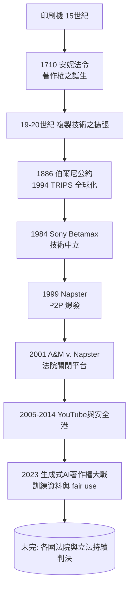

# 10.1 從 Napster 到生成式 AI：數位時代的智慧財產

1999 年，十九歲的大學生夏恩·范寧（Shawn Fanning）在東北大學的宿舍寫了一個軟體，把全世界個人電腦上的 MP3 檔案連成一網。一年之內，Napster 擁有數千萬使用者，全球音樂產業為之震驚。

這個故事之所以在法學史上重要，不是因為它是第一個 P2P 軟體，而是因為它把二十一世紀的基本矛盾第一次大規模地搬上法院：數位資源可以被無限複製，而財產權卻以「排他」為本質。從 Napster 到今日的生成式 AI 著作權大戰，一系列案例反覆追問同一個老問題：財產權的邊界，如何隨科技重新劃定？

## 智慧財產權的前身

在談網路之前，得先看這套制度的來源。1710 年，英格蘭通過《安妮法令》（Statute of Anne），這是第一部現代意義的著作權法：給作者有限期（十四年，可續展）的出版專有權，理由是「鼓勵學習」。注意這個結構有兩個特點：保護在時間上有限；目的在「促進」而非「固有」——它是國家為公共利益而設的政策工具，不是自然權利。這個「工具論」的性格，使著作權在科技變遷中比物權更具可塑性。

1787 年的美國憲法第一條第八款把同樣邏輯寫得更直白：國會有權「在有限時間內保障著作者與發明者對其著作與發明的專有權利，以促進科學與有用技藝的進步」。十九至二十世紀，這套制度繼續擴張成全球體系：1883 年巴黎公約（專利）、1886 年伯爾尼公約（著作權）、1891 年馬德里協定（商標），1967 年成立世界智慧財產權組織（WIPO）；1994 年 TRIPS 協定把智慧財產保護納入世界貿易組織（WTO）體系，保護的強度與貿易制裁掛鉤——這是發展中國家與藥品、影音產業利益博弈的結果，也是全球化年代最富爭議的法律輸出之一。

## Napster 2001：法院第一次關閉一個網路

A&M Records v. Napster（2001）由加州北區聯邦地區法院與第九巡迴上訴法院審理，判決認定：Napster 的中央索引伺服器（讓使用者能搜尋彼此共享的檔案）構成「幫助侵權」（contributory infringement）與「代位侵權」（vicarious infringement）——Napster 知道使用者大量分享受保護的音樂、且從中獲益，卻未阻止，因此須負責並停止供應受侵權之歌曲。

判決書的法律關鍵是「次要侵權」理論——這在傳統法中早已存在，但第一次以網域規模被援用。2001 年 7 月 Napster 被迫關閉。但技術沒有消失：eDonkey、BitTorrent、eMule 接棒；而產業最終的出路不是訴訟，而是新商業模式——iTunes（2003）與 Spotify（2008）把音樂拉回合法串流的市場。這裡出現了科技與法律互動的一個規律：技術衝突先爆發，法院劃下界線，而市場再用新模式消化界線。法律的裁判影響商業設計，商業創新又反過來改寫法律的適用範圍。

## 第二回合：安全港與 YouTube

2000 年代，問題轉向平台責任：一家不提供檔案、只提供空間的平台，為何可能為使用者侵權內容的承載者？答案是由 1998 年美國《數位千禧年著作權法》（DMCA）之「安全港條款」（safe harbor）給出的：平台若在收到權利人通知後及時下架（notice-and-takedown），便不因使用者的侵權內容承擔責任。

2007 年維亞康姆（Viacom）以十億美元起訴 YouTube 與其母公司 Google（2006 年 Google 以 16.5 億美元收購 YouTube）；2010 年紐約南區法院判 YouTube 勝訴——關鍵在於平台須有「實際知識」或可見的「紅旗知識」才須介入，而非承擔一般監控義務。案件最終和解，「通知—下架」機制成為全球通行的平台管理模板。這是一個 mid-way 的折衷：它既保住了平台經濟（Web 2.0）的生長空間，也成為今日所有內容審核爭議（假新聞、仇恨言論、版權過濾器制度如 Content ID）的制度原型。

## 第三回合：生成式 AI 與訓練資料

2022 年 11 月 30 日 OpenAI 發布 ChatGPT，兩個月內涌入一億用戶。生成式 AI 的一個技術前提，是用海量文字、圖像、程式碼「訓練」模型。2023 年起，訴訟潮一波接一波：Getty Images 起訴 Stable Diffusion 之開發商 Stability AI（2023 年 2 月）；多組作家（包括 Sarah Silverman、Michael Chabon、John Grisham 等）起訴 OpenAI 與 Meta；《紐約時報》起訴 OpenAI 與微軟（2023 年 12 月）；GitHub Copilot 被程式設計師起訴。歐盟 2024 年通過的《人工智慧法案》（AI Act）則要求開發「通用目的模型」者須提供著作權人之「選擇退出」（opt-out）機制。

訴訟的核心是三個問題：

1. 訓練是否為「複製」？模型訓練須先將原始文本數位化、切塊、轉為向量，這個過程是否構成著作權法上的「複製」？各國判決尚在分化。
2. 「合理使用」（fair use）能否覆蓋訓練？美國著作權法第 107 條的四因素檢驗（使用目的與性質、作品性質、使用比例、對原作市場之影響）中，關鍵是「轉換性」（transformative，Campbell v. Acuff-Rose 1994 確立其重要性）：訓練是「以全新的目的消化既有作品」，還是「間接市場替代」？2025 年 Bartz v. Anthropic 與 Kadrey v. Meta 等案中，法院初步傾向認為訓練具轉換性而可主張 fair use，但同時也強調生成結果之相似性另構成獨立之侵權疑點——此議題仍在審理中。
3. 誰是有權利的主體？AI 生成之物有無著作權？美國著作權局（US Copyright Office）之立場：須有人類創作參與（參見 Thaler v. Perlmutter，2023 年聯邦法院確認非人類不能為作者）。而生成內容若與特定原作相似（如畫風、人物、歌聲），是否侵犯原權利人之權利，則涉及「風格是否有著作權」這類老問題的新樣態。

## 技術衝擊的規律

把時間軸擺寬，可以看見「複製成本的爆炸」總是先於法的一次改寫：

* 印刷機（十五世紀）：複製文本成本第一次崩塌，催生了「作者」與「出版權」之概念，最終催生《安妮法令》。
* 照相、唱片、電影（十九至二十世紀）：複製藝術的成本下降，產生錄音與影音之新權利類別。
* 磁帶與家用錄影（Sony v. Universal 1984，Betamax 案）：一般家庭錄影屬「實質上非侵權用途」（substantially non-infringing use），造成錄影機的製造商不因此擔責——這是「技術中立」在大陸法美國法院最重要的判決，也接著成為所有網路技術的立場基石。
* MP3 與 P2P（1999 Napster 之後）：複製成本降到個人層級，第一次由法院以「次要侵權」切斷大型平台。
* 生成式 AI（2023 起）：複製不再針對檔案，而針對「人類文化的統計特徵」——它把全部文化壓縮為模型權重，帶出「訓練算不算複製」「生成算不算改作」之核心難題。

## 小結

智慧財產權的歷史是一場持續的談判：法律如何為「可被零成本複製」的資產劃一個排他圈。每一次技術爆炸（印刷、錄影、P2P、生成式 AI），都是「先有技術，後有法」；而每一次法院的態度都不只是技術判決，而是「開放與封閉、創新者與投資者」之間的價值取捨。這場談判至今仍在進行。

最後一節，我們把問題推向另一個方向：當法院不僅要處理「AI 有沒有權利」，甚至準備接受 AI 作為量刑與保釋的顧問 —— 法治之形式（rule of law），會不會在某一次小小替換之後，變成「code is law」？
