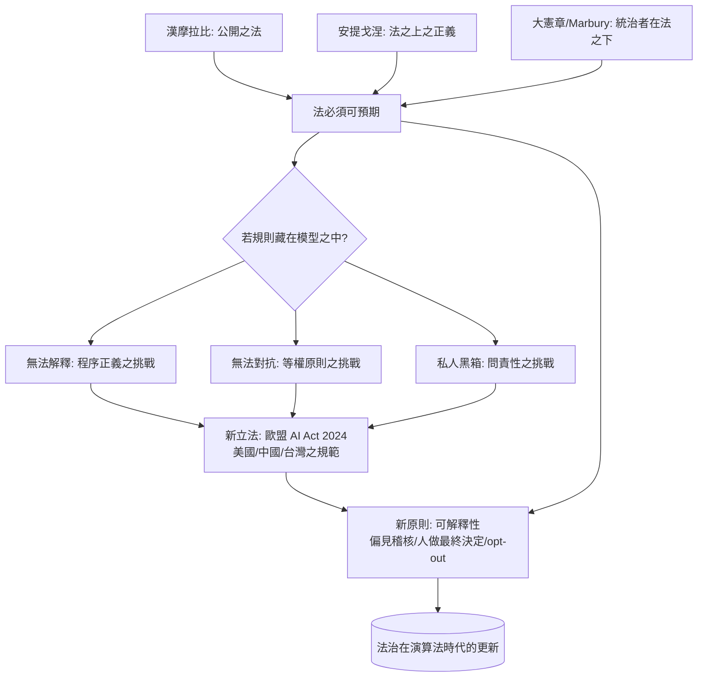

# 10.2 演算法偏見與未來的正義

「你的保釋金是……系統打出的分數是：高風險。」

2016 年，記者調查機構 ProPublica 發表了一篇石破天驚的報導〈Machine Bias〉。它分析了美國各州廣泛使用的一套量刑與再犯風險評估工具 COMPAS，得出的結論令人不安：這套演算法在預測再犯風險時，對黑人被告的「誤判為高風險」比例是白人的約兩倍，而對白人被告「誤放為低風險」（實際上再犯而系統判為低風險）的比例明顯較高。換句話說，這個由程式計算的分數，在美國的法院中被法官用來決定保釋、量刑與假釋，而它明顯地不平等地分配錯誤。

這篇報導既是數位時代的法律故事，也是一個老問題的科學化版本：當「判斷」被交給了一個黑箱，法治還剩下什麼？

## 先看清楚這些工具是什麼

美國的刑事司法系統中，被告在被判罪之前，往往需要被評估「再犯風險」：是否可以保釋？量刑應該多重？假釋的機會有多高？這些判斷傳統上依賴法官的直覺與累積經驗。自 1990 年代起，各州引入「風險評估工具」（risk assessment tools）：一種統計模型，輸入被告的年齡、犯罪紀錄、教育、就業、家庭狀況等指標，輸出一個風險分數。

COMPAS（Correctional Offender Management Profiling for Alternative Sanctions）是其中最有名的一款，由 Northpointe 公司（後併入 Equivant）開發。它的優點是把主觀判斷標準化，其普及面在美國多個州超過百年。但其問題正是 ProPublica 揭露的：它的訓練資料來自於過往的犯罪紀錄與司法結果；如果過往的警方檢控、檢方起訴、社區巡邏在黑人社區更密集，那麼模型「學到」的不是犯罪，而是警政資源之分布——偏見被數據化，再被演算法放大。在公司不服的說明與後續的學術研究中，這一結論並非一個簡單的是非：本質上，這在任何預測模型中都會出現的「基率不平等」與「公平定義不相容」（impossibility of fair calibration，Kleinberg 等人 2016 之著名定理）之間的困境——你不能同時滿足所有公平標準，除非基率相等。

2017 年，威斯康星州最高法院在 State v. Loomis 案中把 COMPAS 的問題推到了司法層面：被告 Loomis 主張，依其風險分數量刑時，COMPAS 之演算法源代碼不公開、其準確性不可檢驗，應屬正當程序之違反。法院維持原判，但裁定：法官不得「唯賴」演算法分數，必須在判決書中列入相關之警告（如 COMPAS 之性別與族裔差異），以確保裁決之非基本性。這是「演算法裁判」第一次被法院直接面對的著名案例。

## 但我們是誰：回顧憲政原則的智慧

從法治之大脈絡中，演算法繼承了幾個古老的原則，而這些原則在演算法時代面對新的挑戰：

一、可解釋性（大憲章→獲知法）。大憲章與推動法治上百年的這個原則是如此的具體：統治者之判斷應有源由、可追溯。今日之風險評估模型，其內部權重與決策路徑往往是私有的商業機密——被告不能知其分數來源，也無法提出挑戰。這是「法公開」原則在演算法上之挑戰。

二、非歧視（第十四修正案 + 《人權宣言》第 2 條）。無論是美國的平等保護，還是世界人權宣言，其核心是禁止基於族群之歧視。但一個「表面中性」之演算法（不含族群變數），卻可能因資料之偏差，而以群體之身分引出差距。這一啃咬已產生出新的法律尺度：歐盟《人工智慧法案》（AI Act 2024）把人事、司法、保釋、信用類之 AI 系統列為「高風險」（high-risk），要求其須進行公平性與透明度之評估；美國也已有地方性立法（如伊利諾伊州之 AI 影像分析法，及紐約市 2023 年之 Local Law 144）要求雇主對自動招聘工具進行獨立之偏見稽核。

三、正當程序（米蘭達之精神）。被告至少應知道何種判斷依據如何得來、有異議之機會。若判決含有一個不可解釋之商業模型，被告無法有效抗辯，就等於程序之剝奪——德國憲法與德國憲法法院早在 2010 年代就已判決「演算法不得成為行政裁決之最終依據」（如聯邦憲法法院 2020 年之「非法軟體評分」決定）。

四、司法問責（Marbury 之教訓）。法院之權力建立在「不站隊」的獨立性上。若一個私人公司之模型成為法官之影子顧問，誰是審判者？Loomis 案之原則是：分數只是「顧問」，不可取代法官之理由，此為「人做最終決定」（human in the loop）之原則。歐盟 AI Act 採取更強高的立場：司法領域之 AI 只可用於輔助研究與文件處理，不得用於個案之實質裁判。

## 演算法審判之深度問題

先暫時離開具體案例，從法哲學之層面問一個老問題在這裡的新樣式。

人判 vs 程判之對比，其實是一個十九世紀法學討論（刑事古典學派 vs 實證犯罪學派）的新樣貌：刑罰之基礎，是行為人之「應然責任」（古典學派，報應）還是「危險性」（實證學派，預防）？風險評估工具之出現，是「預防」之再一次強化：一個還未被定罪的人，已被依群體之統計而打分——這本質上是「基於群體之罪」的成本與效益重估。它讓我們重新面對十八世紀貝卡里亞之刑罰論：罪刑法定要求個人之行為，而非個人之「群體特徵」。

另一方面，演算法本身不是公權力之全然替代物。風險評估工具由法官參照，最終仍在法官手上；其意義在於使「不受檢驗之直覺」變為「可稽核之統計」。這也提醒我們：演算法未必比人壞，但它的「理解門檻」更高；問題的解決不在於「是否用 AI」，而在於「AI 如何被審查」。

## code is law？— 法治在演算法時代的方向

"Code is law" 是哈佛法學者萊斯格（Lawrence Lessig）1999 年《Code and Other Laws of Cyberspace》提出的著名說法：網路空間的架構（代碼、加密、協議）本身就構成了實質的規制力量，比國家的書面法更深、更難更變。二十多年後，這一命題有了新的重要性：

* 平台治理比內國法更日常：社交媒體之社群規則、集貨平台之判責機制、跨境支付之 KYC，已成為普通人一天中面對最多之「規則」。
* AI 模型之輸出即「行為準則」：當招聘工具篩選履歷、信用模型決定貸款、量刑模型輔助判決，模型之內部標準就直接成為個人命運之判準，而不必有任何人「立法」。
* 這樣一來，rule of law 之含義必須被更新：不僅「國王在法之下」，而且「工程師在法之下」——模型之訓練資料、目標函數、驗證程序，都須具備公開性、可解釋、可異議、可修正。

從制度看，全球已在多個戰線上作回應：歐盟 AI Act（2024，全球第一部綜合性 AI 法）、中國之《算法推薦管理規定》（2022）與生成式 AI 管理暫行辦法（2023）、美國以各州法與聯邦之行政命令進行（2023 年之行政命令、2025 年後續立法）、台灣則採生成式 AI 管理指引之構想（2023）。這些制度雖然形式不同，共享一個底層思想：把演算法與其他技術同樣地，置於「有規則、可追責、可透明」之範圍之外。

## 從古巴比倫到演算法：兩條線的交會

## 小結

法治不是一個歷史博物館的文物；它是一組在每一代技術面前被重新檢驗之原則。演算法與生成式 AI 帶來的挑戰，在結構上與過往相同：正義之來源在哪裡？統治者是否受規則之拘束？程序是否在實體之前？惡的「技術立法」是否可以不計正義地面對人民？

本書從巴比倫的石柱開始，以演算法與形成中AI之司法準則作結——是一條長而曲折的線，但方向卻一貫：讓權力減少任意、讓規則有界、讓正義可以被言說。當代法學面對之不僅是新的問題（基因、演算法、氣候），而是兩千年同樣的一組問題在新之地基上的重寫。這也許是法學故事真正的長壽：因為它所問的問題，每代人都要重新問一次。
