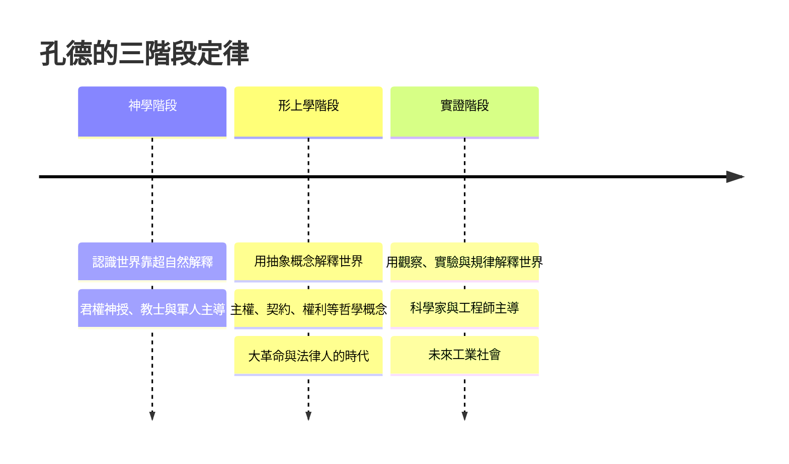

# 1.3 孔德與「社會學」的命名：實證主義的曙光（1830 – 1842）

1838 年，巴黎一位失業的前家庭教師在他的《實證哲學教程》第四卷裡，隨手造了一個新字：Sociologie。拉丁文的 socius（社會）加上希臘文的 logos（學問）。這看起來只是個命名儀式，實際上卻是一門新科學的出生證明。這個人叫奧古斯特·孔德（Auguste Comte, 1798–1857）。他曾當過空想社會主義大師聖西門的秘書，後來與師父鬧翻翻臉成仇，獨立收下那一整套「用人類科學重組社會」的構想，把它定調成「實證主義」（Positivism）。

## 一個受挫的數學尖子

孔德的人生起初順到發光：他考進巴黎綜合理工學院（École Polytechnique），那是拿破崙時代法國科學的最高學術殿堂，而且入學成績名列前茅。但王朝復辟時期學校整頓關閉重組，他失去學籍，此後一生找不到正式教職，靠寫作、演講與私人資助維生。1820 年前後他發表的一系列論文（如《重建歐洲社會的哲學工作》）已勾勒出後來的思想，卻應者寥寥。

更戲劇性的是 1826 年：他公開開講「實證哲學」系列課程，才講到第三堂就精神崩潰中斷。剛結婚的妻子卡羅琳（Caroline Massin）幾乎撐起那個家，他自己則陷入嚴重憂鬱。1827 年他全身綁上石頭投塞納河自殺，被救起。（有趣的是，這位後來主張「科學地研究社會」的人，自己就撞上了個人社會連結斷裂最激烈的形態——這正是六十年後涂爾干要在《自殺論》裡分析的主題。）

好轉之後，他重起爐灶：1829 年重新開講，講稿陸續出版為《實證哲學教程》六卷（1830–1842）。1832 年他終於得到一份賴以維生的工作——重返母校擔任入學考生複習課的講師，職位低微、薪俸不定，一做就是十二年。1830 年代末，他經由學生的介紹結識了克洛蒂爾德·德·沃（Clotilde de Vaux），一位分居中的年輕女性、業餘寫作者。這段精神上的深愛在她 1846 年病逝後戛然而止；孔德自此轉向「人性宗教」——這是他晚年最爭議的一段，後面再談。

## 三階段定律：社會學的「牛頓式」宣言

孔德體系的核心是「三階段定律」（Law of Three Stages）。他主張人類認知的發展分三代：

他認為每門科學都會先後走過這三代，而「最複雜、最一般」的科學——社會學——最後才達到實證階段。這是他著名的「知識階梯」（hierarchy of sciences）：數學最先成熟，然後是天文、物理、化學、生物，社會學殿後。社會學不是比其他科學更高貴，而是更晚熟。

「實證」這個字，孔德的意思是「以觀察到的、可用實驗與比較確認的事實為基礎」。他對當時的政治哲學感到絕望：革命派與蜂起的各種主義都在空談「權利」，根本不對社會「事實」負責。他說：只有先「了解」（savoir）社會的規律，才能「預測」（prévoir）社會，最後才談得上「引導」（guider）社會。這句「Savoir pour prévoir, prévoir pour pouvoir」成為日後所有社會科學的座右銘。

## 失敗之處：他是啟蒙的恩人，也是還債人

孔德的理論有幾個嚴重的問題。

第一，他的「科學」基本是空談。他對當時法國的統計、人口資料、遍地可見的「社會物理學」僅有粗淺接觸。稍早，比利時天文學家凱特勒（Adolphe Quetelet）1835 年出版《論人》，用機率論研究犯罪率與婚率，發現「犯罪與自殺在人口平均數下驚人地穩定」——這才是社會學統計的真正起點，但孔德沒有跟進，他反而譏笑「社會物理學」這個字被凱特勒「不合法地」拿走了。（沒錯，孔德原本想用的名字，後來被凱特勒用走了，他才被迫現造 Sociologie。）

第二，他晚年走火入魔。1840 年代失業又貧病，克洛蒂爾德死後，他宣佈成立以愛、秩序與進步為核心的「人性宗教」（Religion de l'Humanité），自任大祭司，設計了曆法、聖徒名錄（名單裡有笛卡爾、腓特烈大帝、亞當·斯密等）與一整套儀式。信徒寥寥，卻在巴西意外發芽：巴西國旗上的格言「秩序與進步」（Ordem e Progresso）正是出自孔德；巴黎的「人性聖殿」（Temple de l'Humanité）至今仍在，門可羅雀。

第三，他對女性的看法極端守舊，把「情感與家庭」歸給女性、「智慧與科學」歸給男性——這在當時讓聖西門主義者、傅立葉的信徒看到都搖頭。

對他的重新評價是十九世紀後半才有的：英國的約翰·史都華·密爾早年極力推崇他，成年後摔了心儀教科書；涂爾干一方面肯定「社會學的獨立地位」，一方面完全不認同他「造新宗教」的怪癖。馬克思則更狠：他與孔德同時代，卻把實證主義描述成「資產階級的自我圖像」。

## 一門新科學的出生登記

歪打正著的是，孔德用「科學規律」把舊世界與新世界的秩序問題綁在了一起。他留下的正面遺產有三個：一是「社會可以做為科學研究的對象」這個觀念本身；二是「實證」——先觀察、後理論、可比較、可驗證的方法論承諾；三是「分工是工業社會的凝聚力來源」這個供後人大量借用的基本命題。

孔德 1857 年死於巴黎的公寓，妻子先前已離開他，門徒把他的骨灰葬在墓園中的拉雪茲公墓。可吊詭的是：社會學真正的第一波影響力，不在巴黎，而在倫敦。下一章，陪伴這門科學最關鍵的四、五十年時間，就要看英國人赫伯特·斯賓塞，如何把生物學新學說「適者生存」拉進人類社會——引發一場今天還沒結束的爭議。
