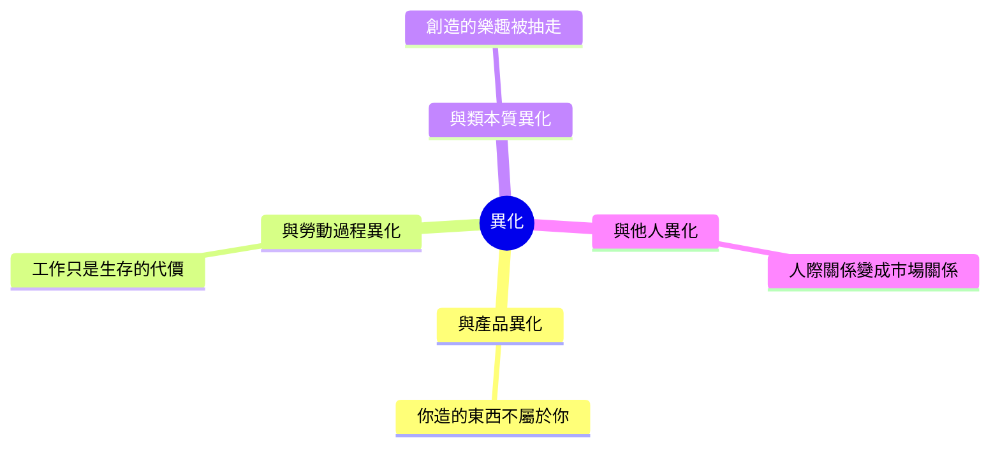

# 3.2 資本論：剩餘價值與異化（1867 – 1883）

《資本論》副標題是「政治經濟學批判」。馬克思不是要寫一本經濟學教材，而是要拆掉一個體系：亞當·斯密與李嘉圖相信自由市場會自動給人和諧的秩序，馬克思相信這套和諧論本身就是幻覺——市場的每一分效率，都建立在一種隱形的剝削上。他給這種剝削起了一個精準的名字：剩餘價值（Mehrwert / surplus value）。

## 剩餘價值的偵探小說式的推論

馬克思的推理路徑像偵探小說，一步步逼近真相：

- 亞當·斯密留下了一個謎：如果所有交換都是等價交換（各自按合理價格買賣），利潤從哪裡來？
- 李嘉圖以勞動價值論答覆：商品的價值由「社會必要勞動時間」決定。
- 馬克思接手這個答案，再對準它：如果勞動是價值的源頭，那資本家在市場上買的到底是什麼？答案是「勞動力」（Arbeitskraft）本身，而不是「勞動」。工人賣出的是一天十小時的勞動能力，但薪資只需覆蓋勞動力再生產（吃飯、住屋、養育下一代）的成本，例如四小時。
- 中間那六小時的產出，就是剩餘價值，落入資本家口袋——這便是利潤的來源。

這就是剝削的定義。它不需要暴力、不需要詐欺：在完全自由競爭的市場裡，剝削照樣成立，這才是馬克思理論真正嚇人的地方——錯的不是某個壞人，而是制度本身。

## 異化：工作的喪失

馬克思年輕時（1844《巴黎文稿》）已經提出一個更抽象也更觸動人心的概念：異化（Entfremdung / alienation）。在資本主義的生產方式下，工人與產品的四條紐帶同時被切斷：

異化不是「心情不好」這種主觀感受，它是一種結構狀態：即使工廠燈火通明、工資準時發放，人們每天仍必須與自己的創造性勞動分離。用今天的話講：上班不是生活，上班是為生活付的代價。這個概念至今仍被大量借用，從流水線工廠到「996 工作制」的討論，本質上都是異化的語言。

## 從商品到機器：整個社會的邏輯

《資本論》第一卷的結構，是從一個小小的起點——「商品」（Commodity）——出發，逐層展開整個社會形式：

- 商品有兩重性：使用價值（對人有用的部分）與價值（凝結的社會必要勞動時間）。
- 貨幣是商品交換的普遍等價物，它解放了交換，也讓「M–C–M′」（錢 → 商品 → 更多的錢）的資本循環成為可能。
- 資本家把錢投入「生產資料 + 勞動力」，工人活化著生產資料；資本積累的內在驅動力是「無止境地增殖自身」。
- 為了增殖，資本不斷提高生產力：機器、分工、科層化——這有兩面：一面降低單位成本、消費品便宜化（就像今天的智慧手機），另一面是對工人的嚴酷壓迫（加班、童工、事故率）。
- 週期性的生產過剩、競爭淘汰與勞動後備軍（失業人口構成資本的「產業後備軍」），使資本主義呈現出景氣與危機交替的律動。

這些構想不是哲學空談。馬克思引用的英國工廠稽查報告，連英國議會議員讀了都受到震動；1867 年英國通過工廠法，將婦女與少年的工時限制為十小時（「十小時工時法案」），這正是工人運動數十年鬥爭的成果，也是《資本論》第一卷出版那一年。

## 「資本主義自我毀滅」的預言：為何沒有實現？

馬克思的致命推論是：資本有機構成上升、利潤率下降、階級對立擴大、最後崩潰並被社會主義取代。然而二十世紀西方資本主義的走向，恰恰相反——工人合法組織（工會）、普選、社會保險（1883 年德國俾斯麥創立世界第一套社會保險制度，其黨派動機之一正是收編工人票緩和社會主義）、再加上帝國殖民把矛盾外移，讓西歐資本主義活了下來，而且是相對穩定地活了過來。

社會學如何看待這一段？下一節，我們看馬克思的遺產：一方面，他對結構性不平等的敏銳，被整個社會學繼承；另一方面，他那套「一階邏輯」式的預言，反倒放出了二十世紀政治光譜上最激烈的火藥。
