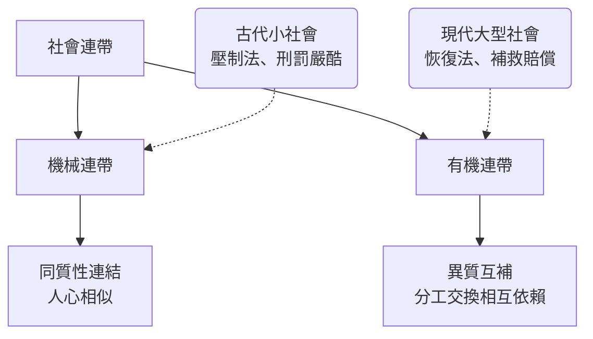

# 4.1 涂爾干與「社會事實」：社會學的第一份方法論宣言（1893 – 1895）

如果說馬克思是社會學的「矛盾引擎」，那愛米爾·涂爾干（Émile Durkheim, 1858–1917）就是社會學的「建制工程師」。他是第一個讓社會學在大學裡站穩腳步的人：創學系、辦期刊、訓練世代、建立方法論。今天世界上任何一門社會學概論的第一章，幾乎都是從涂爾干教起——因為他回答了這門新學科最急迫的問題：憑什麼說「社會」是真實存在的東西？

## 從猶太拉比之家到波爾多大學

涂爾干出生於法國阿爾薩斯－洛林的埃皮納勒（Épinal）一個猶太拉比世家，祖父與父親都是拉比，家族預期他繼承衣缽。他少年時卻轉向理性主義（他後來自述一度經歷極深的憂鬱），讀巴黎高等師範學院（École normale supérieure，1879 入學），當時的法國知識圈正沉浸在普法戰爭（1870 年戰敗）的整體挫敗之中：帝國垮了、共和不穩、社會主義運動興起、教會與共和派的鬥爭白熱化。涂爾干一生最關心的問題是：共和國要靠什麼團結？

他的學術之路克難。1882 年起先在塞納省的中學教哲學，1885–86 年獲公費留學德國，走訪柏林、萊比錫的實驗心理學與社會科學機構（包括馮特的實驗室與民族心理學的相關機構），回國後大力呼籲法國引進一門「社會科學」。1887 年，波爾多大學文學院為他設立了法國第一個社會學課程教席；1902 年他轉到巴黎大學（索邦），1906 年正式取得社會學教授職位。

## 《社會分工論》：社會學的第一本經典

涂爾干的第一個大動作，是 1893 年的博士論文《社會分工論》（De la division du travail social）。他對斯賓塞提出了針鋒相對的反駁：斯賓塞說分工是為了追求個人利益，涂爾干說「個人利益若只靠自身，人類根本無法和平相處，分工是為了讓人們得以彼此依賴，從而產生團結」。

他做了一個雙向的分類：

- 機械連帶（mécanique）：共同體社會裡，人和人相似，抱著同樣的信仰與習慣，團結靠「同」；法律的型態是壓制型——你怎麼能傷害集體的情感，就刑罰你，報復要嚴酷。
- 有機連帶（organique）：現代社會裡，人人職業不同、各自專長，團結靠「異」——你有我沒有，我需要你；法律型態是恢復型——契約、賠償、民事訴訟，重點是讓系統恢復運轉，不是報復。

這不是歷史的浪漫化，他真的用法律的資料印證：古代法典與現代法典的條文比例、刑罰與賠償條款的比重差異。這是社會學第一次大規模用「制度證據」來支撐理論。

## 《社會學方法的準則》：社會事實是「物」

1895 年的《社會學方法的準則》（Les Règles de la méthode sociologique）把方法論完整寫出。核心只有一句話，但極具爆破力：

> 「社會事實是物。」（Les faits sociaux sont des choses.）

涂爾干說，一個社會學家面對的現象——法律、習俗、語言、道德、思潮——互相都有「外部徵候」，而且對個人有强制性（你逃不掉它們的作用力）。它們可以用經驗方法觀察、分類、比較，就像物理學家面對物體。社會學的第一個規則是：必須把社會現象當成「物」來研究，不能用日常感受或心理本能去解釋。進一步：解釋一個社會事實，必須用另一個社會事實（不是用個人的心理、不是用生物本能）。

同一年，他創辦《社會學年鑑》（L'Année sociologique，1898 年創刊），組織一個年鑑學派團隊，把人類學、宗教學、法律比較研究都塞進社會學的研究範疇——這成為日後法國社會學學派的大本營。

涂爾干的方法論被批評的有兩點：一是「物」這個說法造成大量誤讀（有人以為他想說社會事實是「實體物質」，其實他意在「可觀察、可經驗研究」的對象）；二是他對因果推論的操作細節與當代統計方法的距離。即便如此，「社會事實」的概念至今仍是社會學課本的第一課——它告訴我們：每個人的行為背後，都站著一個「看不見的社會」。

這個方法論的第一次大規模應用，就是《自殺論》。下一節，我們走進十九世紀末的歐洲統計局的資料間，看涂爾干如何用國家統計資料，擊碎「自殺是純個人的事」的常識。
