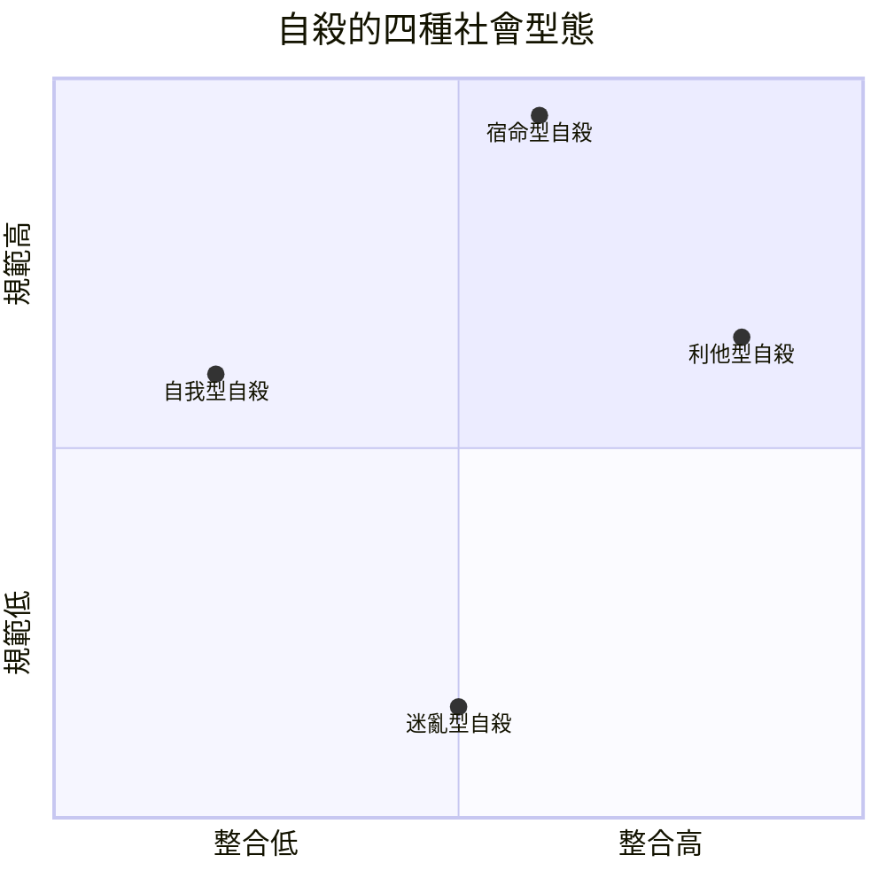

# 4.2 自殺論：最個人的行為，最社會的原因（1897）

1897 年，涂爾干出版《自殺論》（Le Suicide）。這本書的副標題洩漏了它的野心：「一項社會學研究」。如果涂爾干要證明「社會事實是物」，那沒有比自殺更好的檢驗場——自殺在一切文化裡都被理解成最私密、最自主的選擇，是人自己決定自己的生死。如果連這種行為都服從社會規律，那還有什麼是社會學不能研究的？

## 為什麼自殺率會「穩定」？

十九世紀的歐洲，各國統計局已累積了幾十年的人口與自殺登記資料（普魯士從 1816 年就有完整統計，法國、丹麥、義大利、奧地利等都有多年序列）。義大利統計學家莫塞利（Enrico Morselli）1879 年出版的《自殺論》已是一份厚重的跨國比較研究（涂爾干大量參考了他的資料，也在方法上與他抗辯）。涂爾干看出了資料中的幾個驚人事實：

- 自殺率跨年度極為穩定。某些地區的年度自殺人數波動極小，像是被一條看不見的韁繩拉著。
- 自殺率與季節、緯度有關係：夏季較高（這不是因為冷或者曬太陽，而是與社會活動節奏相關）。
- 不同國族差異極大：北歐、德國某些郡自殺率極高，義大利、西班牙極低。
- 關鍵是：自殺率不隨心理認知的常識解釋而動——個人的精神疾病、自殺動機、家庭糾紛，無法解釋「為什麼這個地方比那個地方高五倍」。

如果自殺純粹是個人心理事件，那它應該是隨機的。但它不是。它呈現規律性、地區性、季節性。涂爾干的結論是：自殺率（taux de suicides）本身是「社會事實」——它存在於個體之外，它由集體的結構決定。

## 三種自殺類型

涂爾干進一步用兩個社會變數來切割類型：社會整合度（你被群體接納的程度）與社會規範度（群體對你的期望與約束程度）。這兩個向度交織，推出三種主要類型（後人常補上第四類）：

- 自我型（égoïste）：整合過低。個人被孤立，缺乏集體紐帶。研究顯示未婚者、獨居者、失業者自殺率高；天主教社群自殺率低於新教社群（新教強調「個人直接面對上帝」，共同體也更強調個人判斷——這在涂爾干讀來是更弱的集體調控）。
- 利他型（altruiste）：整合過高。個人完全被群體吞噬，個體生命不被算數。典型案例是軍隊、傳統社會裡的寡婦殉葬；現代則如恐怖攻擊中的殉難、或者命定殉從者的自殺。
- 迷亂型（anomique）：規範過低。當社會快速變動——革命、經濟崩盤、急速發財——原有的道德標尺失效，慾望失去規矩。涂爾干發現：經濟崩潰時自殺率升高（並非因為貧窮本身，而是因為「失去秩序」）。這就是著名的「迷亂」（anomie，也有譯「失序」「脫序」）。
- 宿命型（fataliste）：規範過高，個人被壓到失去自主。涂爾干只以奴隸與一名囚犯為例附註一筆，篇幅極小，但這一型後來被廣泛借用（例如監獄人口的討論）。

## 強制閱讀的結論：「社會是自成一格的存在」

《自殺論》最後的推理是：既然自殺率穩定、可預測、隨社會結構變動，那它就是一種社會性產物。涂爾干因此提出「自成一格的存在」（être de choses sui generis）：社會不是個人的總和，是一種獨立的存在層次——如同分子不是原子的總和，分子有自己的性質。這是「結構主義」思想的遠祖，也是社會學獨立於心理學與經濟學的根基。

這本書在當時的迴響分成兩路：統計學與社會調查的人，把「用社會調節自殺率」當成公共政策的課題（涂爾干本人在結尾動情地呼籲重建職業團體與共同體）；而個人人格論者與心理學者，認為「自殺是社會決定的」是失控的簡化。這場爭論持續到二十一世紀——今天的精神醫學與社會流行病學，大致採取了折衷的立場：生物、心理、社會三層互動。但涂爾干立下的命題「增加社會連結能降低自殺風險」，是當代公共衛生學中被廣泛檢驗過的假說。

## 一個時代的注腳

《自殺論》出版二十多年後，涂爾干親身撞上書中的巨響：1914 年一次大戰開打，他獨生子安德烈從軍，1915 年死在塞爾維亞前線。涂爾干此後不出書齋的目光轉向戰後的道德重建與對「德國心態」的批判文章，1917 年在巴黎病逝。他一生最後一次觸及「迷亂」這個主題，正是談自己孩子所在的戰爭世代。

下一節，我們看涂爾干的另一側面：《宗教生活的基本形式》如何把「神聖」變成社會學的核心概念，以及他與韋伯的宗教對話如何擦出火花。
