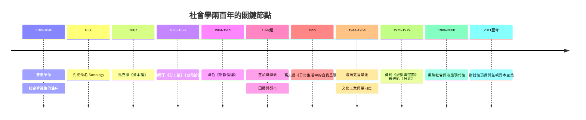

# 社會學的故事：從工業陣痛、現代性迷思到演算法社會

本書講述社會學如何從「雙重革命」（法國大革命與工業革命）造成的社會失序中誕生，經過馬克思、涂爾干、韋伯三大奠基者的理論工程，一路擴展到解構權力、性別、階級與消費文化，最後走向二十一世紀的演算法與孤獨社會。

全書圍繞四大核心提問演進：

1. 結構 vs. 主體：是社會結構決定了我們，還是我們的選擇創造了社會？
2. 秩序 vs. 衝突：社會靠什麼連結？還是本質上就是權力與資源的博弈？
3. 宏觀 vs. 微觀：從國家、階級與全球化，到眼神接觸與舞台表演。
4. 現代性的雙刃劍：理性與效率帶來自由，也帶來異化、鐵籠與孤獨。

---

## 第一篇：雙重革命與社會學的誕生（18 世紀末 – 19 世紀中）

* 第1章-撕裂的舊秩序與實證主義的曙光
    * [1.1-雙重革命的風暴](01.1-雙重革命的風暴.md)
    * [1.2-空想社會主義的先行者](01.2-空想社會主義的先行者.md)
    * [1.3-孔德為社會命名](01.3-孔德為社會命名.md)

* 第2章-社會有機體與適者生存
    * [2.1-斯賓塞的社會有機體](02.1-斯賓塞的社會有機體.md)
    * [2.2-社會達爾文主義的爭議](02.2-社會達爾文主義的爭議.md)
    * [2.3-現代性衝擊的回應](02.3-現代性衝擊的回應.md)

## 第二篇：三大奠基者與現代性大辯論（19 世紀末 – 20 世紀初）

* 第3章-資本主義的黑洞與階級密碼：馬克思
    * [3.1-馬克思的時代與人生](03.1-馬克思的時代與人生.md)
    * [3.2-資本論：剩餘價值與異化](03.2-資本論：剩餘價值與異化.md)
    * [3.3-歷史唯物主義與遺產](03.3-歷史唯物主義與遺產.md)

* 第4章-自殺率背後的無形紐帶：涂爾干
    * [4.1-涂爾干與社會事實](04.1-涂爾干與社會事實.md)
    * [4.2-自殺論：最個人的行為最社會](04.2-自殺論：最個人的行為最社會.md)
    * [4.3-宗教生活與涂爾干的遺產](04.3-宗教生活與涂爾干的遺產.md)

* 第5章-科層制與資本主義的清教精神：韋伯
    * [5.1-新教倫理與資本主義精神](05.1-新教倫理與資本主義精神.md)
    * [5.2-合理化與鐵籠](05.2-合理化與鐵籠.md)
    * [5.3-科層制的當代迴響](05.3-科層制的當代迴響.md)

## 第三篇：微觀世界、芝加哥學派與日常生活的社會學（20 世紀初 – 1950 年代）

* 第6章-大都市的陌生人與微觀互動
    * [6.1-齊美爾的大都會與貨幣哲學](06.1-齊美爾的大都會與貨幣哲學.md)
    * [6.2-芝加哥學派與田野調查](06.2-芝加哥學派與田野調查.md)
    * [6.3-都市社會學的深水區](06.3-都市社會學的深水區.md)

* 第7章-社會是一座大舞台：符號互動與戲劇論
    * [7.1-米德與符號互動論](07.1-米德與符號互動論.md)
    * [7.2-高夫曼的戲劇論](07.2-高夫曼的戲劇論.md)
    * [7.3-標籤理論與經典個案](07.3-標籤理論與經典個案.md)

## 第四篇：結構、法蘭克福學派與符號消費（20 世紀中 – 20 世紀末）

* 第8章-大眾文化的大腦洗禮：法蘭克福學派
    * [8.1-法蘭克福學派的流亡誕生](08.1-法蘭克福學派的流亡誕生.md)
    * [8.2-文化工業](08.2-文化工業.md)
    * [8.3-單向度的人](08.3-單向度的人.md)

* 第9章-權力、微觀監控與文化資本
    * [9.1-傅柯的規訓與懲罰](09.1-傅柯的規訓與懲罰.md)
    * [9.2-權力知識與生命政治](09.2-權力知識與生命政治.md)
    * [9.3-布迪厄的文化資本與品味](09.3-布迪厄的文化資本與品味.md)

## 第五篇：後現代、風險社會與演算法時代（1990 年代 – 今日）

* 第10章-流動的現代性與風險社會
    * [10.1-貝克的風險社會](10.1-貝克的風險社會.md)
    * [10.2-鮑曼的液態現代性](10.2-鮑曼的液態現代性.md)
    * [10.3-結構與行動的和解](10.3-結構與行動的和解.md)

* 第11章-演算法同溫層、監視資本主義與孤獨社會
    * [11.1-群體性孤獨](11.1-群體性孤獨.md)
    * [11.2-監視資本主義與演算法](11.2-監視資本主義與演算法.md)
    * [11.3-孤獨社會的未來提問](11.3-孤獨社會的未來提問.md)
