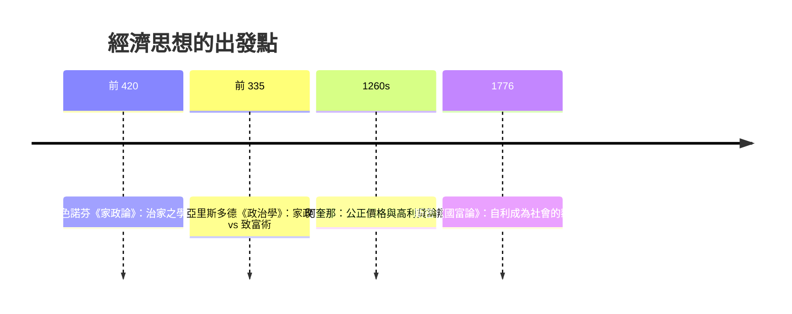

# 1.1 亞里斯多德：家政與致富術之分

## 從一個希臘詞說起

英文的 Economics、法文的 Économie、中文的「經濟」，全都來自同一個古希臘詞 oikonomia。這個詞由 oikos（家）與 nomos（法則、管理）組成，意思是「家庭的管理」。對今天的我們來說，這幾乎不可思議：經濟學現在研究的是 GDP、股市、全球貿易與演算法市場，怎麼會起源於「家務管理」？

要理解這一點，必須回到西元前四世紀的希臘城邦。那時沒有民族國家，沒有全國性的經濟政策，更沒有專門研究「經濟」的學科。城邦（polis）是由一個個家庭（oikos）組成的政治共同體。每個家庭是一個生產單位：有田地、牲畜、奴隸，男人務農或經商，女人管理儲藏與紡織。所謂的經濟活動，首先就是讓這個自給自足的單位運轉良好——所以古希臘人說的「經濟學」，就是「治家之學」。

## 色諾芬與《家政論》

最早把「治家」當成一門學問來寫的，是蘇格拉底的學生色諾芬。在他的《家政論》（Oikonomikos）裡，他用對話形式記錄了一位雅典紳士如何教導妻子持家：如何管理糧倉、如何安排奴隸工作、如何讓作物生長得更好。有趣的是，色諾芬甚至提到，波斯國王曾把各省的豐饒與繁榮當成自己治理得法的功績來誇耀——治理愈大、愈多的田園，愈是榮耀。這等於是把「治家」的技術放大到「治城」的層級，但重心仍然停在「管理」與「富足」上，而不是「賺錢」。

## 亞里斯多德關鍵的一刀

真正讓這門學問有了靈魂的，是亞里斯多德。他在《政治學》第一卷裡做了一個影響西方兩千年的區分：

1. 家政（Oikonomia）：為了滿足生活的需要而進行的交換與管理。它的終點是有界的——當一個家庭夠用了，就達成了目的。
2. 致富術（Chrematistics）：以累積金錢本身為目的的活動。它的終點是無界的——錢永遠可以更多。

亞里斯多德認為，前者是自然、合理、值得讚美的；後者是「不自然」的，就像醫學的目的應是健康，若醫生無限追求收費，便背離了醫學的本義。換句話說，在他眼中，財富是手段，良好的生活（eudaimonia）才是目的。

他特別批評的一種致富術，是「錢生錢」。這在當時有一個具體的様貌：利息。亞里斯多德在《政治學》裡說，貨幣本來是為了交換而設的，但收取利息讓貨幣「生出了貨幣」，這是最違背自然的發明。這句話成為之後一千多年歐洲禁止高利貸的思想源頭（見 1.2）。

身為亞里斯多德老師的柏拉圖對交易同樣抱持戒心。他在《國家篇》中設想理想城邦時，嚴格限制工商階層的政治參與；而在《法律篇》裡，他更主張對糧食等必需品的買賣設立價格規範，認為開放討價還價必然滋生欺騙。這種對「交易會敗壞人心」的擔憂，同樣成為中世紀公正價格論的思想來源之一。

## 為什麼要從道德談起？

今天我們習慣把「賺錢」和「道德」分開談，認為市場有市場的規則。但這套「分離」要到亞當·斯密與十八世紀才逐漸形成。在此之前，歐洲的主流想法一直是亞里斯多德式的：經濟活動嵌在共同體與倫理之中，賺錢只是為了過好生活的一個環節，任何超出「滿足需要」的金錢追求，都必須交給道德法庭審判。

## 留下的問題

亞里斯多德留下了一道往後兩千年都沒有完全關閉的裂縫：如果所有人都同意金錢不是目的，那麼如果有一種制度，能讓每個人「不自覺地」追求自身利益，同時促成了公共的更多的財物——這樣的制度，算不算道德？這是斯密在一千九百年後將要回答的問題。而在那之前，歐洲先要等過一段以農業、封建與基督教為骨架的時代——經濟思想會在修道院的小室裡被重寫。
