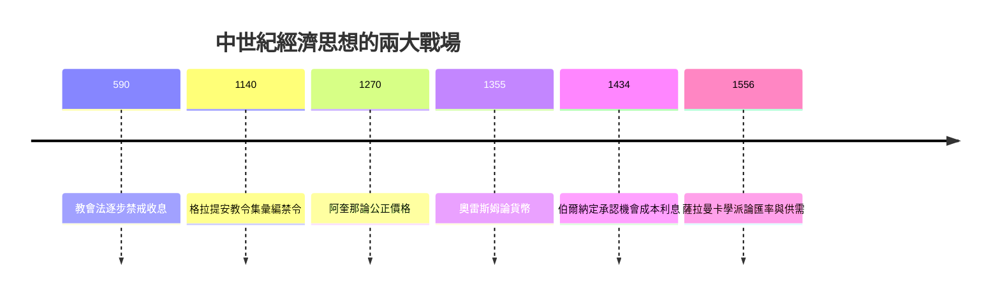

# 1.2 高利貸與公正價格：中世紀的道德經濟學

## 一個幾乎沒有「經濟學家」的時代

西羅馬帝國崩潰之後，歐洲的商品流通大幅萎縮，道路失修、貨幣劣化、城市凋零。西元的頭一千年裡，經濟思想的重心從希臘羅馬的城邦轉到修道院與主教座堂。這一千年的特點是：經濟問題不被當成「經濟」問題，而是神學與道德問題。寫下這些問題的人，幾乎全是神學家。

支撐這個時代的制度是封建制：土地層層分封，農民綁在土地上繳付勞役與實物；教會擁有龐大莊園，同時是最大的土地主人；「公平」與「正當」的標準不來自市場，而來自聖經、教父著作與自然法傳統——也就是亞里斯多德經由穆斯林學者（如阿維森納、伊本·魯世德）與猶太學者翻譯、註釋後重新流入拉丁歐洲的那個傳統。

## 中世紀商業的復甦與新問題

從十一世紀起，事情開始變化。十字軍東征打開了地中海的商路，義大利的威尼斯、熱那亞、佛羅倫斯城邦崛起，香檳伯爵領地的市集（香檳市集）串連起佛蘭德斯的呢絨與地中海的香料。復甦的商業要求兩樣舊道德體系極不舒服的東西：大額借貸，以及遠距定價。

於是兩個古老的問題重新浮上檯面，而這一次必須由最有學術權威的人來回答。

## 高利貸：一條慢慢被侵蝕的禁令

「利息」在拉丁文中稱 usura，即「使用費」——借出之物被使用應有的代價。教會立場早在教父時代就已明朗：聖巴西略、聖安波羅修、哲羅姆都譴責放貸收息；聖奧古斯丁視之作罪。此後歷次宗教會議（如 1179 年第三次拉特朗大會議、1311 年維埃納大會議）再三確認：基督徒之間收取高利貸者，不得領受聖事、不得葬於教會墓地。1119 年起，聖殿騎士團曾以「保管」名義替朝聖者匯兌，但「收息」本身仍是禁忌，於是猶太人（不受教會法約束）與倫巴第人、卡奧爾人等被半推半就地推入放貸這個人人需要、人人鄙視的行業。

這段歷史最耐人尋味的地方，是這條禁令如何在實務中被一層層「合法繞道」掏空：以「合夥」代替借貸，讓放款人分享利潤；以「匯票」跨幣別、跨城市把利息藏進匯率；以「違約罰款」名目收取本應收取的息金。到了十三世紀，像佛羅倫斯的美第奇家族這樣收息的銀行家，依然捐錢辦醫院、修教堂、資助藝術，以求道德上自圓——尼德蘭畫家昆丁·馬賽斯的《錢莊主與其妻》（1514）正是這種矛盾心理的寫照：畫中夫妻一面點算錢幣，一面望著攤開的宗教畫，目光在金錢與聖像之間游移。

到了十五世紀，方濟各會士奧雷斯姆與聖伯爾納定才開始有條件地承認：出借資金若使債權人承擔風險、損失機會（poena damni emergens、lucrum cessans），可收取適度報酬。商業資本主義就這樣在神學家的讓步中長出了最初的根系。

## 公正價格：市場價格最早的一次理論化

第二個問題是價格。買賣雙方該以什麼價成交才不致於「欺騙」？答案由十三世紀最偉大的經院哲學家托馬斯·阿奎那給出系統形式。他在《神學大全》中承襲亞里斯多德「交換正義」的框架，提出三個關鍵論點：

1. 等價交換：買賣應以「公正價格」（justum pretium）進行，多取或短給都是對交換正義的違背。
2. 商品有用性決定價值：公正價格既取決於商品的內在有用性，也貼近於共同體中「通行」的價格——阿奎那說得相當務實，允許隨時間、地點與風險做合理的調整。
3. 需求急迫時必須克制：若明知對方急迫（比方說漲大水時賣屋、歉收時賣糧），趁機抬高價格就是不義——這正是今日法律裡「暴利」「哄抬物價」條文的遠祖。

經院學者後來在十六世紀的薩拉曼卡學派手中更進一步：他們承認公正價格會隨供給與需求、貨幣數量與匯率而變動，甚至明確指出「物以稀為貴」、「人多價高」。這已經離現代需求理論只差臨門一腳，只是這一腳他們始終沒有踢出——因為對他們而言，價格首先是倫理問題，其次才是技術問題。

## 一張時代的轉折圖

## 留給後世的兩項遺產

把我們今天看來「陳舊」的中世紀道德經濟學翻過來看，它其實留下了兩項延續至今的遺產。第一，它最早把交換行為建成了一門可以推理的「科學」——大學教育裡的經院辯論培養了一整套嚴密的邏輯工具，日後邊際學派的收入效用分析、均衡分析，形式上都是經院邏輯的後代。第二，它把「價格公平嗎」、「利息正當嗎」烙進了西方制度的良知；幾百年後，糧價管制、消費者保護、金融監管的政策辯論，仍會反覆聽見亞里斯多德—阿奎那的迴聲。

但是中世紀的答案終究屬於一個以土地與教會為中心的世界。當能力更强的遠洋帆船把整個地球串成一個市場，當金銀從新大陸源源不絕湧入歐洲，當民族國家開始動用整個官僚機器追求「國家致富」——一套完全不同的經濟思想，重商主義，就要登場了。
