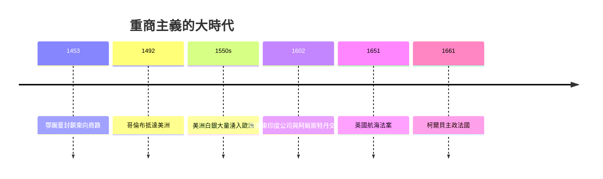

# 2.1 重商主義：大航海時代的國家致富術

## 當「國家」第一次思考「經濟」

中世紀歐洲的財富藏在莊園與行會裡，國王本身常常窮得可憐，靠著王室領地的租金過活，要打仗還得向地方議會借錢。但從十五世紀末開始，一切都變了。1453 年鄂圖曼帝國攻陷君士坦丁堡，傳統的東方香料貿易路線被掐住咽喉；1451 年古騰堡改良活字印刷術，讓思想與情報以前所未有的速度流動；更重要的是，1492 年哥倫布抵達美洲，1498 年達伽馬繞過好望角抵達印度。地球第一次成為一個可以航行的整體市場。

同時，英法百年戰爭（1337–1453）結束後，英格蘭、法蘭西逐漸凝聚成中央集權的民族國家，西班牙更是透過與天主教會的深度結合（西班牙宗教裁判所）完成政教合一的統一。國家第一次擁有足夠的行政能力，去「規劃」一個國家的貿易與工業。

在這個新世界裡，一種全新的經濟思想冒了出來——它不叫「重商主義」（這是後人如斯密給它貼的標籤），而是散落在無數的國王諮商文書、公司章程與商人小冊子裡。這套思想可以用一句話概括：國家的財富，就是國家口袋裡的金銀。

## 為什麼金銀是財富？

這種想法在當時並非愚蠢，而是極其務實的「軍事—貿易」邏輯的必然：

1. 金銀是打仗的籌碼。僱傭兵、艦隊、火砲、軍糧都必須用現金支付。十六世紀的戰爭被史家稱為「火藥帝國」時代——沒有金銀，就沒有軍隊。
2. 金銀是貿易的血液。當時的國際貿易必須以金銀清算，誰出超誰流入金銀，逆差國金銀外流，國勢就衰退。
3. 財富是零和的。當時的想像世界裡，地球上金銀的總量幾乎固定（直到美洲銀礦大開探掘），因此一國所得，必為他國所失。貿易不是雙贏的算術，而是國家之間的角力。

## 重商主義的政策工具箱

這套想法落到政策上，就是一整套今天看來都熟悉的國家機器：

- 關稅與保護：英國的《航海法案》（1651 年）規定，只有英國船隻才能運載英國的進出口貨物，狠狠打擊了荷蘭的海上霸權。法國柯爾貝（Colbert，路易十四的財政總長，1665–1683）建立了高關稅壁壘與嚴格的出口檢查網。
- 特許公司：1600 年英國東印度公司、1602 年荷蘭東印度公司（世界上第一家發行股票的公司，在阿姆斯特丹建立第一座證券交易所）——這些壟斷公司就是「國家的海外經濟武器」。
- 獎勵出口產業：英國伊莉莎白時代的《造船獎勵條例》、法國的皇家五金與織造工場，都是用來生產「能出口、能節省進口」的高價品。
- 資源管制：法國禁止殖民地（如聖多明哥）直接與外國貿易；英國立法限制殖民地與母國以外的一切製造業。

## 重商主義的兩幅面孔：英式與法式

重商主義在英國與法國呈現兩種不同風格，也影響了後來的經濟學發展走向：

- 英式重商主義：強調貿易順差，認為「賣到外國的比買的多，國家的金銀就會增加」。托馬斯·孟（Thomas Mun，東印度公司董事，1621 年《論英國與東印度的貿易》）把想像中的「順差」當成國家繁榮的唯一指標（見 1647 年補充、1664 年《英國得自對外貿易的財富》）。
- 法式（柯爾貝式）重商主義：路易十四在 1660 年代起以中央官僚，全國施行嚴格的產業品質管制——皇家工廠有超過 300 條規則規範呢絨的每一根紗——更曾病態地嚴查出口。這對法國工業反而是束縛：本地的手工業精密度下降，消費者在黑市尋求更自由的商品。

## 重商主義的社會與文化效應

重商主義不僅是一套經濟政策，更重新劃分了歐洲社會的人事地圖，強化了幾個在整個往後兩百年間愈演愈烈的潮流：

- 新商人階級崛起：商人不再是中世紀被行會與教會看不起的「賤業」，而成為國王身旁的顧問、議會的議員。這種社會地位的躍升，孕育了啟蒙時代非常重視商人的思想環境。
- 黑奴貿易的擴張：三角貿易——英國工廠造出的紡織品運往非洲換取黑奴與查找到的新大陸熱帶產品——是重商主義最黑暗的一面。估計十六至十九世紀被運往美洲的黑奴超過一千二百萬人。
- 殖民地戰爭：歐洲各國為貿易航路大打出手，18 世紀的主要戰爭（如奧地利王位繼承戰、七年戰爭），本質上都是重商主義式的貿易帝國戰爭。

## 金銀的詛咒：西班牙的教訓

如果要問一句「重商主義到底靈不靈」，最好的答案是十六世紀的西班牙。西班牙從美洲獲得的歷史上最大的金銀進帳——白銀流入估計使歐洲銀存量在 1500 到 1650 年間成長了近三倍——但它並沒有因此變成繁榮的工業大國，反而陷入了今天所謂的「荷蘭病」：金銀大量湧入引發世紀級通貨膨脹（都市生活成本翻漲），讓西班牙本土的工業與農業完全無力與外國競爭；熱那亞銀行家拿走了金融利潤，德意志與荷蘭拿走了實際的生產。十六世紀西班牙的沒落，成為日後斯密、休謨（Hume）與李嘉圖駁斥重商主義最好的歷史教材——金銀不是財富，能生產的真實商品與服務才是財富。

## 誰先看到了裂縫？

第一個真正在理論上動搖重商主義的，是法國的情勢與一位法國醫生。十八世紀上半葉，法國的柯爾貝式管制結合連年戰亂與路易十四的排場開支，讓法國農村困苦不堪，於是一群以魁奈（Quesnay）為首的宮廷經濟學家開始相信：一切財富真正的泉源不是金銀也不是製造，而是土地，而政府對貿易的干預是徒勞的。這是重農主義（見 2.2）。幾乎同一時間，英國的休謨與斯密在反思重商主義關於金銀財富的假設時，走向了完全相反的方向：自由貿易與看不見的手（見第 3 章）。重商主義統治了歐洲三百年，但正是它自己造成的貧困與戰爭，孕育了埋葬它的理論。
