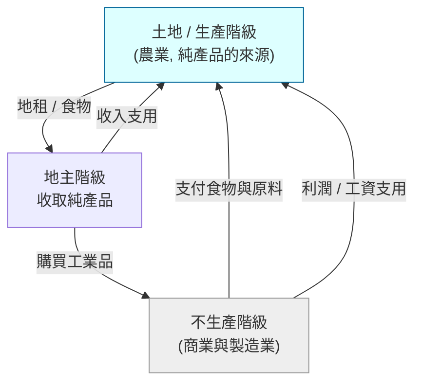

# 2.2 魁奈與重農主義：經濟表、土地與自由放任

## 一個醫生開出的處方

弗朗索瓦·魁奈（François Quesnay, 1694–1774）並不是職業經濟學家。他是路易十五最寵愛的貴婦龐巴度侯爵夫人的宮廷醫生，在凡爾賽宮裡擁有一層公寓，因此結識了宮廷的貴族與大臣。魁奈直到六十歲前後才開始研究經濟問題，而他的經濟學有一個鮮明的特點：他用看病人的眼光看國家。

十八世紀中葉的法國，在魁奈眼中就是一個病人。連年戰爭（路易十四晚期的征伐、七年戰爭）讓皇室財政搖搖欲墜，與英國的貿易競爭也節節失利；柯爾貝式的高關稅與管制讓內部流通阻滯；更嚴重的是，重商主義只重視工商，農業被高稅收與中間剝削層層壓迫，農民困苦，耕作技術落後。1760 年前後法國人口比 1700 年多，但每人平均的產出並沒有增加，經濟已處於低度均衡的停滯。

魁奈的診斷是：法國生病的根源，在於重商主義把「財富」的來源搞錯了。財富不在商業的順差，而在土地的生產。

## 三個假設與《經濟表》

魁奈與他的門徒（如里維埃爾、杜爾哥）提出了三個根本命題：

1. 自然秩序：經濟與社會有其合乎自然的法則，人為的管制只是對自然秩序的干擾。
2. 純產品（produit net）：只有農業才能真正生產出「超出投入的新增價值」。土地像聖經中流著奶與蜜的土地，是唯一把陽光、雨水轉化為人類可消費的源泉。工商業只是改變形態（加工），並不新增價值——純粹是「榨取」或「中介」。
3. 社會由三個階級組成：
   - 生產階級：承租土地、實際耕作農夫與農場主，純產品由他們創造。
   - 不生產階級：工商業者。
   - 地主：擁有土地，以地租形式帶走純產品；只有他們有「多餘」的收入去支撐循環。

魁奈於 1758 年出版《經濟表》——經濟思想史上第一張把整體經濟循環畫成系統圖表的圖片。圖中顯示：農產品如何在三個階級之間循環：地主持有的地租在工農之間流轉，淨產品最終回到土地，循環推進。這是今天總量經濟學、投入產出分析、甚至國民所得會計最早的直覺雛形——比瓦爾拉斯的一般均衡、比列昂提夫的產業關聯分析，早了將近兩百年。

後來的馬克思研究資本主義時，也承認魁奈的循環圖給了他《資本論》第二卷再生產理論的啟發。魁奈的想像，可以說是第一張「經濟循環示意圖」。

## 自由放任（Laissez-faire）的誕生

重農主義最有長遠影響的不是「只有土地是財富」這個後來被放棄的主張，而是他們的政治口號。對魁奈而言，既然存在著一個緊密的自然循環，政府能做的最好的事情就是不干預這個循環，讓它自行暢通流轉。「自由放任」一詞的誕生通常被歸給魁奈同時代的財政官文森·德·古爾奈（Vincent de Gournay）。據流傳的軼事，一位叫勒讓德的商人向官員如此答覆——「 laissez-nous faire」（讓我們自己做吧）。不管故事的細節屬實與否，古爾奈確實把這句話定為自己的座右銘，而重農學派則把它發展成一整套系統的理論，日後成為兩百多年自由市場主義的旗幟。

重農主義者據此推動了多項具體政策：主張廢除國內穀物流通的關卡與內地關稅、穀物貿易自由化，並提出「單一土地稅」——只對土地的地租徵稅，因為只有純產品有能力負擔賦稅，其餘稅收只是轉嫁與扭曲。1763–1764 年法國曾一度放寬穀物貿易管制，1774 年重農思想的同路人杜爾哥出任財政總長後更大力推行穀物自由貿易與取消行會束縛，卻在巴黎引發麵包暴動（史稱「麵粉戰爭」），在既得利益反撲下黯然去職。這場改革的失敗，是「說理敵不過舊特權」這個法國難題的第一次預演，也預示了十幾年後大革命注定以更暴烈的方式登場。

## 法國學界的「經濟學」小圈圈

《經濟表》一出，法國出現了一小圈被稱為「經濟學家」（Les Économistes）的人士——這是「經濟學家」這個稱謂第一次用來指一群真實存在的學者。他們固定聚會討論、辦期刊（如 1765 年創刊的《農業、商業與財政期刊》），讓經濟學第一次擁有「學派」的形態。

當亞當·斯密於 1765–1766 年以布克勒公爵的家庭教師身分遊歷歐陸時，曾在巴黎會見魁奈與杜爾哥等人。斯密十分敬重魁奈，一度打算把尚未出版的《國富論》題獻給他；但魁奈在成書前兩年（1774 年）去世，題獻遂被取消。斯密雖然不認同「只有農業是生產」的說法，但「自然秩序」、「單一稅」與自由放任的思想，深深印入《國富論》——書中的「自然自由體系」（system of natural liberty），正是重農主義洞見在更廣闊產業基礎上的延伸。

## 為什麼重農主義走向失敗

但重農主義有自己的死結：

1. 對工業財富的過度誤判：法國此後工業實力與商業實力崛起，工業產品的生產力飛速提高，重農主義「工商不生產」的命題和事實明顯脫節。這正是斯密《國富論》先用第一章「分工」，而不是「土地」開宗明義的原因。
2. 排斥一切的中央管制理論在法國財政崩潰的時刻反而牴觸現實——法國王權需要的是施行具體的財政重整（如軍隊重新規模、縮短常備軍），而不是等待自然秩序發動奇跡。
3. 政治理想與法國社會的斷層：重農主義者支持君主立憲與啟蒙，可是法國的革命群眾需要的不是「地主單一稅」，而是「取消所有的既有特權」，重農主義的理論難以承載這種更急迫的訴求。

因此，重農主義作為一個學派在 1770 年代後便迅速式微。但它的重要性遠比它的存續久。它的「自然秩序」概念、它的「政府應該少管」的主張、它的宏觀循環圖像，是重商主義與古典經濟學之間恰好的橋樑——正是踩著這座橋，亞當·斯密在 1776 年一步跨出了現代經濟學的大門。
