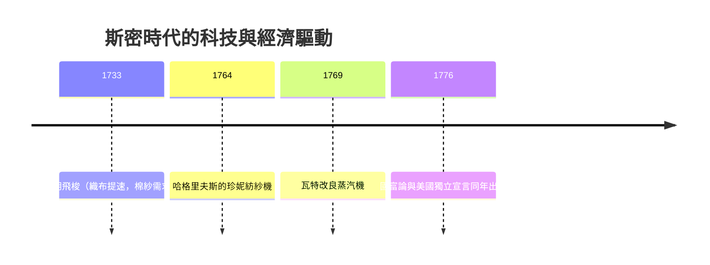
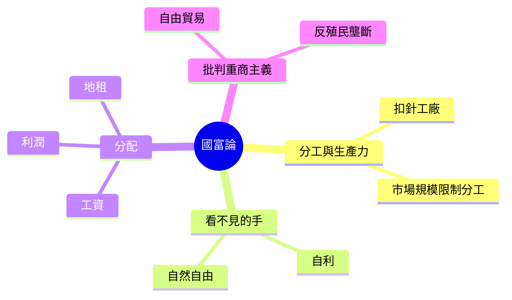

# 3.1 扣針工廠與分工：國富論的誕生

## 一位教授的十萬針

1776 年 3 月，《國民財富的性質和原因的研究》（簡稱國富論）在倫敦出版。作者亞當·斯密此前只是一名格拉斯哥大學的道德哲學教授，此前已出版《道德情操論》（1759）。他自己也未必意識到，《國富論》第一卷第一章的頭頂故事，將成為往後兩百年經濟學最受引用的段落之一。

這個故事是一根扣針（pin）。斯密寫道：一名不熟練的工人，獨力做扣針，一天恐怕連一根也做不出來；但把製作扣針拆成約十八道工序——拉鐵絲、剪斷、磨尖、裝針頭……由十名工人各自專職一項，一天可產出約四萬八千枚扣針，每人平均四千八百枚。十個人的勞動，被「分工」放大了上百倍。（這個例子實際借自法國《百科全書》中「扣針」條目，斯密把它變成了教科書。）

分工為什麼能放大生產力？斯密給出三個理由：一是專注一事使技巧爐火純青；二是省去了從一項工作轉到另一項的時間損耗；三是簡單重複的操作容易催生機械的改良——他提到，磨坊工人為省力而發明的絞車與滑輪，正是「旁觀的哲學家」與操作工人共同改進的產物。

## 分工受市場規模的限制

斯密的第二個關鍵洞見是這句話：分工受市場範圍的限制。一個只有幾戶人家的村莊，養不起一個專職做扣針的人；一個百萬人口的倫敦，卻能讓每種手工活都有專職。所以，巨大的市場是分工的前提，而分工是財富的前提。這條邏輯把「財富的來源」從重商主義的金銀、重農主義的土地，轉到了人類的生產方式上：國家的財富，是每年每一個居民平均能消費的商品與服務的量；它的來源，是生產力；生產力的根源，是分工；而分工的擴展，則靠自由的市場把它擴大。

## 蒸汽機尚未到來的工業革命

1776 年，瓦特與博爾頓合作的第一批改良蒸汽機才剛出廠；工業革命在英國啟動，卻還沒有全面展開（在紡織業上，哈格里夫斯的珍妮紡紗機 1764 年發明，克朗普頓的走錘紡紗機 1779 年登場，到了 1790 年代，工廠制與機器才普遍化）。也就是說，《國富論》並不是在為一場已經成功的革命寫讚歌，而是一名敏銳的觀察者恰恰看見那場革命開始在英國多處萌芽——畜力、水力，加上一點蒸汽；手工、工廠制，加上大規模的殖民地與歐洲市場。斯密的理論，是頭一波被工業化觸發的思想回應。

有趣的是，1776 年也是美國獨立宣言發表的一年。舊的商業帝國秩序（重商主義）在理論上被《國富論》拆解，在殖民地上被子彈拆解——兩者在大西洋兩岸同時發生。

## 格拉斯哥與法國：思想的兩個搖籃

斯密是蘇格蘭啟蒙運動的核心人物。他一生的思想，可以說由兩場相遇構成。第一場與他的好友、哲學家休謨（David Hume）有關：休謨在 1752 年《政治論叢》中提出了後來被稱為「金銀流向機制」（price-specie-flow mechanism）的模型——一個國家累積了太多金銀，就會物價上漲、出口失去競爭力，金銀便自動流出；因此，追求金銀順差的重商主義是自敗的。這個論證拆掉了重商主義的理論地基，斯密把它擴展成了一座完整的建築。斯密與休謨相差十餘歲，卻是一生摯友——休謨去世前，斯密寫下著名的《某先生生平概述》，公開為這位被教會視為異端的朋友辯護。兩人的思想互動，可以說共同孵化了古典經濟學——這一點在往後的教科書中常被遺忘。

第二場相遇是法國。1765–1766 年斯密陪同布克勒公爵遊歷法國，在巴黎結識了重農學派的魁奈與杜爾哥，旅途中他寫下大量筆記，日後成為《國富論》第四卷批判重農與重商、也多年吸收自然秩序的思想（見 2.2）。

## 《國富論》的骨架

全書五卷，主旨可簡化為一句：財富不是金銀，是勞動的年生產物；而這個生產物能不能成長，取決於制度與政策是否「讓人自己去交易、自己去選擇」。書中還有幾個著名的概念：

- 「看不見的手」：出現在全書僅一次的篇章（第四卷第二章），而且原文的語境是「資本家拒絕把資本送往外國而留在本國投資」——並不是現代人意會的那種「市場全能論」。
- 工資、利潤與地租：本書明確把「勞動、資本與土地」三種基本生產要素對應到三種主要所得，是李嘉圖、馬克思日後分配理論的直接框架。
- 稅賦四原則：公平、確定、方便、經濟——成為後世稅制設計的經典原則。

## 一個常被忽略的事實

《國富論》被讀成「資本主義的讚歌」，但斯密的本意更細膩：他同情工人，批評商人的合謀（他寫道：「同一行業的人很少聚在一起，即使是為了消遣與娛樂；但只要會面，談話總是結束在對付大眾的共謀上——抬高價格」）；他支持政府辦教育、修公共工程、維持國防與司法（第四、五卷），主張對販售者收公平稅。也就是說，斯密不是「小政府主義者」，而是「市場優先、但政府不可缺席」的設計者——這一點，常比他本人在二十世紀被引用的姿態，更貼近今日主流的經濟治理觀念。
