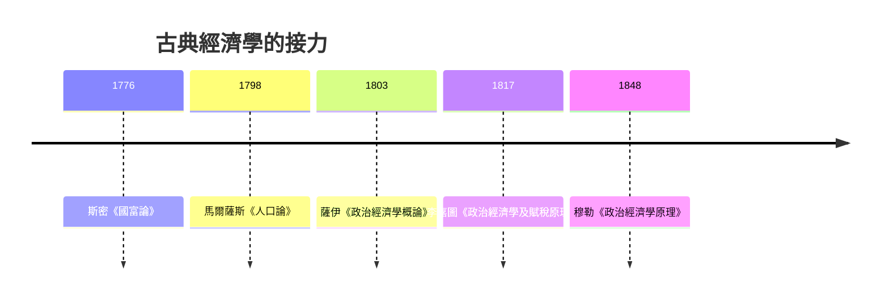

# 3.2 看不見的手：市場自我調節與自由貿易

## 「看不見的手」出現了兩次

今天的人常以為「看不見的手」是《國富論》的招牌，其實這個比喻在斯密一生中只出現過三次：一次在《天文學史》（早期的哲學論文），一次在《道德情操論》（1759），一次在《國富論》第四卷第二章。而且《國富論》裡的語境相當具體：商人基於自身安全與利益的考量，偏好把資本投在本國而不是外國；斯密說，在這個過程裡，他「像在其他許多情況下一樣，被一隻看不見的手引導，去達到他並不打算達到的目的」——即便他不為公共利益打算，他投資本國的選擇仍增進了本國的產出。

換句話說，斯密的主張不是「市場永遠完美」，而是「在自由競爭的制度下，自利行為經常被導向社會有用的方向」。這是對重商主義「必須由政府指揮經濟」的直接反駁：既然每個人都比官員更了解自己的生意，那麼讓資本自由流動，通常比官員規劃更好。

## 看不見的手為什麼能運作：價格的三重身分

斯密沒有畫出供給曲線與需求曲線（那是馬歇爾的事，見第 7 章），但他已經指出價格同時扮演三個角色：

1. 訊息：價格告訴人們什麼東西稀缺、什麼東西充裕。
2. 誘因：價格引導勞動與資本流向報酬更高的用途。
3. 分配：價格決定所得如何在工人、資本家與地主之間分配。

一件商品的「自然價格」恰好足以支付工資、利潤與地租的「自然率」；市場價格因供給與需求的波動圍繞自然價格上下浮動。這就是均衡思想的雛形——市場不是一個「總量」，而是一個自我調節的系統。

## 自由貿易：拆掉重商主義的城牆

《國富論》第四卷對重商主義的批判，在當時有直接的政治意義。斯密逐條拆解重商主義的支柱：

- 貿易順差崇拜：財富不在金銀而在年產出；一國的繁榮不需要靠「賣多買少」。
- 進口管制與關稅：關稅保護讓資本與勞動錯置，消費者多付的代價遠大於被保護產業的所得。
- 殖民壟斷：英國對美洲殖民地的貿易壟斷，實際上是讓英國消費者補貼特許商人——他甚至預言，若給予殖民地與英國「自由貿易與平等代表權」，帝國或許能和平重組。1776 年獨立戰爭爆發，證明改革窗口已經關閉。

斯密的名言是：從來沒有哪兩個國家因為自由貿易而彼此毀滅，但戰爭與關稅卻讓無數財富化為灰燼。「國防」比「富國」重要——因此他仍為《航海法案》辯護，因為航運能力是英國海權的基礎。這種「自由貿易但有例外」的務實態度，也成了後來古典學派的立場。

## 薩伊、馬爾薩斯與古典體系的接力

斯密在 1790 年去世。他的學生們把《國富論》變成了一門學科的起點：

- 在法國，薩伊（Jean-Baptiste Say，1803 年《政治經濟學概論》）提出「供給創造自身的需求」（後世稱薩伊定律），成為古典學派否定普遍生產過剩的核心信條——直到凱因斯把它推翻（見第 8 章）。
- 在英國，馬爾薩斯與李嘉圖把斯密的體系推向兩個尖銳的方向：一個看見人口的陰影（見 4.1），一個看見貿易的利得（見 4.2）。

## 制度與文化的土壤：為什麼是蘇格蘭？

《國富論》誕生在蘇格蘭並非偶然。1707 年蘇格蘭與英格蘭合併後，蘇格蘭人獲得了整個英帝國的市場與殖民地，格拉斯哥迅速成為菸草貿易大港；斯密本人就在這座商港城市任教，天天看見商船進出。同時，蘇格蘭啟蒙運動（休謨、弗格森、里德、布萊克與瓦特都在同一座城市出沒）有一個共同信念：社會像自然一樣有法則，可以像牛頓研究行星那樣被研究。斯密把牛頓式的系統思維用在「人的社會」上，這正是《國富論》的方法論革命：經濟不是道德勸說的對象，而是一個有其內在秩序、可以被分析的系統。

## 留給後世的一個張力

看不見的手有一個斯密自己沒有完全處理的盲點：分配。市場讓蛋糕做大，但工資與利潤、地租之間怎麼分？工人的工資長期會停在「剛好養家」的水平嗎？資本與勞動之間的張力，會不會撕裂整個社會？這些問題在十九世紀被馬爾薩斯的悲觀、李嘉圖的模型與馬克思的批判接連引爆——古典經濟學的黃金時代，就從這些爭論開始。
