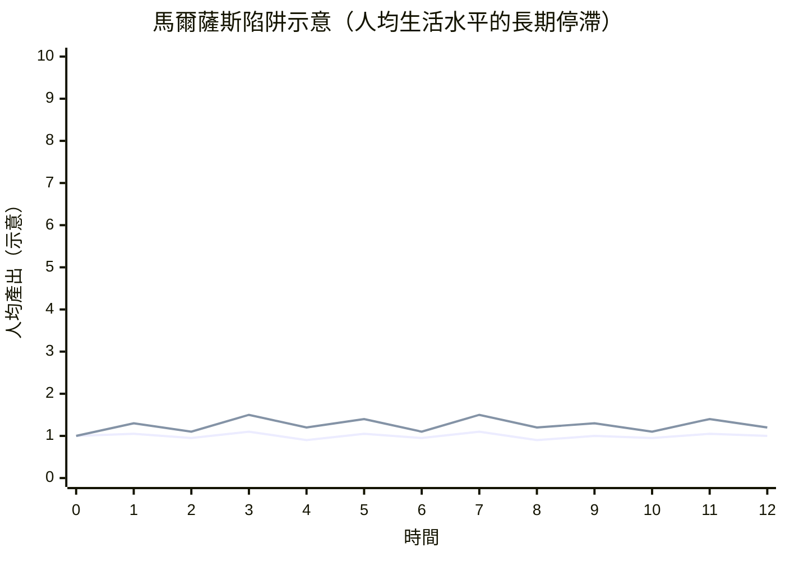

# 4.1 馬爾薩斯的人口論：指數與算術的賽跑

## 一場家庭餐桌上的爭論

1798 年，一位英國國教牧師托馬斯·馬爾薩斯（Thomas Robert Malthus, 1766–1834）匿名出版了一本小冊子：《人口論：人口對社會未來進步的影響》。這本書的靈感，來自他與父親在薩里郡鄉間餐桌上的爭論。老馬爾薩斯是盧梭與戈德溫的崇拜者，相信人性本善、社會必然趨向完美；年輕的馬爾薩斯則被一個冰冷的算術說服：再美好的社會設計，也逃不過人口與糧食的賽跑。

馬爾薩斯的兩條定律如今人人可背：

1. 人口在沒有阻礙時，按幾何級數增長（1, 2, 4, 8, 16, 32……），約每二十五年翻一倍。
2. 生活資料只能按算術級數增長（1, 2, 3, 4, 5……），因為土地的邊際報酬遞減。

兩條曲線的差距，只能靠兩類「抑制」來填補：預防性抑制（晚婚、節制）與積極抑制（饑荒、瘟疫、戰爭）。換言之，任何試圖改善窮人處境的濟貧制度，只會鼓勵早婚多育，讓人口更快的逼近生存底線，最終以更慘烈的方式回到原點。

## 這本書在罵誰？

《人口論》的第一個讀者群不是經濟學家，而是啟蒙運動的理想主義者。戈德溫 1793 年的《政治正義論》描繪了一個沒有政府、沒有貧困的未來社會；馬爾薩斯用兩條曲線宣告：這種烏托邦在生物學上不可能。這在當時是驚世駭俗的——它把「進步」的樂觀主義攔腰斬斷，連年輕的達爾文都承認，讀到馬爾薩斯時深受震撼：如果人口壓力如此殘酷，那麼自然界必然是無情的淘汰場。1838 年，達爾文在筆記裡寫下「我碰巧為了消遣讀了馬爾薩斯」，自然選擇的靈感由此點燃。

## 古典經濟學的「工資鐵律」

馬爾薩斯把人口論嵌入斯密的體系，得出一個悲觀的分配結論：長期而言，工資會被壓到維持生存的最低水平（後世稱為「工資鐵律」或「馬爾薩斯陷阱」）。原因很簡單：工資一旦高於生存水平，工人便早婚多育，人口增加壓低工資；工資一旦低於生存水平，人口因死亡而減少，工資又回升。整個社會像一個有彈性的皮筋，永遠在生存線附近震盪。

這個模型與十八世紀以前的歷史大致吻合：人類在馬爾薩斯陷阱裡生活了幾千年，任何技術進步帶來的溫飽，最終都被人口增長吃掉，人均生活水平長期停滯。但十九世紀的歷史卻證明馬爾薩斯錯了，而且錯得漂亮：

- 農業革命與後來的化肥（哈伯法合成氨，1913 年起）、育種與機械化，讓糧食增長遠超算術級數。
- 避孕技術與教育普及，讓生育率隨收入上升而下降（人口轉型）——預防性抑制以馬爾薩斯沒有預料的方式發揮作用。
- 貿易與殖民體系讓「土地」的範圍擴大到全球。

## 一個意外的遺產：有效需求

馬爾薩斯在經濟學史上還留下另一項常被低估的貢獻：他是最早系統質疑「薩伊定律」的人。1815 年拿破崙戰爭結束後英國陷入戰後蕭條，馬爾薩斯認為，蕭條的根源是「有效需求不足」——社會的儲蓄過多、消費不足，商品賣不出去。他與李嘉圖為此通信辯論多年，李嘉圖堅持「生產本身創造購買力」，馬爾薩斯始終反駁。這場辯論在當時以李嘉圖的勝利告終，馬爾薩斯幾乎被遺忘；但一百多年後，凱因斯在《通論》的緒論裡鄭重向他致意，稱他為「劍橋經濟學真正的先驅」——馬爾薩斯的名字，就這樣在 1936 年復活（見第 8 章）。

## 遺留的問題

馬爾薩斯錯在低估了技術與制度，但他提出的問題從未過時：資源的物理極限、人口的動態、以及「幫助窮人是否反而製造貧困」的政策爭論。二十世紀的《人口爆炸》（1968）、綠色革命、乃至今日關於地球承載力與移民政策的辯論，都還是那兩條曲線的延長線。差別只在於：馬爾薩斯相信曲線會交會在悲劇上；歷史證明，交會點可以被人類的創新與選擇不斷推遠——但推遲，不等於取消。
