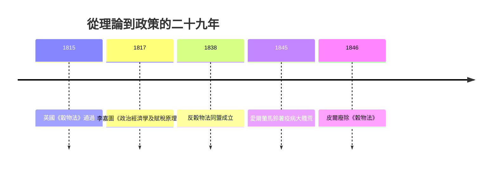

# 4.2 李嘉圖：比較優勢與自由貿易

## 一個證券經紀人的科學

大衛·李嘉圖（David Ricardo, 1772–1823）不是學院出身。他是阿姆斯特丹猶太移民家庭的孩子，十四歲進入父親的證券行，二十歲因為與教友之女結婚而被逐出家門，此後靠證券交易自立——據說他在 1815 年滑鐵盧戰役前後大膽押注英國公債，獲利豐厚，四十多歲便退休，買下莊園，還當上了國會議員。他讀到斯密的《國富論》時已是成年人，據他自己說，是在巴斯度假時讀的；從此他把經濟學當成畢生的智力遊戲，以一種前所未有的方式寫作：抽象、模型化、以簡馭繁。

李嘉圖是第一個真正把經濟學寫成「演繹科學」的人。他不描寫歷史，不引經據典，而是設定少數假設，然後一步步推導結論。1817 年的《政治經濟學及賦稅原理》就是這樣一本薄薄的、幾乎沒有修辭的書——卻成為此後一百多年理論經濟學的聖經。

## 比較優勢：一個違反直覺的證明

李嘉圖最著名的貢獻，是 1817 年書中論對外貿易的一章。他用英格蘭與葡萄牙、呢絨與葡萄酒的例子，證明了一件違反直覺的事：即使一國在所有產品上都比另一國更有效率，兩國之間的分工貿易仍然對雙方有利。

他的數字例子如今還印在教科書裡：生產一單位呢絨，英格蘭需 100 人年勞動，葡萄牙需 90 人年；生產一單位葡萄酒，英格蘭需 120 人年，葡萄牙只需 80 人年。葡萄牙在兩樣商品上都占絕對優勢，但優勢的程度不同——葡萄酒的優勢更大。李嘉圖證明：若葡萄牙專產酒、英格蘭專產呢絨，兩國合計用同樣的勞動，可以換得比各自閉門自產更多的商品。

$$
\text{英格蘭呢絨的機會成本} = \frac{100}{120} < 1 \quad<\quad \text{葡萄牙呢絨的機會成本} = \frac{90}{80} > 1
$$

關鍵詞是機會成本：重要的不是「誰比較強」，而是「誰放棄的比較少」。每個國家專注於自己機會成本最低的產品，透過交換，全世界的總產出便增加。這就是比較優勢原理——薩繆爾森說過，這是社會科學中少數「既反直覺又必然為真」的命題之一，他找不到第二個。

## 這個理論是為誰說話的？

比較優勢誕生於一場真實的政治鬥爭。1815 年拿破崙戰爭結束後，英國國會通過《穀物法》，對進口穀物徵收高關稅以保護本土地主——穀價高漲，工人的麵包變貴，工廠主被迫加薪，工業利潤被擠壓。李嘉圖站在工業資產階級一邊，用理論證明《穀物法》使整個國家變窮：土地是有限的，人口增長迫使耕種推向更貧瘠的邊際土地，地租因此不斷上漲，吞噬利潤與工資（他的地租理論、工資—利潤反向關係、靜態停滯預言，構成一個完整的分配模型）。自由貿易，是打破地主階級壟斷、解放工業資本主義的武器。

這場鬥爭在 1846 年才分出勝負：首相皮爾（Robert Peel）在愛爾蘭大饑荒的壓力下廢除《穀物法》，英國轉身成為自由貿易帝國。李嘉圖已去世二十三年，但他的理論贏了。

## 比較優勢的兩張面孔

李嘉圖的遺產有光與影兩面。

光明面：比較優勢成為國際貿易理論的基石。二十世紀的赫克歇爾—俄林模型、克魯格曼的新貿易理論，都是在李嘉圖框架上的修補與擴充。戰後的 GATT／WTO 體系、區域自由貿易協定，背後的論證語言全是李嘉圖式的。

陰影面：比較優勢是靜態的。它假設各國的技術與稟賦固定，卻不回答「優勢會不會被自己培養出來」——十九世紀的美國（漢密爾頓的製造業報告）、德國（李斯特的國民經濟學）正是以「幼稚產業保護」對抗李嘉圖，靠關稅扶植工業而後來居上。二十世紀的東亞發展模式，同樣是「出口導向＋選擇性保護」的混合。理論與歷史之間的這道縫，至今仍是發展經濟學的核心爭論。

## 一個方法論的轉折

最後要指出李嘉圖帶來的深遠影響：他把經濟學變成了一門模型科學。在他之前，斯密的寫作是歷史與哲學式的；在他之後，經濟學家的標準工作方式是「設假設、推結論」。熊彼特稱之為「李嘉圖惡習」——把複雜世界壓縮成少數變數，然後在模型裡推理；凱因斯則說，李嘉圖征服英國經濟學，就像宗教法庭征服西班牙。無論褒貶，現代經濟學的方法論——從邊際革命到一般均衡，到今天的 DSGE 模型——都是沿著李嘉圖開闢的這條路走過來的。
