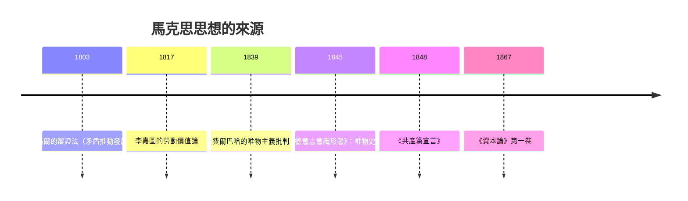

# 5.1 剩餘價值與異化：資本論的誕生

## 大英博物館圓形閱覽室裡的四十年

1867 年 9 月，卡爾·馬克思（Karl Marx, 1818–1883）在漢堡出版了《資本論》第一卷。此時他流亡倫敦已十八年，住在蘇豪區兩居室的貧困公寓裡，靠恩格斯的接濟與為報紙撰稿度日，幾個孩子死於貧病。他每天上午到大英博物館的圓形閱覽室，研讀藍皮書（英國官方工廠視察報告）、議會文件與古典經濟學著作，一坐就是一整天。這樣的閱讀持續了三十年：第一卷出版時他已四十九歲，第二、三卷直到他死後才由恩格斯根據手稿整理出版（1885、1894）。

《資本論》的副標題是「政治經濟學批判」。馬克思不是從外部批判資本主義，而是鑽進古典經濟學（斯密、李嘉圖）的內部，用他們自己的概念工具，推出他們不願接受的結論。

## 從李嘉圖的勞動價值論出發

馬克思的起點是李嘉圖的勞動價值論：商品的交換價值由生產它所需的社會必要勞動時間決定。但李嘉圖留下一個他自己承認無法解決的難題：如果一切商品都按價值交換，那麼資本家付給工人的是工資（勞動的價值），利潤從哪裡來？

馬克思的答案是引入一個新的區分：勞動力（labour power，工人出賣的、工作能力這種商品）與勞動（labour，能力的實際使用）。勞動力這種商品很特殊——它的使用價值，恰好是創造出比自身價值更多的價值。工人一天工作八小時，可能前四小時就已生產出相當於自己工資的價值；剩下四小時生產的價值，被資本家無償占有。這就是剩餘價值（Mehrwert）。

$$
\text{剩餘價值率} = \frac{\text{剩餘勞動時間}}{\text{必要勞動時間}} = \frac{s}{v}
$$

資本家提高剩餘價值的兩條路：延長工作日（絕對剩餘價值），或提高生產力、縮短必要勞動時間（相對剩餘價值）。馬克思用英國工廠視察報告裡的真實案例——童工、十六小時工作日、女工夜班——說明這不是抽象推理，而是血淋淋的制度現實。這些報告後來成為英國《工廠法》改革的依據；馬克思把官方文件變成了控訴的證據。

## 異化：人成為機器的附屬

《資本論》的哲學底層，是馬克思在 1844 年《經濟學哲學手稿》中發展的異化（Entfremdung）概念。在資本主義生產方式下：

1. 勞動者與勞動產品異化：產品不屬於製造它的人，反而作為異己的力量支配製造者。
2. 勞動者與勞動過程異化：分工把人固定在單一動作上——這正是斯密讚美的扣針分工，在馬克思筆下成了「把工人變成局部機器」的過程。
3. 人與人的類本質異化：創造性的勞動本是人的本性，如今淪為謀生手段。
4. 人與人異化：社會關係化約為金錢關係。

有趣的是，這套批判的兩個靶子——扣針分工與工廠制度——都直接來自《國富論》。斯密自己也留了一句伏筆：他承認分工會使工人「變得愚蠢無知」，並主張政府應辦公共教育來補救。馬克思把這句伏筆放大成了整卷的判詞。

## 機器大工業與「資本有機構成」

《資本論》第一卷的後半部描寫了從手工工場到大工業的轉變：機器不僅替代工人，更把工人變成機器的附屬品；婦女兒童被捲入工廠；農村人口被驅入城市貧民窟。馬克思由此提出資本積累的一般規律：資本追逐利潤必然不斷提高技術構成（不變資本相對可變資本的比重），造成「相對過剩人口」——一支產業後備軍，反過來壓低工資。資本主義因此內在地生產出自己的失業與貧困。

這個預言在十九世紀後期部分應驗（工業國的勞工貧困確實嚴重），但二十世紀的歷史走出了馬克思與古典學派都沒預料到的路：工會、社會立法、普遍選舉權與凱因斯式需求管理，使發達資本主義國家的實際工資在二十世紀大幅上升。馬克思的模型缺少的，正是後來被稱為「民主的階級鬥爭」的那部分制度變數。

## 從哲學到經濟學：一個思想的譜系

馬克思的方法可以概括為：把黑格爾的辯證法「倒轉過來」放在物質基礎上——歷史的動力不是觀念的演進，而是生產方式與生產關係的矛盾；把李嘉圖的價值論推到底——勞動價值論加上「勞動力是商品」，就推出剝削；把英國工廠報告當作證據——理論與經驗文件互相印證。德國哲學、英國經濟學、法國社會主義（聖西門、傅立葉、蒲魯東），三條河流在他筆下匯成一套體系。

## 為什麼《資本論》無法被繞過

無論人們是否接受馬克思的結論，《資本論》重塑了此後所有經濟學的提問方式。它迫使經濟學正視分配衝突、權力關係與制度歷史；它提供的「資本主義是一個歷史地產生、也將歷史地演變的體系」這個視角，滲入了韋伯、熊彼特、波蘭尼與今天的皮凱提（見 12.1）。同時，它也引發了經濟學的「防衛性轉向」：十九世紀末的邊際學派（見第 6 章）以效用取代勞動作為價值基礎，把經濟學重建成一門「中立的」選擇科學——某種意義上，邊際革命是對馬克思問題的一種迴避，也是一種回答。
