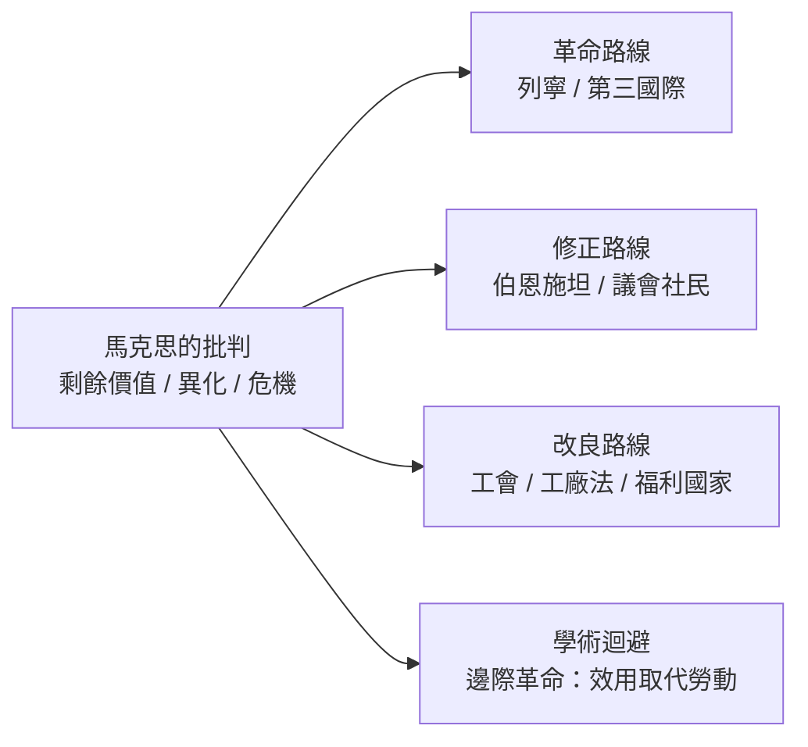

# 5.2 資本主義的內在矛盾與勞工運動

## 從理論到運動：第一國際與第二國際

《資本論》第一卷出版時，歐洲的工人運動已經風起雲湧。1864 年，國際工人協會（第一國際）在倫敦成立，馬克思是實際的靈魂人物；1866 年日內瓦大會通過的決議，要求八小時工作制、廢除童工——這些訴求直接反映《資本論》裡的論證。1889 年成立的第二國際，把「五一勞動節」與「三八婦女節」變成國際日程。馬克思的經濟學，就這樣從大英博物館的閱覽室，走進了各國工會的傳單。

而理論的傳播還有另一條路徑：1872 年《資本論》俄譯本出版，俄國書報檢查官判定「這是一本嚴謹的科學著作，人人未必讀得懂」，竟准予發行；結果俄國成了馬克思主義最早的大本營，普列漢諾夫、列寧都由此入門。理論的「難懂」反而成了它的護身符。

## 馬克思預言的三個矛盾

馬克思對資本主義內在矛盾的診斷，可以整理為三條：

1. 生產社會化與占有私人化的矛盾：生產越來越是集體協作的結果，利潤卻歸少數資本所有者。
2. 生產過剩的危機傾向：資本競相擴張產能，而工人的支付能力有限，導致周期性的過剩危機。
3. 利潤率趨向下降：競爭迫使資本家不斷提高資本有機構成（用更多機器、相對更少勞動），而按勞動價值論，只有勞動創造剩餘價值，於是利潤率長期趨降——這是《資本論》第三卷的核心定律。

第三條在理論上最受爭議（後來被稱為「轉形問題」：價值如何轉化為生產價格），在經驗上也未能成立——二十世紀資本主義的利潤率並未出現單向下降。但第一、二條的直覺，在 1929 年大蕭條（見第 8 章）中得到了戲劇性的歷史回響：有效需求不足、生產過剩、以鄰為壑——那場危機讓馬克思主義在西方知識界一度聲勢大振。

## 修正主義與德國的獨特道路

並非所有追隨者都接受革命預言。德國社會民主黨的伯恩施坦（Eduard Bernstein）在 1899 年《社會主義的前提》中提出修正主義：工人的生活並未惡化，中產階級在擴大，資本主義沒有崩潰的跡象；社會主義應該透過議會、工會與合作社「逐步實現」。考茨基堅持正統理論，雙方論戰多年。歷史的裁決複雜：德國走出了議會社會民主主義的道路（今日歐洲社民黨的源頭），而俄國則走向了列寧的革命道路。馬克思的遺產，從一開始就分裂成兩條政治路線。

## 資本主義的自我改造：另一種回應

馬克思的批判同樣逼出了資本主義的自我改造，而且主要發生在他最熟悉的那個國家——英國：

- 工廠立法：1833 年《工廠法》禁止九歲以下童工、設置工廠視察員（馬克思引用的藍皮書正是這些視察員寫的）；1847 年十小時工作法；此後限制不斷加碼。
- 工會合法化：1824 年英國廢除結社禁令；1871 年《工會法》給予工會法律地位；集體談判逐漸成為常態。
- 公共衛生與教育：1848 年《公共衛生法》、1870 年《教育法》——斯密當年主張的公共教育，在馬克思批判的壓力下終於落地。
- 選舉權擴張：1867 年、1884 年改革法案逐步把選票交給城市工人。

這條路線的理論代言人，是德國經濟學家施穆勒與歷史學派、英國的費邊社與韋伯夫婦：資本主義可以不經革命而被「馴化」。二十世紀的福利國家，就是這條路線的成果。

## 大眾文化中的馬克思

十九世紀末，《資本論》的影響越出政黨與工會，滲入文學與大眾文化。蕭伯納、威爾斯都是費邊社成員，把社會主義寫進戲劇與小說；左拉《萌芽》（1885）以法國礦工罷工為題材；狄更斯更早的《艱難時世》（1854）已把工廠主葛擂硬寫成功利主義的諷刺像。經濟思想第一次成為大眾娛樂的一部分——這是《國富論》從未有過的待遇。

## 遺產的兩面

二十世紀的歷史給了馬克思的遺產兩種截然不同的驗證。計劃經濟的實驗（蘇聯及其陣營）證明了中央計劃在訊息與激勵上的根本困難——哈耶克在 1940 年代的論證（見 9.1）正是針對這一點；而發達資本主義國家吸收了馬克思的診斷（不平等、危機、異化），卻拒絕了他的藥方，以混合經濟與福利國家回應。1989 年柏林圍牆倒塌後，許多人宣告馬克思主義死亡；但 2008 年金融危機後，《資本論》在德國、日本重新登上暢銷榜，皮凱提的《二十一世紀資本論》（2013）再度以「資本主義自生不平等」的命題震撼世界（見 12.1）。

馬克思留下的問題——資本會不會自我膨脹到吞噬社會？——顯然還沒有過期。
