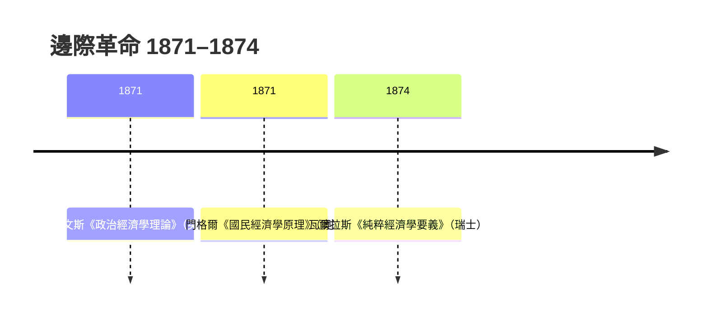

# 6.1 邊際效用：拯救經濟學的估值危機

## 一個兩千年的老難題

水是生命的必需品，鑽石幾乎一無用處，為什麼鑽石昂貴、水便宜？這個「水與鑽石悖論」亞當·斯密在《國富論》中明確提出（更早可追溯到約翰·洛克與伽利略），成為古典勞動價值論頭上的一朵烏雲。斯密的答案是區分「使用價值」與「交換價值」：水使用價值大而交換價值小，鑽石相反。但他沒能真正解釋交換價值由什麼決定——李嘉圖與馬克思用勞動時間來解釋，可這個答案在「一雙手畫的畫與一雙手印的畫價值天差地遠」這類例子面前依然勉強。

整個十九世紀中葉，價值理論處於危機：古典學派的成本（勞動）決定論解釋不了市場上真實的價格波動，也解釋不了為什麼有些昂貴的東西幾乎不耗費勞動。

## 「邊際」登場

答案在 1870 年代幾乎同時從三個角落出現，而且用的是同一個關鍵概念：價值不取決於商品「整體」的有用性，而取決於「最後一單位」的有用性——邊際效用（marginal utility）。

想想那個經典的例子：一個人在沙漠邊緣擁有一袋水。第一杯水用來救命，價值無限大；第二杯用來煮飯；第三杯用來洗臉；最後一杯可能拿去澆花。水的總效用巨大，但價格由最不重要的那一杯——邊際單位——決定。如果水像在河邊那樣取之不不盡，邊際一杯幾乎不值錢，於是水便宜；鑽石稀少，每一顆都落在需求曲線的高處，於是昂貴。悖論消解：價格反映的不是總效用，而是稀缺性與邊際效用的交點。

用今天的數學語言，消費者會把錢分配到每一種商品的「邊際效用除以價格」都相等的那一點：

$$
\frac{MU_1}{p_1} = \frac{MU_2}{p_2} = \cdots = \frac{MU_n}{p_n}
$$

這條等邊際原則（後由馬歇爾、費雪等人精煉）就是微觀經濟學的核心引擎。

## 一場沒有協調的三重奏

奇妙的是，這個概念在 1870 年代被三個人各自獨立提出：

- 傑文斯（William Stanley Jevons），英國，1860 年代已形成想法，1871 年出版《政治經濟學理論》。他在日記裡寫下「價值完全取決於效用」的那一刻，自認發現了真理；他還用微積分寫下效用函數，主張經濟學應該成為「快樂與痛苦的微積分」。
- 門格爾（Carl Menger），奧地利維也納，1871 年《國民經濟學原理》。他不用數學，用純粹的邏輯推演，從需求遞減一路推出貨幣的起源（貨幣是自發演化的制度，不是政府發明的）——這條「奧地利路線」後來發展出哈耶克的知識理論（見 9.1）。
- 瓦爾拉斯（Léon Walras），法國出生、在瑞士洛桑任教，1874 年《純粹經濟學要義》。他走得更遠：不滿足於單一市場，要把所有市場聯成一個一般均衡體系，用聯立方程組求解整個經濟。

三人互不相識（傑文斯晚年才知曉另兩人，曾為發明權頗感不平），卻撞出同一個真理——這在科學史上極為罕見，通常意味著時代條件已經成熟。

## 為什麼是這個年代？

邊際革命不是憑空而降，背後有深刻的時代動力：

1. 數學工具的擴散：微積分在十九世紀已是大學通用教育，物理學的成功（能量守恆、力學）讓「用數學描述社會」變得可以想像。傑文斯本是化學與氣象學者，瓦爾拉斯的父親是數學素養極高的學者。
2. 鐵路與統計的時代：價格資料、市場資料大量累積，抽象理論有了經驗對照物。
3. 對馬克思的「理論競賽」：勞動價值論正在成為工人運動的旗幟。邊際效用論提供了一個替代答案——價值由主觀效用與稀缺性決定，而不是由勞動決定；剝削的邏輯基礎被釜底抽薪。龐巴維克隨後以「時差利息論」正面攻擊馬克思的剝削理論，這場論戰塑造了此後百年的意識形態分野。
4. 學科職業化：大學開始設立經濟學講座與期刊（美國經濟學會 1885 年成立），新一代學者需要可傳授、可考試、可形式化的理論——邊際分析恰好符合。

## 一個方法論的深遠後果

邊際革命把經濟學的重心從「財富」（斯密的問題）轉向「選擇與稀缺」（羅賓斯 1932 年的定義：研究稀缺資源在相互競爭的用途之間的配置）。價值從客觀（勞動、成本）變成主觀（效用），數學成為標準語言，「經濟人」——在約束下最大化效用的人——成為標準假設。

這次轉向的收穫是嚴密與普遍性：同一套工具能分析消費、生產、勞動、貿易。代價則是馬克思式與歷史學派式的問題——權力、階級、制度演化——被擠出了主流模型的邊框。這個「收穫與代價」的張力，貫穿了整個二十世紀：從馬歇爾的綜合（第 7 章），到凱因斯的叛離（第 8 章），再到行為經濟學對「經濟人」的反攻（第 11 章）。
