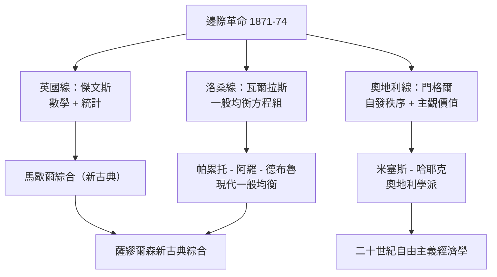

# 6.2 傑文斯、門格爾與瓦爾拉斯：三條路同一真理

## 傑文斯：煤炭經濟的預言家

威廉·斯坦利·傑文斯（1835–1882）的一生濃縮了維多利亞時代的精神。他年輕時赴澳洲造幣廠任職化驗師，在雪梨的五年裡自學氣象、統計與社會問題；回英後在倫敦大學學院受數學訓練，1866 年出任曼徹斯特歐文斯學院教授。他相信經濟學應成為「快樂與痛苦的微積分」，並且身體力行：用統計方法研究價格波動（太陽黑子與穀物週期的著名研究，雖然結論站不住，卻開創了時間序列分析）、發明「邏輯鋼琴」——一種機械邏輯運算機器，堪稱計算機的遠祖。

他留給後世最有名的預言是 1865 年《煤炭問題》：英國工業建立在煤炭之上，而煤炭終將耗竭，英國的霸權將隨之衰落。這本書引發全國恐慌，也留下了一個經濟學上極有意思的悖論——後人稱為「傑文斯悖論」：提高煤的燃燒效率，反而讓煤更便宜、更被大量使用，總消耗不降反升。這個悖論在今天的能源與環境政策裡依然活著：省電的燈泡讓人開更多的燈，效率的提升被規模的擴張吃掉。

傑文斯 1882 年溺水早逝，年僅四十六歲。他沒有建立學派，但他的工具——效用函數、微積分、統計檢驗——成為新古典經濟學的標準裝備。

## 門格爾：奧地利學派的創始人

卡爾·門格爾（1840–1921）走的是完全不同的路。這位奧地利記者出身的學者，1871 年以《國民經濟學原理》提出邊際效用論，卻幾乎不用數學。他關心的不是均衡方程式，而是一個更根本的問題：複雜的社會秩序（貨幣、市場、法律、語言）如何從沒有設計者的個人互動中自發湧現？

他給貨幣起源的答案成為經典：人們不是「發明」貨幣，而是在以物易物中逐漸發現某些商品（牛、鹽、貝殼、金屬）更容易換出去，於是人人持有它們，貨幣便「湧現」了。這個「看不見的手解釋制度起源」的思路，直接啟發了米塞斯與哈耶克——哈耶克後來把它推廣為整個「自發秩序」理論，成為二十世紀自由主義經濟學的哲學基石（見 9.1）。

門格爾與德國歷史學派的施穆勒爆發了著名的「方法論之爭」（Methodenstreit，1883 年起）：經濟學應該是抽象的理論科學，還是歷史的描述科學？門格爾捍衛理論，歷史學派捍衛歷史。這場爭論沒有贏家，但它劃出了經濟學至今仍在的兩種自我理解。奧地利學派的傳承清晰可見：門格爾→維塞爾、龐巴維克→米塞斯→哈耶克，一條跨越百年的思想血脈。

## 瓦爾拉斯：一般均衡的建築師

里昂·瓦爾拉斯（1834–1910）是三人中最孤獨、也走得最遠的。他兩次落榜巴黎礦業學院，一生沒有進入法國主流學術圈，最後在瑞士洛桑大學謀得一席。他自認繼承的是父親的「稀少性」（rareté）理論與法國理性主義傳統（從笛卡爾到拉普拉斯），並以庫爾諾（Cournot）1838 年的數理經濟學為先驅。

瓦爾拉斯的野心是把整個經濟寫成一組聯立方程：所有商品、所有要素市場同時出清。他證明（以方程數等於未知數的計數論證）一般均衡解的存在，並設計了「喊價」（tâtonnement）過程描述市場如何向均衡摸索。這套體系在當時被同行視為數學遊戲，但他寫信給友人說：如果我的理論是對的，經濟學將像天文學一樣精確。

瓦爾拉斯的影響姍姍來遲卻極其深遠：帕累托繼承洛桑學派，把效用改寫為序數、提出帕累托效率；二十世紀中葉，阿羅與德布魯用拓撲學與不動點定理嚴格證明一般均衡的存在（阿羅 1972、德布魯 1983 年諾獎），瓦爾拉斯體系成為微觀經濟學的數學殿堂。今天的 CGE 模型（可計算一般均衡）、拍賣演算法、甚至電商的動態定價，血統上都可追溯到洛桑那間孤獨的書房。

## 三條路的分岔與匯流

三人同時撞見邊際效用，卻走向三個不同的經濟學未來：英國線被馬歇爾整合成新古典主流（第 7 章）；奧地利線堅持主觀主義與市場過程，成為二十世紀干預主義最系統的反對者（第 9 章）；洛桑線把均衡推向數學極致，成為理論微觀的骨架。有趣的是，這三條線在二十世紀末又以意想不到的方式匯流：賽局理論與實驗經濟學檢驗均衡的現實性（第 10 章），行為經濟學修正效用假設（第 11 章），而拍賣設計與演算法市場則把瓦爾拉斯的方程組變成了每天運行的軟體（第 12 章）。

一個概念（邊際效用），三種命運——這正是思想史的迷人處：真理只有一個，但真理的用法有無窮多種。
