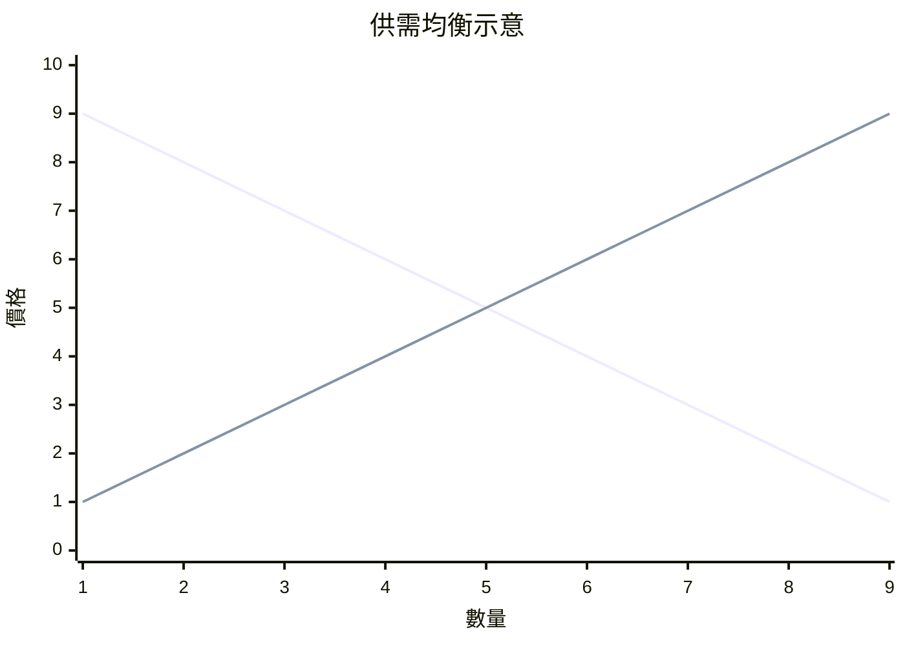

# 7.1 馬歇爾：供給與需求如剪刀的兩刃

## 劍橋的數學家轉行的經濟學家

阿爾弗雷德·馬歇爾（Alfred Marshall, 1842–1924）原本是劍橋的數學講師。他在 1860 年代讀到斯密、李嘉圖與穆勒的著作後轉向經濟學，理由帶有時代的精神焦慮：他遊歷貧民區時親眼所見的都市貧困，讓他相信「消除貧困是經濟學家最大的希望」。他把數學帶進了經濟學，卻又刻意把數學藏起來——《經濟學原理》（1890）的正文幾乎沒有公式，數學與圖解全部收進頁腳與附錄。他說：把數學當工具用，然後燒掉。

1890 年的《經濟學原理》是經濟學史上第一次「教科書革命」：它把傑文斯的效用、李嘉圖的成本、瓦爾拉斯的均衡熔鑄成一個可以教、可以學、可以考試的體系。此書再版八次，統治英語世界的經濟學教育四十年，直到凱因斯（他的學生）的《通論》問世。

## 剪刀的兩刃：一個比喻解決一場戰爭

馬歇爾最著名的比喻：討論價格由效用決定還是由成本決定，就像爭論剪刀的上刃還是下刃剪開了紙。需求（源自邊際效用）與供給（源自生產成本）共同決定價格——任何把兩者分開的企圖都是徒勞。

這個綜合的歷史意義在於調停了兩個陣陣營：奧地利與英國的邊際效用論者說「價值在需求端」，李嘉圖—馬克思傳統說「價值在成本端」。馬歇爾說：短期看需求，長期看成本；時間是關鍵變數。他區分了瞬時均衡、短期均衡與長期均衡——市場的調節需要時間，不同的時間尺度給出不同的答案。

需求線向下、供給線向上，交點即均衡價格。這張圖今天印在每一本教科書的第一章，而它的發明權（英國的弗萊明·詹金也幾乎同時獨立畫出）屬於馬歇爾。

## 消費者剩餘、準租與「其他條件不變」

馬歇爾還留下了一批今天仍在使用的概念工具：

- 消費者剩餘：需求線以下、價格線以上的面積，衡量消費者「賺到的」滿足。這是福利經濟學的起點，後來的皮古（馬歇爾的學生）由此發展出外部性與庇古稅理論。
- 彈性：價格變動百分之一，需求量變動百分之幾。馬歇爾從物理學借來這個概念，使「需求對價格的敏感度」變成可測量的數。
- 準租：短期內供給固定的要素（如已建成的廠房）所獲得的報酬——連接李嘉圖地租理論與現代要素定價的橋。
- 其他條件不變（ceteris paribus）：把複雜世界切開、一次分析一個市場的方法論承諾——局部均衡的代價與力量都在這四個字裡。

## 內部經濟與外部經濟：規模報酬的先見

馬歇爾研究產業時提出「內部經濟」（企業內部的規模經濟）與「外部經濟」（整個產業群聚帶來的共享優勢——專業供應商、技術工人池、知識外溢）。他用蘭開夏的棉紡、謝菲爾德的刀具產業群聚做例子，寫下「行業的祕密不再是祕密，彷彿懸浮在空氣中」。

這個「外部經濟」概念在二十世紀被嚴重低估，直到 1990 年前後克魯格曼以它重建國際貿易理論、波特以「集群」理論重塑區域政策，馬歇爾的洞見才重新登場。今天的矽谷、深圳的電子產業帶，本質上都是馬歇爾外部經濟的活標本。

## 劍橋學派與一個學科的職業化

馬歇爾把經濟學建成了一門職業學科：他在劍橋推動設立經濟學與政治學榮譽學位（1903 年），培養出皮古、凱因斯等一代學者；他參與創立英國經濟學會（1890，皇家經濟學會前身）與《經濟期刊》。他也是第一位把「經濟學」（Economics）而非「政治經濟學」（Political Economy）用作書名主詞的大家——一個詞的更換，標誌著這門學科從道德哲學的分支，變成了獨立的科學。

但馬歇爾的科學觀仍然帶著維多利亞的道德底色。他說經濟學的「冷靜的頭腦」是為了服務「溫暖的心」；他在《原理》的獻詞裡寫著，貧困與愚昧是社會進步的障礙，經濟學家的使命是消除它們。這種「科學工具＋社會關懷」的組合，在二十世紀被薩繆爾森的新古典綜合繼承，也被凱因斯以另一種方式實踐——他的學生推翻了老師的部分理論，卻完整繼承了老師的使命感。
