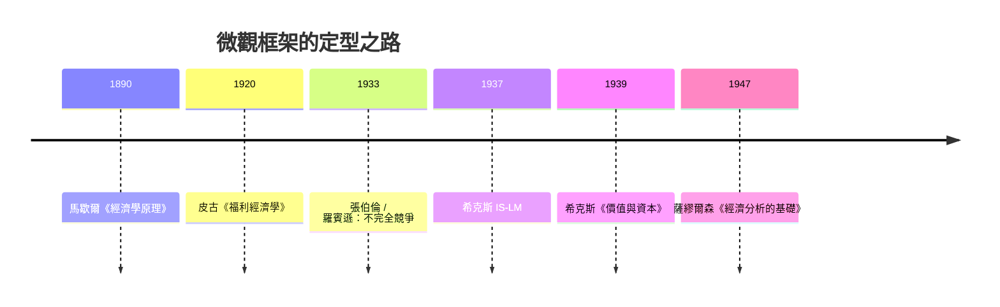

# 7.2 彈性、均衡與微觀框架的定型

## 從一張圖到一門科學

馬歇爾的《經濟學原理》到 1920 年代已經完成了一件大事：它讓微觀經濟學有了標準的形狀。消費者沿著需求曲線選擇，廠商沿著成本曲線生產，市場在供需交點出清；價格是訊號，均衡是常態。這套框架配上彈性、消費者剩餘、準租等工具，讓經濟學第一次擁有了「可以寫進法規、算進預算」的分析能力——政府第一次能用經濟學家的圖表評估一項關稅、一項補貼、一項稅率的後果。

本節追蹤這套框架在馬歇爾之後如何被補完、被推廣、以及在哪裡露出裂縫。

## 皮古：福利經濟學的誕生

馬歇爾的繼承者皮古（A. C. Pigou，1877–1959）把消費者剩餘工具化，1900 年代接掌劍橋講席，1920 年出版《福利經濟學》。他的核心問題是：市場均衡何時背離社會最優？

答案是外部性：當生產或消費的成本（或收益）落在交易雙方之外的人身上，市場價格就不再反映真實的社會成本。工廠排煙讓鄰居洗衣服的成本上升，但煙囪的帳單上沒有這一項。皮古的藥方是矯正稅——對污染者課稅，使私人成本等於社會成本。今天氣候政策裡的「碳稅」「碳定價」，理論原型就是皮古稅。

皮古還區分了社會淨產值與私人淨產值、提出了收入再分配的邊際效用論證（把錢從富人移給窮人，若兩者效用函數相同，總效用增加）——這成為福利國家再分配政策的經濟學論證起點。市場失靈（market failure）這個詞雖然後出，概念上已經在皮古那裡成形。

## 壟斷競爭與不完全競爭：框架的第一次修補

馬歇爾的世界以完全競爭為預設，但二十世紀二三十年代的現實——大公司、品牌、廣告、規模經濟——顯然不符。兩位經濟學家幾乎同時完成修補：

- 張伯倫（Edward Chamberlin，哈佛，1933《壟斷競爭理論》）：大多數市場是「有差異的競爭」——每家餐廳、每個品牌都有小小的壟斷（自己的招牌），彼此又互相競爭。
- 羅賓遜（Joan Robinson，劍橋，1933《不完全競爭經濟學》）：壟斷者面對向下傾斜的需求線，會把價格定在高於邊際成本之處；買方集中（買方壟斷）則壓低工資。她由此推出「剝削」的嚴格定義——工資低於勞動的邊際產值。

羅賓遜是劍橋首位女性經濟學講席教授，也是後來劍橋資本爭論中對新古典的尖銳批評者。不完全競爭理論的另一個深遠後果是：一旦承認價格由企業「設定」而非市場「決定」，價格的黏性就順理成章——這為凱因斯宏觀經濟學的微觀基礎埋下了伏筆（見第 8 章）。

## 希克斯：把微觀與數學焊在一起

約翰·希克斯（1939《價值與資本》）把馬歇爾的局部均衡升級為一般均衡的直觀版本，用序數效用（無異曲線）取代基數效用，把消費者理論、廠商理論與一般均衡串成一個現代形態的體系；他隨後的 IS-LM 圖（1937）則成為凱因斯宏觀經濟學的標準教學工具（見 8.2）。薩繆爾森 1947 年《經濟分析的基礎》再以最優化與對應原理把整個框架數學化——微觀經濟學至此「定型」，成為今天碩士課程第一學期的內容。

## 框架的成就與它的盲區

到 1930 年代末，微觀經濟學的框架已經異常精密：它能解釋價格如何傳遞稀缺性、稅負如何分攤、壟斷如何造成無謂損失、外部性如何使市場失靈。它的政策影響從反托拉斯法（美國 1890 年休曼法、1914 年克萊頓法）延伸到公共事業定價與戰後的福利設計。

但同一時期，這套框架也暴露出兩個大盲區：

1. 它假設均衡是常態。可 1929 年之後的世界顯示，整體經濟可以長期停在遠離充分就業的狀態——局部均衡的加總不等於宏觀的答案。這個裂縫由凱因斯炸開（第 8 章）。
2. 它假設人是理性的最大化者。這個假設的鬆動要等到心理學實驗室介入（第 11 章）；而資訊不對稱對「價格傳遞一切訊息」的反駁，則要等到檸檬市場（第 10 章）。

換句話說，馬歇爾的框架越成功，它的例外就越醒目。二十世紀經濟學的戲劇，很大程度上就是這些例外被一一正名的故事。
