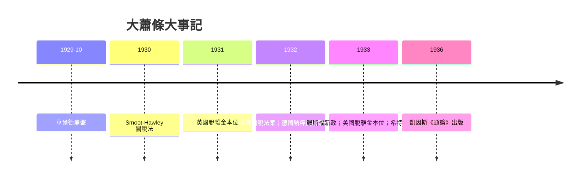

# 8.1 1929：大崩盤與古典理論的束手無策

## 繁榮的頂點

1920 年代的美國是「新時代」：汽車、收音機、電冰箱進入尋常家庭；道瓊指數從 1921 年的約 75 點漲到 1929 年 9 月的 381 點；經紀行推出「保證金交易」，買股票只需付一成現款，其餘向經紀人借。費雪（Irving Fisher，耶魯教授、貨幣數量論大家）在崩盤前夕宣告股價已站上「永久的高原」。

崩潰來得比所有人預想的都快：1929 年 10 月 24 日「黑色星期四」，紐約交易所成交量創紀錄；10 月 29 日「黑色星期二」，恐慌性拋售，道瓊單日暴跌約 12%。到 1932 年，指數跌到 41 點——從頂點跌去近九成。

但股市崩盤本身並不等於大蕭條。真正的災難在隨後的三年：美國名義 GDP 跌近一半，失業率從 3% 升到 1933 年的約 25%；九千多家銀行倒閉，數百萬人的存款化為烏有；物價下跌（通縮），實際債務負擔反而加重——農民與企業賣掉產品換來的錢變少了，欠的債卻一分不少。費雪 1933 年的「債務—通縮」理論精準描述了這個螺旋：拋售資產還債→資產價格下跌→更多破產→貨幣湮滅→更深的通縮。

## 胡佛與金本位的枷鎖

赫伯特·胡佛總統並非無所作為（他推動了大型公共工程如胡佛水壩），但他的政策工具箱被時代理論限制住了。當時的主流信念是：

1. 預算平衡神聖：政府舉債支出會「擠出」私人投資。1932 年國會反而通過大規模增稅（Revenue Act），在蕭條最深處收緊財政。
2. 金本位不可動搖：貨幣必須與黃金掛鉤。央行無法放手印鈔救市，否則黃金外流、幣值崩潰。
3. 市場會自我修復：工資與物價下跌到一定程度，需求自然回來——薩伊定律的信念。降薪減支是「藥」，不是「病」。

結果是災難性的螺旋：銀行倒閉→貨幣供給收縮（弗里德曼與施瓦茨後來測算，1929–1933 年美國貨幣量收縮約三分之一，見 9.2）→通縮→實際債務加重→更多倒閉。聯準會眼睜睜看著銀行系統崩塌而按兵不動，因為「讓該倒的倒」被認為是市場的淨化。1931 年英國被迫脫離金本位，1933 年羅斯福上任後美國跟進，各國競相貶值、築起關稅牆（美國 1930 年 Smoot-Hawley 關稅法把平均關稅推到歷史高點，全球貿易萎縮過半）——「以鄰為壑」成為十年關鍵詞。

## 政治的後果：極端主義的溫床

經濟崩潰的政治代價同樣驚人。德國失業率 1932 年達 30%，納粹黨從邊緣小黨躍為國會第一大黨，1933 年希特勒上台；日本在蕭條與貿易崩潰中轉向軍國主義擴張；民主陣營內部，蘇聯「五年計劃」的工業化神話（雖以農業集體化的悲劇為代價）讓不少西方知識分子傾向計劃經濟。1930 年代的問題不再只是「如何恢復繁榮」，而是「自由市場與民主制度本身是否已經失敗」。

## 古典理論的束手無策

在這個背景下，主流經濟學（古典與新古典）的無力感是全面的：

- 薩伊定律說供給創造需求，可現實是工廠停工、貨物賣不出去。
- 工資彈性說降薪能恢復就業，可工資一降，購買力更弱，失業更深。
- 利率理論說儲蓄自動轉為投資，可現實是利率再低也沒人投資——「流動性陷阱」的現象已清晰可見，只是還沒有名字。
- 貨幣中性說貨幣只是面紗，可通縮正把實體經濟絞碎。

凱因斯 1930 年代初在劍橋的私人通信與 BBC 廣播裡反覆說：這不是正常的週期，這是經濟機器本身出了故障，而故障的說明書——古典理論——寫錯了。他需要一本新說明書。這本說明書，就是 1936 年的《就業、利息和貨幣通論》（見 8.2）。

## 一個思想史的註腳

值得記住的是：大蕭條不只是經濟事件，也是一場理論危機。正是「看不見的手」在十年間看起來徹底失靈，才給了政府干預主義歷史性的正當性；而三十年後對凱因斯主義的反彈（弗里德曼、盧卡斯），同樣以「大蕭條的真正教訓是央行失職而非市場失靈」為論據。1930 年代的災難像一塊磨刀石，此後半個世紀的經濟學都在它上面磨過刀。
