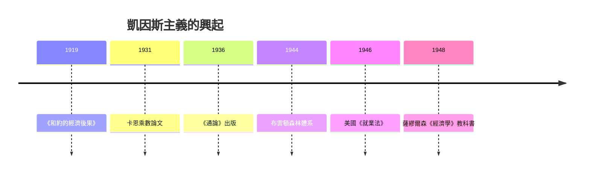

# 8.2 1936 通論：有效需求與政府干預

## 一個先知式人物的轉身

約翰·梅納德·凱因斯（1883–1946）是馬歇爾的學生、劍橋經濟學講席教授、布魯姆斯伯里文化圈的成員、成功的投資人（他為國王學院管理基金，也在 1920 年代的外匯投機中幾乎破產又東山再起）。他並非革命的局外人——他是英國財政部的戰時顧問、1919 年巴黎和會的英國代表團成員。正是《凡爾賽和約》的賠款安排讓他憤而寫下《和約的經濟後果》（1919），預言苛刻賠款將摧毀歐洲經濟並滋養復仇主義——這個預言的應驗方式（希特勒），比他自己設想的更慘烈。

1920 年代的凱因斯已經對正統理論漸生疑慮：英國戰後以戰前平價回歸金本位（1925，時任財政大臣邱吉爾主持）造成通縮與失業，凱因斯寫《丘吉爾先生的經濟後果》激烈反對；1929 年後他支持公共工程、反對削減工資。1930 年《貨幣論》仍試圖在舊框架內解決問題，他自己不滿意。真正的突破來自 1930 年代初與「劍橋馬戲團」（卡恩、羅賓遜夫婦等年輕學者）的研討：卡恩 1931 年的乘數論文是關鍵一步——政府支出的一元，會透過收入循環變成超過一元的總需求。

## 《通論》的三個顛覆

1936 年 2 月，《就業、利息和貨幣通論》出版。書難讀（薩繆爾森自嘲第一次讀時「沒有看懂，凱因斯也沒有」），但三個命題清晰而顛覆：

1. 有效需求決定產出與就業。薩伊定律被倒轉：不是供給自動創造需求，而是需求決定供給被利用到什麼程度。經濟可以長期停在「低就業均衡」——市場沒有自動拉回充分就業的機制。
2. 消費函數與乘數。人們不會把新增收入全部花掉（邊際消費傾向小於一），於是投資的波動被放大：$Y = C + I$，投資每增減一元，國民所得變動 $1/(1-c)$ 倍。這解釋了為什麼投資的小幅波動能造成失業的大幅震盪。
3. 流動性偏好與利率。利率不是儲蓄與投資在實物市場上的報酬，而是放棄流動性（持有貨幣）的代價。在極端不確定下，人們囤積貨幣，利率降不下去，貨幣政策失效——流動性陷阱。因此最後一招是財政政策：政府直接舉債花錢。

哲學底層同樣顛覆：凱因斯把「不確定性」（不可計算概率的未知）放回經濟學中心。未來不可知，所以人們依賴「動物精神」（animal spirits）——信心與情緒——做投資決策。市場不是穩態機器，而是騎在集體心理上的系統。這一點後來被明斯基（Hyman Minsky）發展成金融不穩定理論，並在 2008 年危機後重新成為顯學。

## 政策的勝利與教科書的革命

《通論》出版時，各國其實已在實踐中先行：羅斯福新政（1933 起）的公共工程、社會安全法、證券監管，方向與凱因斯一致；瑞典更早採行擴張財政。理論是追認，也是放大器。二戰把乘數做了最極端的實實驗：戰爭支出讓美國失業率從 14% 掉到 1.2%，凱因斯主義由戰時經驗獲得鐵證。

戰後的制度化分三層：

1. 1944 年布雷頓森林會議：凱因斯親自設計戰後貨幣秩序（他提出的「bancor」國際清算貨幣未獲採納，但 IMF 與世界銀行的架構有他的手筆），目標正是防止 1930 年代的競相貶值與以鄰為壑重演。
2. 1946 年美國《就業法》：聯邦政府正式承擔「促進最大就業」的責任——政府干預從應急變成憲制義務。
3. 教科書革命：薩繆爾森 1948 年《經濟學》把凱因斯宏觀與新古典微觀焊成「新古典綜合」，IS-LM 圖（希克斯）成為標準教具。此後三十年，西方大學的經濟學就是凱因斯主義。

## 質疑者從未沉默

凱因斯主義如日中天時，反對者已在集結。哈耶克在 1930 年代與凱因斯有過激烈的利率與投資理論論戰，戰後寫下《通往奴役之路》警告計劃經濟的滑坡（見 9.1）；弗里德曼則以貨幣史證據主張大蕭條的元凶是央行失職，而非市場自發崩潰（見 9.2）。1970 年代的滯脹（高通膨＋高失業並存）讓菲利普斯曲線失效，凱因斯主義的政策共識瓦解——那是下一章的故事。

## 凱因斯留給今天的

凱因斯最持久的遺產也許不是某個公式，而是一個原則：市場會自己運轉，但沒有保證運轉在充分就業上；因此政府的職責不是取代市場，而是在市場失速時踩油門、過熱時踩剎車。2008 年金融危機時，各國政府重施財政刺激與量化寬鬆，各國央行「不計代價」救銀行——凱因斯與明斯基的名字被重新放上頭條。大蕭條教會世界的事，每一代人都要重新學一次；而《通論》就是那堂課的講義。
