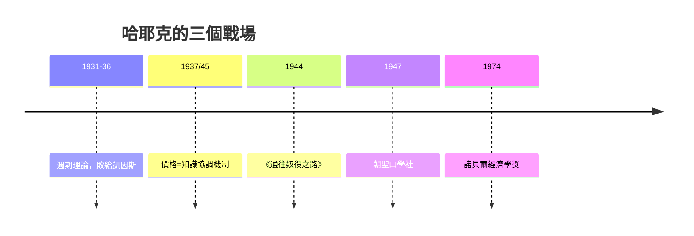

# 9.1 哈耶克：通往奴役之路與價格的訊息

## 從維也納到倫敦政經學院

弗里德里希·哈耶克（Friedrich Hayek, 1899–1992）生於維也納一個學者世家，一戰時在奧匈帝國軍中服役，戰後在門格爾—維塞爾—龐巴維克開創的奧地利傳統中受訓。1920 年代他追隨米塞斯研究商業週期：信貸擴張扭曲利率、誤導投資、最終以危機清算——這套「奧地利週期理論」讓他在 1931 年獲聘倫敦政經學院（LSE），正好與凱因斯的劍橋隔泰晤士河對峙。

1930 年代的哈耶克—凱因斯論戰（在《經濟期刊》等陣地上往返數年）以凱因斯勝出告終：大蕭條的現實站在凱因斯一邊，哈耶克的週期理論被邊緣化，LSE 的學生甚至轉投凱因斯陣營。哈耶克一度轉向知識論與政治哲學——而這個「退場」，反而成就了他對二十世紀最深刻的貢獻。

## 1937/1945：價格作為訊息系統

哈耶克真正的殺手鐧是兩篇論文。1937 年〈經濟學與知識〉提出：經濟學的核心問題不是「給定資訊下的最大化」，而是「分散在千百萬人腦中、彼此互不知曉的知識如何被協調」。1945 年〈知識在社會中的用途〉把答案講透：

社會需要的知識從不集中存在。它散落為千百萬人的具體知識——哪個倉庫有存貨、哪台機器閒置、此地此刻何物稀缺——而且隨時空變動，根本無法統計彙總。價格系統的偉大之處，在於它是一台通訊機器：漲價這一個數字，就把「此物稀缺」的訊息傳遍全球，讓每個不知內情的人自動調整行為，無需任何人掌握全貌。哈耶克稱之為「奇蹟」：僅憑這個機制，千百萬互不相識的人竟能合作無間。

這個論證的鋒芒直指兩個對手：一是中央計劃經濟——計劃者不可能取得分散知識，蘭格—哈耶克論戰（1930–40 年代，社會主義計算之爭）因此展開；二是凱因斯式的宏觀管理——若價格是唯一的訊息總和，人為壓低利率與操縱需求就是在污染訊號。

## 1944：通往奴役之路

二戰末期，哈耶克把政治論證寫成大眾讀物《通往奴役之路》（1944）。核心命題：計劃經濟與自由不可兼得——不是計劃者邪惡，而是邏輯使然。要全面計劃，就必須給目標排出優先序；要排出序，就必須由一套統一的價值觀覆蓋所有領域；而民主社會的價值多元恰恰不容這種覆蓋。於是計劃要推行，就得靠說服、再靠豁免、最終靠強制；每一個「暫時的」緊急權力都在為下一個鋪路。書中引用的例證（當時的德國：從俾斯麥的國家社會主義傳統到納粹對計劃的延續）在戰時英國顯得刺耳——這本書在英美被主流出版社拒稿，最後由哲學家波普爾的老友、經濟學家輾轉介紹才得以出版。

結果出乎意料：《讀者文摘》節選版讓它成為暢銷書，哈耶克一夜之間成為英語世界自由主義的旗手。1947 年他召集米塞斯、波普爾、弗里德曼、羅賓斯等人成立朝聖山學社（Mont Pelerin Society）——三十年後席捲西方的「新自由主義」思想網絡，就從這個學社起航。

## 從邊緣到諾獎

戰後三十年，哈耶克在凱因斯主義的黃金時代裡是個邊緣人：芝加哥大學只給他「社會與道德科學」的教職（經濟系婉拒），他轉而寫《自由憲章》（1960）、《法律、立法與自由》（1973–79），把自發秩序推廣到法律與文明演化。1974 年石油危機後滯脹爆發，凱因斯主義失靈，瑞典皇家科學院出人意料地把諾獎同時頒給哈耶克與繆爾達爾——哈耶克在得獎演說中半是自嘲半是警告：經濟學家若模仿物理學的精密，會變成「科學的僭妄」的受害者。這篇演說成為對經濟學科學自負的經典批評。

## 遺產與爭議

哈耶克的影響在 1980 年代達到頂峰：柴契爾夫人把《自由憲章》帶進內閣，宣稱「這才是我們相信的東西」；雷根的鬆綁與減稅、1990 年代前共產陣營的轉型，理論上都以「價格機制與分散知識不可替代」為據。他對蘇聯式計劃的批判，被 1989 年後的歷史普遍認為獲得了驗證。

爭議同樣持續：批評者指出，哈耶克對計劃的滑坡論證在民主國家並未應驗——福利國家與自由共存了大半個世紀；他對社會正義的否定（「社會正義是海市蜃樓」）始終難以安頓市場經濟的輸家。而他最深的洞見——知識是分散的、制度是演化的、理性有其邊界——如今也成為行為經濟學、複雜性科學與機器學習時代的共同前提：演算法市場的設計者（見 12.2）每天處理的，正是哈耶克所說的「分散知識如何被協調」的工程版問題。
