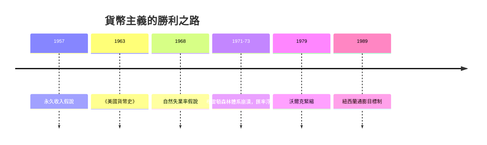

# 9.2 弗里德曼與貨幣主義：通膨是貨幣現象

## 從蕭條教訓出發的反叛

密爾頓·弗里德曼（Milton Friedman, 1912–2006）是俄國移民的兒子，在羅格斯大學受教於新政時代的凱因斯主義者，博士班在哥倫比亞，最後落腳芝加哥大學。他與哈耶克不同：哈耶克是哲學家式的批評者，弗里德曼是實證主義的工匠——他要的不是推翻凱因斯，而是用資料把凱因斯主義一塊塊拆開檢驗。

他的第一個目標是「消費函數」。凱因斯假設消費隨當期收入上升，邊際消費傾向遞減——這暗示長期儲蓄率會隨收入上升而升高。弗里德曼與庫茲涅茨的資料顯示：長期儲蓄率大體穩定。1957 年《消費函數理論》以「永久收入假說」解決矛盾：人們按長期平均收入（永久收入）安排消費，暫時的收入波動主要落入儲蓄。這篇著作至今仍是微觀消費理論的基石之一，也展示了弗里德曼的方法：用理論與資料的對撞，逼出更精確的行為假設。

## 美國貨幣史：重審大蕭條

1963 年，弗里德曼與施瓦茨（Anna Schwartz）出版《美國貨幣史（1867–1960）》。這部近九百頁的實證巨著給出了一個改寫教科書的結論：1929–1933 年美國貨幣供給收縮約三分之一，元凶不是市場崩潰，而是聯準會——銀行倒閉潮中，聯準會既未放款救市，也未大規模買入債券，反而放任貨幣湮滅。1930 年代的那場浩劫，「不是私人的進取精神過度，而是政府的政策失敗」。

這個結論的殺傷力在於它搶走了凱因斯主義的立論根基。凱因斯說大蕭條證明市場會自我崩潰、必須政府干預；弗里德曼說大蕭條恰恰證明是政府（央行）把市場推下懸崖。伯南克 2002 年在弗里德曼九十大壽的演說中說：「關於大蕭條，你們是對的，是我們（聯準會）幹的。我們很抱歉。但不會再犯了。」——2008 年危機時聯準會的激進擴表，正是這句話的兌現。

## 貨幣主義的核心命題

弗里德曼把這些發現整理成一個與凱因斯主義對立的宏觀框架：

1. 通膨無論何時何地都是貨幣現象。通膨的根源是貨幣供給增長超過產出增長；控制住貨幣，就控制住通膨。
2. 自然失業率假說（1968，與費爾普斯同期提出）：長期菲利普斯曲線是垂直的。通膨與失業只在短期可交換；政府若持續用通膨換就業，預期會調整，失業回到自然率，只剩更高的通膨。
3. 政策規則優於相機抉擇：政策制定者的判斷與政治誘因不可靠，貨幣應按固定規則增長（如每年 k%）。「規則 vs 權變」從此成為央行學的核心辯題。

## 1970 年代的驗證：滯脹

理論等來了它的歷史時刻。1970 年代的兩次石油危機（1973、1979）疊加此前多年的擴張性政策，讓西方同時出現高通膨與高失業——滯脹。凱因斯主義的菲利普斯曲線交換關係失效，政策工具箱空轉。1979 年英國柴契爾與美國雷根相繼上台，1980 年代初沃爾克（Paul Volcker）執掌聯準會，以「貨幣主義實驗」緊縮貨幣：利率一度升到 20%，美國經歷 1981–82 年深度衰退，失業破 10%，但通膨從 13.5% 壓回 4% 以下。代價慘烈，方向有效——此後「央行獨立性＋通膨目標制」成為全球標準（紐西蘭 1989 年首創通膨目標制，各國跟進），貨幣主義的核心直覺以制度形式沉澱下來。

諾獎的時間線也說明風向：弗里德曼 1976 年獲獎；哈耶克 1974；盧卡斯（理性預期，把弗里德曼的預期邏輯推向極致）1995。芝加哥學派在七、八、九十年代理論與政策兩線全勝，先後走出數十位諾獎得主。

## 另一面：自由的經濟學家

弗里德曼同時是二十世紀後半最有影響力的公共知識分子。1962 年《資本主義與自由》主張浮動匯率、志願兵役制、學券制、負所得稅、毒品除罪化——立場橫跨左右，一致的軸心只有一個：讓個人選擇最大化。1980 年與妻子蘿絲合寫的《選擇的自由》配上電視片，把經濟自由主義帶進千萬家庭。他為智利皮諾契特軍政府提供經濟建議一事，終身受到嚴厲批評；但他回應說：市場改革與獨裁並無必然關係，而通膨失控才是自由最直接的敵人。

## 貨幣主義的黃昏與與遺產

嚴格版貨幣主義（盯住貨幣總量）在 1980 年代中期便告失效：金融創新讓貨幣需求函數不穩定，M2 與經濟的關係斷裂。弗里德曼晚年承認「貨幣總量作為目標已經不再好用」。但貨幣主義作為「學說」勝利了：今天全球央行的憲法——獨立性、通膨目標、透明規則、對財政主導的警惕——全是弗里德曼論證的制度化。而 2008 年後的量化寬鬆與零利率時代，貨幣數量論的簡單版本再度受挫（貨幣暴增而通膨遲遲不來），直到 2021 年後供應鏈與能源衝擊疊加大規模財政貨幣刺激，通膨重回世界舞台——貨幣主義的直覺又一次被重新討論。

從重商主義的「金銀即財富」到弗里德曼的「通膨是貨幣現象」，貨幣始終是經濟學最迷人也最危險的變數。它可以是訊息（哈耶克）、可以是繩索（金本位）、可以是藥（沃爾克）、也可以是毒（超發）。經濟學史的很大一部分，就是人類學會駕馭這頭怪獸的記錄。
