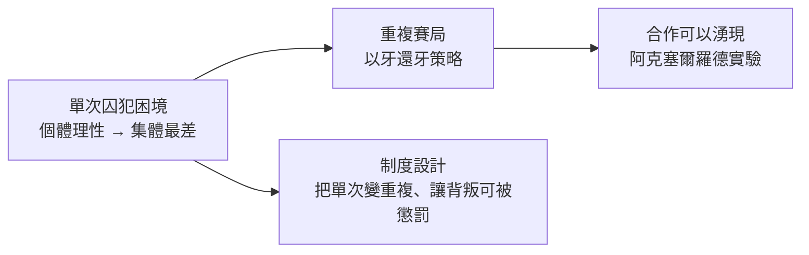

# 10.1 納什均衡：當所有人都偷算別人的算盤

## 從蘭德的餐桌上說起

1950 年，普林斯頓數學系二十一歲的博士生約翰·納什寫出一篇不到三十頁的博士論文，證明了一個日後改變社會科學的定理。翌年夏天，蘭德公司的餐桌上流傳著一個小遊戲：每人選一個 1 到 100 的數字，最接近平均數三分之二的人贏。如果人人都「理性」地推理，唯一穩定的答案是 0；但現實的贏家往往報 20 左右——因為真實的人不會推理到底，也不相信別人會。

這個遊戲正是納什思想的縮影。在他之前，馮·紐曼與摩根斯坦 1944 年的《賽局理論與經濟行為》已建立兩人零和賽局的系統理論，但對「非零和」（利益部分重疊、部分衝突）的情形束手無策——而現實中的經濟與政治，恰恰幾乎全是非零和。納什證明：任何有限賽局都存在至少一組「均衡策略」——在這組策略下，沒有任何一方能靠單方面改變策略而獲益。這就是納什均衡。

## 囚犯困境：合作的邏輯難題

賽局理論最著名的寓言是兩名被分開審訊的囚犯：都沉默，各判一年；一人招供，招者自由、沉默者重判；都招供，各判五年。對每個人而言，「招供」都是優勢策略——於是均衡落在（招供，招供），兩人都比合作（沉默，沉默）更慘。

這個結構解釋了無數現實現象：軍備競賽、價格戰、公地悲劇（過度捕撈、過度排放）、關稅報復。它揭示了一個殘酷的真理：個體理性可以導致集體非理性——每個人都做了對自己最好的選擇，加總起來卻是所有人都不想要的結果。這對古典經濟學「看不見的手」是一個深刻的限定：市場能協調「買賣」這類利益互補的互動，卻協調不了「陷阱結構」的互動；後者需要制度、重複互動、信任與懲罰。

1980 年代，政治學家阿克塞爾羅德舉辦電腦程式錦標賽，讓各種策略在重複囚犯困境中對戰。冠軍是最簡單的「以牙還牙」：第一輪合作，之後模仿對手上一步。合作的條件不是善意，而是「未來足夠重要」（折扣因子夠高）＋「背叛可以被看見與報復」。這把霍布斯式的問題變成了可設計的工程問題——今天的國際條約、商業信譽系統、平台評價機制，都是這套邏輯的制度化。

## 一個瘋狂的間歇，一段漫長的回歸

納什的故事有一個悲劇的轉折。1950 年代末，他患上妄想型精神分裂症，從學術界消失三十年：辭去 MIT 教職、遊蕩歐洲、在普林斯頓校園裡被稱為「幽靈」。奇蹟般地，他的病情在晚年部分緩解——他說是靠理性「戰勝」了妄想中的聲音。1994 年，納什均衡已成為經濟學、政治學、演化生物學、計算機科學的通用工具，瑞典皇家科學院把諾貝爾經濟學獎頒給納什、海薩尼與澤爾騰。這段經歷後來被改編成電影《美麗境界》（2001）。

理論本身也在繼續深化：澤爾騰的子賽局完美均衡處理了「空洞威脅」，海薩尼的貝葉斯均衡處理了「我不知道你知道」；謝林（Thomas Schelling，2005 年諾獎）把焦點、承諾與協調引入戰略互動——冷戰核威懾的穩定，正是謝林式思維的產物。1990 年代以降，賽局論成為拍賣設計（1994 年美國頻譜拍賣）、機制設計與平台經濟（見 12.2）的底層語言。

## 對「看不見的手」的修正

納什均衡對經濟學的意義，可以這樣概括：斯密的世界裡，人人追逐自利，價格機制把它匯成公共之善；納什的世界裡，人人還要預判彼此的策略，而預判的均衡未必是善。經濟學因此從「價格理論」擴展為「策略互動理論」——壟斷與寡頭（古諾、伯特蘭模型的現代復興）、工資談判、國際談判、乃至演算法之間的定價戰，都成了可分析的對象。看不見的手沒有被推翻，但它被裝上了第二隻手：當互動是策略性的，制度設計（而非放任）才是合作的條件。
