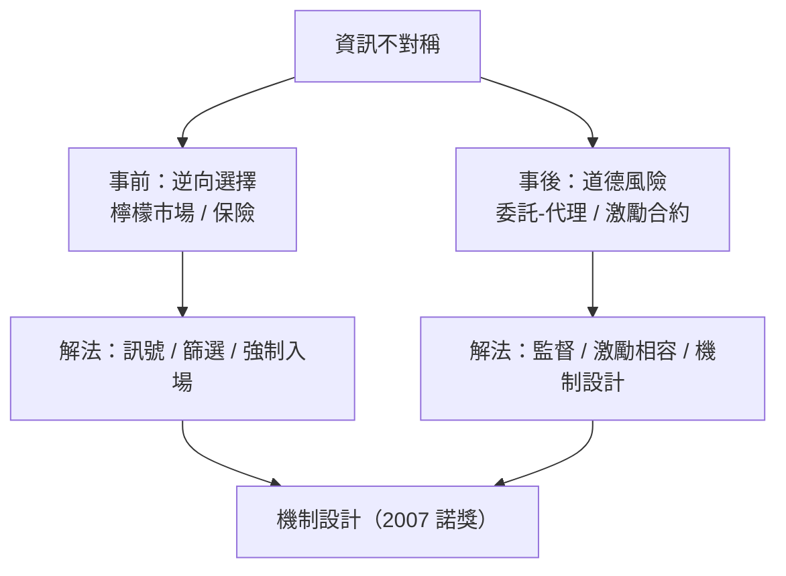

# 10.2 檸檬市場：劣幣如何驅逐良幣

## 一篇被退稿三次的論文

1970 年，伯克利的年輕教授喬治·阿克洛夫（George Akerlof）寫出一篇論文〈檸檬市場：品質的不確定性與市場機制〉。他講的故事極其樸素：二手車市場裡，賣家知道車是好車（peach）還是爛車（lemon），買家不知道。買家只願出「平均品質」的價格；於是好車的賣家覺得虧，退出市場；市場裡剩下的爛車比例升高，買家進一步壓價；更多好車退出……最後市場可能完全消失——剩下的全是檸檬。

邏輯像滾雪球：資訊不對稱不是摩擦，而是能把整個市場吃掉的漩渦。阿克洛夫把論文投給主流期刊，接連被退——審稿人覺得「太瑣碎」「顯然不對，否則市場早就不存在了」。哈佛的教授們說這論文「沒有新意」。直到 1970 年《經濟學季刊》刊出，三年後學界才恍然大悟：這不是玩具模型，這是資訊經濟學的開山之作。2001 年，阿克洛夫與斯賓塞、斯蒂格利茨同獲諾貝爾獎。

## 為什麼「看不見的手」會失靈

檸檬市場擊中了新古典框架的一個核心假設：同質商品、完全資訊。一旦品質隱藏、資訊不對稱，價格就不再能傳遞稀缺性，反而會傳遞「劣質」——你出價低，我就知道你猜我的貨是爛的。哈耶克說價格是知識的匯總（見 9.1）；阿克洛夫說：當知識分布不均時，價格會反噬自己。這是對價格機制的第一次系統性限定。

現實中的檸檬市場俯拾皆是：

- 保險市場：最想買健康險的人往往是身體最差的人（逆向選擇），於是保費升高、健康人退出——這正是 2010 年美國 ACA 醫改強制投保（個人強制條款）的理論依據：用「強制所有人進場」來阻止漩渦。
- 信貸市場：銀行無法分辨借款人的品質，利率升高反而趕走好借款人、留下高風險者，因此銀行寧願配給信貸而不抬價——斯蒂格利茨與韋斯的信貸配給模型（1981）。
- 勞動市場：學歷作為能力的訊號——斯賓塞的「訊號理論」指出，教育在一定程度上的功能不是提升生產力，而是讓有能力者以低成本取得證書、與低能力者分離。這個結論對教育政策意義深遠（也極具爭議）。
- 國際金融：新興市場的貨幣危機、銀行擠兌，本質都是「壞消息驅逐好消息」的漩渦。

## 資訊經濟學的帝國

阿克洛夫之後，資訊不對稱成為微觀經濟學的主戰場，發展出三個分支：

1. 逆向選擇（事前隱藏資訊）：誰進場是由其隱藏品質決定的——檸檬市場、保險。
2. 道德風險（事後隱藏行動）：成交之後，一方行動無法被觀察——保險後的疏忽、經理人的偷懶。委託—代理理論由此誕生：股權激勵、績效合約、央行行長的責任制，都是道德風險的解法。
3. 訊號與篩選：無資訊的一方主動設計選單（篩選，如保險的自付額分級），有資訊的一方主動花成本發訊號（如學歷、保養紀錄、品牌）。

這套語言重塑了整個經濟學：金融學（資訊與資產定價）、會計學（盈餘管理）、組織經濟學（企業是解決資訊問題的治理結構）、乃至政治學（選民與政客的資訊問題）。1990 年代以來，機制設計（赫維茨、馬斯金、邁爾森，2007 年諾獎）更進一步：既然資訊會扭曲，那就設計規則，讓人們「說真話成為最優策略」——拍賣、匹配（腎臟交換、學區分配）、公共採購的現代設計全是其產物。

## 制度是資訊問題的答案

檸檬模型還解釋了大量「看似低效」的制度的意義：二手車行的保固、第三方認證（ISO、米其林）、品牌的沉沒投資（品牌是「我敢保證品質」的抵押品）、中古屋仲介的信譽、電商平台的評價系統。這些機構的本質都是「把不可觀察的品質變成可信的承諾」。市場沒有因資訊不對稱而消失，是因為人類發明了一整套降低資訊不對稱的基礎設施——而這套基礎設施本身，就是經濟制度史的重要篇章。

## 與行為經濟學的合流

資訊經濟學與行為經濟學（第 11 章）在二十世紀末匯流成一個共同結論：真實市場既沒有完全資訊，也沒有完全理性。前者由阿克洛夫們證明，後者由康納曼們證明。兩者的合流，在 2008 年危機後達到頂點：次貸危機正是雙重失靈的樣本——評級機構與投資人之間的資訊不對稱（逆向選擇），疊加從眾與過度自信（行為偏誤），疊加激勵扭曲（道德風險：發行人把風險賣掉就沒事了）。經濟學用了一百年從「完美市場」走到「真實市場」，檸檬是路上最關鍵的一站。
