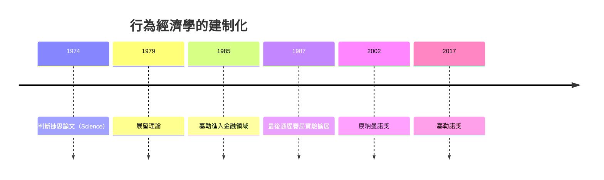

# 11.1 康納曼與特韋斯基：不理性的真實人類

## 兩個心理學家闖進經濟學

丹尼爾·康納曼（Daniel Kahneman, 1934–2024）與阿莫斯·特韋斯基（Amos Tversky, 1937–1996）都不是經濟學家。康納曼是出生於特拉維夫、童年在法國佔領區度過的猶太孩子（他曾說，母親講的一個德國士兵抱緊他的故事，讓他一生著迷於人如何在極端情境下變得難以理解）；特韋斯基是特拉維夫出生、史丹佛任教的數學心理學家。兩人從 1969 年起在希伯來大學與美國的實驗室裡合作，設計出一個個精巧的選擇實驗，專門獵殺經濟學的根基假設——理性經濟人（Homo Economicus）。

他們發現的偏誤可以歸成兩大類：

1. 判斷的偏誤（人們如何估計概率與風險）：
   - 代表性捷思：以「像不像」代替「有多可能」。著名的琳達問題：受試者認為「琳達是銀行出納員且是女性主義者」比「琳達是銀行出納員」更可能——合取事件概率反而更高，違反基本概率。
   - 可得性捷思：越容易想起的事越被高估。飛機失事的新聞讓人高估空難、低估車禍。
   - 錨定效應：先看到的數字（哪怕是隨機的）會把後續估計拉向它。
2. 選擇的偏誤（人們如何做決定）：這是 1979 年展望理論的核心，見 11.2。

經濟學的標準回應起初是防禦性的：「偏誤是隨機雜訊，市場會淘汰不理性者」「實驗室情境不真實」。但證據持續累積，而且經濟學界內部也出現了實驗經濟學（弗農·史密斯，2002 年與康納曼同獲諾獎）：在真實的貨幣激勵下，系統性偏離理性預測的現象依然穩定出現。最經典的是「最後通牒賽局」：提議者分錢，回應者可拒絕（兩人都拿不到）。理性預測是提議者拿走 99%、回應者接受任何正數；實驗結果卻是提議者普遍分出 30–50%，而低於 20–30% 的提議常被憤怒拒絕——人類寧可付錢懲罰不公。這種偏好無法用自利效用函數解釋，卻穩定存在於從學生到獵採部落的所有人群。

## 展望理論：對效用函數的正面改造

1979 年的〈展望理論〉（Kahneman & Tversky）給出的是建設性的替代方案，而不是單純的破壞。三個核心發現：

1. 參考點依賴：人評估得失不是看最終財富，而是看相對某個參考點的變化。同樣的 100 萬，從 200 萬跌到 100 萬是「損失」，從 0 漲到 100 萬是「獲得」——感受截然不同。
2. 損失趨避：損失的痛遠大於等額收益的快（實驗估計約 2 到 2.5 倍）。人們為避免確定的損失願意冒險——這解釋了為什麼虧損的股票投資人「抱著不放」、為什麼企業在沉沒成本面前加碼。
3. 機率權重：人們高估小機率（買彩券、買保險），低估中高機率。價值函數在收益區是凹的（風險趨避），在損失區是凸的（風險偏好）——一條曲線同時解釋了保險與彩券這對古典難題。

$$
v(x) = \begin{cases} x^{\alpha} & x \geq 0 \text{（收益，凹）} \\ -\lambda(-x)^{\alpha} & x < 0 \text{（損失，凸，}\lambda \approx 2.25\text{）} \end{cases}
$$

## 從邊緣到主流：一場漫長的承認

行為經濟學的建制化花了三十年，關鍵人物是一批「翻譯者」：

- 理查·塞勒（Richard Thaler）：在羅徹斯特博士班時就因收集「人類的不理性」例子被教授視為異端；他把康納曼的理論搬進消費者選擇（心理帳戶：辛苦錢與意外之財在人腦裡分開記帳）、金融市場（1985 年起與金融學家合作，用損失趨避解釋股權溢價之謎）。2017 年諾獎。
- 羅伯特·席勒（Robert Shiller）：把行為偏誤引入資產定價，解釋泡沫與恐慌；2000 年在網路泡沫頂點出版《非理性繁榮》，預言崩盤。2013 年諾獎。
- 大衛·卡尼曼—特韋斯基之外的第二代：安德烈·施萊弗（效率市場的心理學批判）、馬修·拉賓（1990 年代末把損失趨避寫進正式模型）。

2002 年康納曼獲諾獎（特韋斯基已於 1996 年去世，諾獎不追授已故者——康納曼說獎屬於兩人共同的靈魂），標誌著主流經濟學正式承認：心理學的證據是經濟理論必須面對的約束。

## 經濟學的自我修正

值得強調的是，行為經濟學的勝利不是「經濟學錯了」的勝利，而是「模型要更貼近人」的勝利。理性選擇框架沒有被拋棄——它被放進了更真實的參數：效用函數裡加入了公平感與損失趨避，信念形成裡加入了捷思與偏誤，決策裡加入了有限注意力與自制力問題。這與 1930 年代不完全競爭對完全競爭的修補（見 7.2）、1970 年代資訊經濟學對完全資訊的修補（見 10.2）是同一類工作：把「不現實的簡化」一個個換成「可檢驗的近似」。

經濟學用了兩百年把人抽象成計算機，又用五十年把計算機還原成人。這個往返本身，就是這門學科最迷人的故事。
