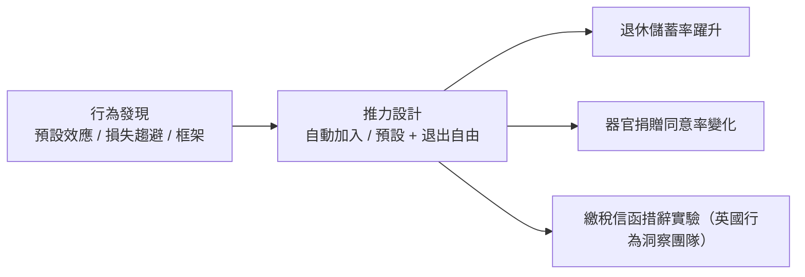

# 11.2 展望理論、推力與公共政策的改造

## 從理論到「自由父權主義」

行為經濟學如果只停留在實驗室，它只是心理學的一章。它真正改變世界，是因為它的發現可以直接轉化為政策工具。轉化的樞紐是一個看似溫和的概念：選擇架構（choice architecture）。

人做選擇時深受「預設選項」、呈現順序、框架效應影響——而任何選單都必然有預設與順序（你不可能「不設計」一個選項表）。塞勒與法律學者卡斯·桑斯坦（Cass Sunstein）在 2008 年《推力》（Nudge）中提出結論：既然影響無所不在，那就讓影響往好的方向去——保留選擇自由（不強制、容易退出），但把預設選項設計成對人們自己有利的那個。他們稱之為「自由父權主義」（libertarian paternalism）。

最有名的實戰案例是退休金計畫。美國 401(k) 制度原本要求員工主動申請加入，結果大量低收入員工因拖延與繁瑣而「選擇」不參加——多年後退休儲蓄嚴重不足。塞勒與班納吉設計了「明天多存一點」（Save More Tomorrow, 2004）：預設自動加入，但加薪時才提高儲蓄率（利用損失趨避的正面版本——人們不願看到薪水減少），參與率從不到一半躍升到九成以上。英國 2012 年的自動加入退休金改革、以及數十國的器官捐贈預設同意制，都是同一路數。

## 各國的「推力單位」

2010 年，英國卡麥隆政府設立全球第一個政府行為洞察團隊（Behavioural Insights Team，媒體稱「推力小隊」），用隨機對照試驗（RCT）測試政策措辭與流程：把繳稅催繳信裡加一句「九成本地人都按時繳稅」（社會規範），回收率顯著提升。歐巴馬政府隨後設立白宮社會與行為科學團隊；世界銀行 2015 年《世界發展報告》以「思維、社會與行為」為題，把行為政策推向發展援助。到 2020 年代，全球有兩百多個政府行為單位。

與此同時，RCT 方法論本身成為發展經濟學的主流：班納吉與杜芙若（Abhijit Banerjee & Esther Duflo，MIT 貧困行動實驗室）用田間實驗檢驗教育、疫苗、小額信貸的具體干預，2019 年與克雷默同獲諾獎。政策制定第一次擁有了像臨床試驗一樣的證據標準——這是行為革命的方法論遺產。

## 框架效應與市場設計

展望理論的另一支應用在市場與談判的「框架」上：

- 定價與行銷：損失趨避解釋了「限時優惠」「先試用再收費」（免費期結束等於損失）、「原價劃掉」的有效性。行為行銷學整個建立在這些發現上。
- 保險與金融產品：人們同時買彩券與保險的悖論被機率權重解釋；「心理帳戶」解釋了紅利再投資、以及投資人對已實現虧損的迴避。
- 談判：同一提案以「獲利」或「避免損失」框架呈現，成交率截然不同——外交與商業談判的框架設計成為顯學。

更系統的應用是市場設計（market design）：羅斯（Alvin Roth，2012 年諾獎）把賽局與匹配理論變成工程——腎臟交換鏈、紐約學校匹配、住院醫師配對，都是在「尊重人的偏好與偏誤」的前提下重造制度。市場不是天然的，是被設計的——這是二十世紀末經濟學最重要的觀念轉變之一，也直接鋪墊了演算法時代的平台設計（見 12.2）。

## 推力的限度與倫理

推力範式也帶來嚴肅的批評。第一是家長主義的界線：誰來決定「好的預設」？桑斯坦的回應是透明與退出自由，但批評者指出，企業同樣在用推力（而且更嫻熟）——免費遊戲的抽獎機制、訂閱的自動續約、社群媒體的無限下滑，都是針對偏誤的「黑暗推力」（sludge）。第二是效果的可複製性：2015 年後心理學可複製性危機波及部分行為研究，許多著名效應的效應量比原始報告小得多；行為政策因此更依賴大樣本 RCT 與預註冊，方法論反而更嚴謹了。第三是政治的兩面性：同一套「人會被框架」的科學，既可做選民登記提醒，也可做精準選戰操弄——行為科學的倫理規範至今仍在追趕它的工程能力。

## 一條回到源頭的線

回頭看，這一條線可以拉得很長：亞里斯多德說人是有習慣與弱點的動物（見 1.1）；中世紀的公正價格假設人會欺騙（見 1.2）；斯密在《道德情操論》裡寫同情與榮譽、在《國富論》裡寫自利——他從未假設人是純粹理性的計算機；邊際革命與新古典把「經濟人」推到極致（見第 6、7 章），是特定歷史時期的方法論選擇；而行為經濟學只是把兩百年前被簡化掉的複雜性，用實驗重新接了回來。經濟學對「人」的想像，走了一個螺旋：從道德的人，到理性的人，再回到真實的人。
