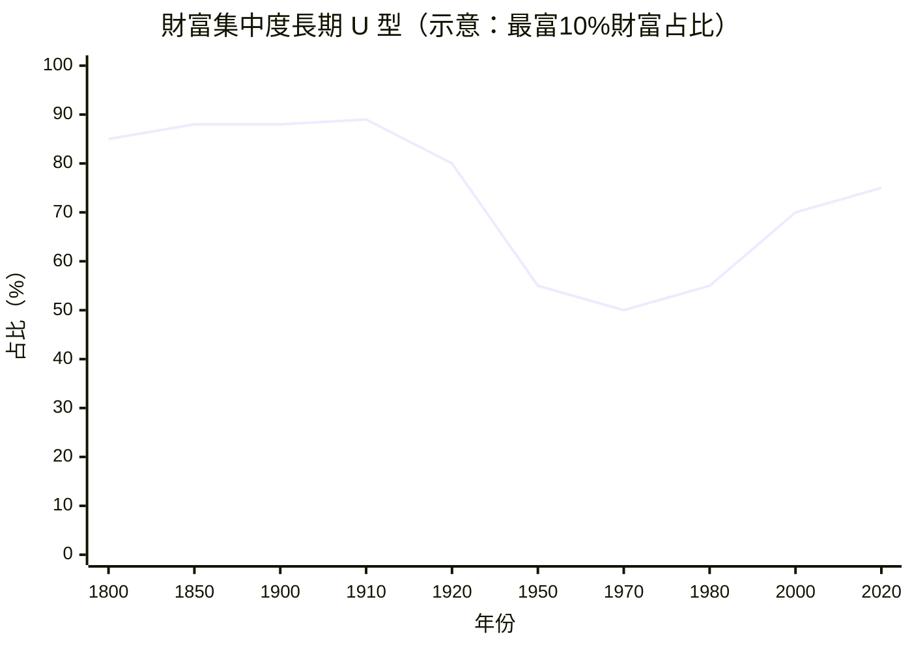

# 12.1 皮凱提：當 r 大於 g，財富自己會長大

## 一個用資料重寫資本主義史的人

2013 年，法國經濟學家托馬斯·皮凱提（Thomas Piketty, 1971–）出版《二十一世紀資本論》。書名刻意呼應馬克思（見第 5 章），但方法完全不同：馬克思從理論推演出矛盾，皮凱提從資料裡讀出規律。他與同事（特別是賽斯 Saez、祖克曼 Zucman）花了十五年，把英國、法國、美國等國兩三百年來的所得稅、遺產稅、財產申報紀錄一張張數位化，重建了人類歷史上第一套長期財富分配資料庫（世界不平等資料庫 WID 的前身）。

這套資料講述的故事清晰得驚人：

- 1790–1914：歐洲是「世襲資本主義」。財富高度集中（最富 10% 擁有 80–90% 的財富），繼承是財富的主要來源，巴爾扎克與奧斯汀小說裡的婚姻算計正是這個制度的文學寫照。
- 1914–1950：兩次世界大戰與大蕭條摧毀資本（通膨、破產、國有化），加上戰後累進稅制（美國最高邊際稅率一度超過 90%），財富集中度跌到歷史最低。中產階級的誕生，不是市場的自然結果，而是戰爭與政策的產物。
- 1980 至今：累進稅退潮、金融全球化、資產價格上升，財富集中度回升。美國最富 1% 的所得占比回到 1920 年代的水平；「超級經理人」的天價薪酬取代了舊式的世襲地租。

## 核心定律：r > g

皮凱提把觀察壓縮成一個不等式：

$$
r > g
$$

r 是資本的平均回報率（歷史長期約 4–5%），g 是經濟成長率（長期約 1–2%，低成長時代更低）。當 r 持續大於 g，既有資本的增值速度超過整體經濟的成長速度：資本家的財富像滾雪球，而只靠工資的人追不上。結果是財富自動向持有資本的人集中——不需要任何人做錯什麼，這是資本主義的內在傾向。

皮凱提由此區分兩種社會形態：g 高時（戰後三十年，人口與生產力雙高），勞動所得增長快於資本回報，社會趨向平等——那是「勞動者的黃金年代」；g 低時（低生育、低成長的成熟經濟），r 與 g 的差距擴大，繼承財富的分量重新超過終身勞動所得——世界正在回到「巴爾扎克的社會」。

他的藥方同樣直白：全球累進資本稅（對大額財富年度課稅）＋更透明的金融資訊（資產登記、跨國資訊交換）。承認其政治可行性極低，但他認為至少要讓「資本稅」成為公共討論的選項，正如 1910 年代的所得稅。

## 一場全球辯論

《資本論》英文版（2014）在美國登上暢銷榜首——一部七百頁的經濟史著作，這是極罕見的事。支持者視之為「我們時代的馬克思」；批評者的火力集中在：r > g 不是定律而是經驗傾向（資本可折舊、可分散、可被增長稀釋）；財富集中未必等於流動性停滯（新財富不斷替換舊財富）；資料對「資本回報」的估算仍有方法爭議。英國《金融時報》2014 年的資料質疑引發一輪交鋒，後續研究大體支持其長期趨勢、修正其細節。

無論細節如何，皮凱提改變了提問的框架：不平等從「道德話題」回到「資本主義動力學的核心變數」。2008 年金融危機、占領華爾街運動、桑德斯與川普的民粹浪潮，都在他的資料曲線上找到了經濟學的註腳——政治極化與中產階級的萎縮，在歷史資料裡是同一條曲線。

## 皮凱提之後

皮凱提的資料工程催生了一整個研究議程：祖克曼估算離岸財富天堂藏有全球 GDP 的約 10%；賽斯的資料成為各國討論富人稅的標準依據；世界銀行與 IMF 的不平等報告如今例行引用 WID。皮凱提本人後來轉向更宏大的《資本與意識形態》（2019）：每個不平等制度背後都有一套為其辯護的意識形態，而意識形態是可以被政治鬥爭改寫的——他從「科學家」轉身成為「歷史的制度設計者」，主張「參與式社會主義」：全民遺產（每人成年時獲得一筆公共贈與）、財產稅、員工董事席次。

馬克思問：資本主義會不會自我毀滅？皮凱提的回答更冷靜也更令人不安：它不會崩潰，它會自我強化——除非政治出手。問題只剩一個：政治會不會出手，以及由誰的手。
