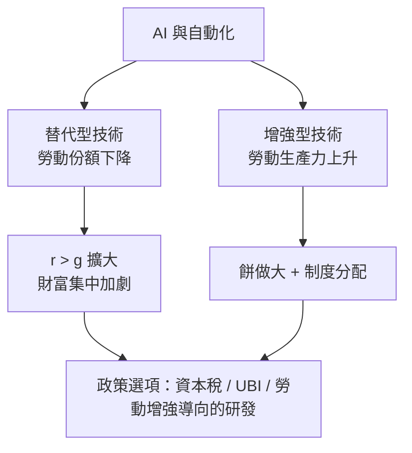

# 12.2 演算法時代：平台、AI與勞動定義的重塑

## 從哈耶克的問題到工程問題

回到 1945 年哈耶克的命題（見 9.1）：經濟的核心難題是分散知識的協調，價格是他所知的唯一解。二十一世紀的演算法經濟給出了第二種解：即時雙邊市場。Uber 的叫車演算法在幾秒內把附近的司機與乘客配對並動態定價；亞馬遜每天調整數百萬商品價格；Airbnb、外送平台、共享單車同理。經濟學家羅斯說的「市場設計」從政策工程變成了軟體工程——瓦爾拉斯的聯立方程組（見 6.2）如今以毫秒級的頻率被求解。

平台經濟的三個結構性變化：

1. 網路效應與贏者通吃：用戶越多平台越有用，規模報酬遞增使市場天然傾向壟斷。二十世紀的反托拉斯以「價格」為核心指標，但 Google、Facebook 對用戶免費——壟斷的證據藏在資料與注意力裡，傳統工具失靈。
2. 資料成為生產要素：財富的來源又添一項——數據、演算法與網路效應（呼應本書「財富來源」的長鏈：金銀→土地→勞動→資本→資料）。
3. 零工與演算法管理：平台把雇傭關係拆成逐單交易。司機不是員工也不是傳統承包商，而是被演算法派單、評分、定價的「人力資源即服務」。管理權從經理人轉移到代碼——這是泰勒制科學管理（二十世紀初）之後勞動控制方式的又一次躍遷，也引爆了全球性的「平台勞工身分」訴訟與立法（加州 AB5、歐盟平台工作指令）。

## AI：通用技術的再一次降臨

人工智慧是自蒸汽機、電力、計算機以來的又一次「通用目的技術」（GPT, general purpose technology）。它的經濟學特徵與前幾次技術革命同構，也有一個新的轉折：

- 同構之處：初期投資巨大、擴散需要數十年（電力從發電到重組工廠布局花了四十年，AI 從模型到組織重構同樣需要時間）；生產率曲線呈 J 型（索洛 1987 年的調侃：「電腦無所不在，唯獨生產率統計看不見」——直到 1990 年代後期統計才顯現，AI 大概也要經歷同樣的 J 型）。
- 新的轉折：以往的自動化替代「常規任務」（體力、例行文書），AI 首次深入「認知非例行」任務——寫作、程式、分析、設計。勞動市場的極化（中間技能被掏空）可能變成「高技能白領任務」的局部替代。阿西莫格魯（Daron Acemoglu）與雷斯特雷波的研究顯示：機器人的影響取決於技術方向——「替代型」技術壓低勞動份額，「勞動增強型」技術提升它；技術的方向不是命運，而是企業稅制、勞工議價與研發導向的選擇結果。

勞動收入份額（勞動所得占 GDP 比重）在多數發達國家自 1980 年代起持續下滑，自動化、全球化與工會式微是三大解釋。如果 AI 加速替代，皮凱提的 r > g 將更陡峭（資本＝演算法與算力，回報率極高）；這正是 UBI 討論升溫的經濟背景。

## 無條件基本收入與「後工作社會」的想像

UBI（無條件基本收入）不是新想法——潘恩、穆勒有過雛形，弗里德曼的負所得稅是它的市場派版本——但 AI 時代給了它新的論據結構：

- 支持的論據：若 AI 大幅替代勞動，工資作為分配機制將失靈，需要「資本紅利」式的再分配（人人分享機器產出）；行為經濟學研究也顯示，現金補助（不附加條件）在多數實驗中改善健康與教育而不降低工作意願——肯亞 GiveDirectly 的長期 RCT、芬蘭 2017–18 年的實驗皆支持這一點（芬蘭實驗中受助者就業與對照組無顯著差異，幸福感顯著更高）。
- 反對的論據：成本巨大且擠壓其他福利；「社會貢獻感」的損失難以用現金補償；在移民開放的經濟體中財政可持續性存疑。

更務實的中間路線正在試驗：負所得稅與擴大的勞動所得稅抵免（EITC）、幼兒與長者的全民服務、主權財富基金的「公民分紅」（阿拉斯加石油基金自 1982 年起每年向居民發放分紅，是最接近 UBI 的現實樣本）。爭論的本質不是技術，而是定義：當「勞動」不再是分配的主要憑據，社會契約以什麼為基礎？

## 經濟學的下一個兩百年

把全書的線索收攏：經濟學從「治家」出發（第 1 章），被國家與市場放大（第 2、3 章），被人口與貿易塑造（第 4 章），被資本與勞動的張力撕扯（第 5 章），被邊際概念數學化（第 6、7 章），被大蕭條逼出宏觀視角（第 8 章），被計劃與自由的對決重塑制度想像（第 9 章），被賽局與資訊逼出真實世界（第 10 章），被心理學還原成人（第 11 章），如今面對演算法與 AI（第 12 章）。

每一次轉折的動力結構都相似：技術改變了可能性的邊界，制度與政治決定誰受益，而思想在舊理論的裂縫處萌芽。斯密的分工、馬克思的矛盾、凱因斯的需求、哈耶克的知識、納什的策略、康納曼的偏誤、皮凱提的 r > g——這些概念不是過時的遺物，而是今天的分析工具箱。AI 時代的經濟學要回答的新問題——當演算法成為「看不見的手」的執行者，誰來監督那隻手？——依然是老問題的變體：財富從哪裡來，往哪裡去，以及，什麼樣的制度配得上人的尊嚴。

這門從古希臘「治家之學」走來的學問，最終研究的始終是同一件事：人如何在一起生活得更好。
