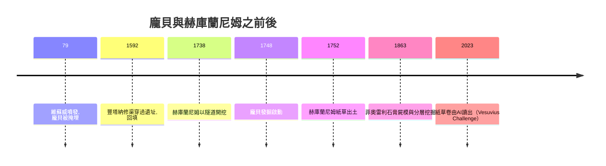

# 1.1 龐貝：被火山灰凍結的羅馬日常

西元 79 年，維蘇威火山（Vesuvius）在一陣巨響中噴發。十餘公里高的火山灰柱衝上平流層，先落下數公尺厚的浮石與火山碎屑，接著是數波高溫火山碎屑流，把龐貝（Pompeii）與鄰近的赫庫蘭尼姆（Herculaneum）整座掩埋。老普林尼（Pliny the Elder）率艦救援，死於斯塔比亞海岸；他的外甥小普林尼在致塔西佗的兩封信中記下整過程，成為世界上最早的火山目擊報告。

龐貝約有兩萬居民，死亡人數估計在千餘至兩千之間。對當時的人是一場浩劫；但對考古學，這是一座被時間凍結的實驗室。

## 中世紀的偶遇與回填

維蘇威火山的東南平原，把它和 Paladin 層霾覆蓋。中世紀的農人耕作時不時鋤出雕塑、碑文與壁畫殘片。1592 年，建築師多梅尼科·豐塔納（Domenico Fontana）在修建運水渠時甚至挖穿過連通的壁畫，但工程之便又把坑道回填。直到十八世紀之前，這一帶傳說是「城底底下有東西」。

1748 年 3 月，統治南義的西班牙波旁王朝在那不勒斯任命工程師羅克·霍金·阿爾庫比埃雷（Rocque Joaquín de Alcubierre）試挖。起初以為挖到的是斯塔比亚的遺址，但由於挖出了牆畫與銅幣，1748 年 8 月正式確認此地為龐貝。幾乎同時（1738 年起），赫庫蘭尼姆已開始以豎井與隧道的方式挖——那裡的火山灰凝成厚達二十公尺的岩層。

## 赫庫蘭尼姆紙草：一千多卅碳化的書

赫庫蘭尼姆最意外的發現出現在 1752 年：在今日所稱的「紙草別墅」（Villa dei Papiri）中挖出一個書房，藏有一千餘卷被高温碳化而倖存的莎草紙——是現存唯一（或近乎唯一）的完整古代私人圖書館。這些碳化紙卷一直難以拆開；二十世紀只能以多光譜掃描儀辨讀其上文字，而 2020 年代的「Vesuvius Challenge」（2023 年由 Brent Seales 團隊與人工智慧讀出首段），以斷層掃描與機器學習的方式，第一次「不拆卷就讀文字」。這是考古與科技結合的長達兩百七十年的故事，至今尚未完全結束。

## 三色線與層次挖掘：龐貝的方法革命

十八世紀後期，赫庫蘭尼姆與龐貝的挖掘開始出現正規的記錄。工程師斯帕塔羅（Carlo Weber）在挖赫庫蘭尼姆劇場時，以平面圖標明隧道位置；1785 年至 1815 年間，龐貝考古總監弗蘭基斯科·拉維尼（Francesco La Vega）用「三色線」系統註記挖出的不同風格壁畫——第一風格為主元件、紅色為第二風格、綠色為第三風格等——從而暴露一條演化的時間軸。1827 年，考古學家卡洛·博努奇（Carlo Bonucci）把「什麼位置用到什麼」記錄為規範。這些做法比英國在十九世紀所展開的分層挖掘法早半個世紀。

1860 年，建築師兼考古學家朱塞佩·菲奧雷利（Giuseppe Fiorelli）出任龐貝考古總監，推行「自上而下分層挖进」（stringently stratigraphic excavation）。1863 年，他注意到火山灰在地面上形成人體或動物之空殼——人被炭化、日後腐壞，但外殼留下人形空腔。他把液體石膏注入空腔，得到第一具「屍模」：跪坐者、蜷縮者、仰臥者在火山灰中被「拍照」。這不僅將龐貝之挖掘，由「拿到文物」升級為「保存一個古代世界」，更使菲奧雷利建立了世界上最早的考古訓練學校——這些創舉，是現代考古學方法之基礎，也奠定了龐貝在城市考古上的地位。

## 龐貝為什麼重要：三個後果

1. 它首次向歐洲展示「羅馬人也是人」：城中有競選標語、有商標、有餐館、有格鬥士塗鴉與日常動物骸骨。帝國不再是幾個古史名字，而是一個有街道、有店鋪、有廚房的生活世界。
2. 它催生了「遺址即整體」的思維：保存城牆、街道、公職選舉的完整佈局，而不是只取走雕塑。此概念即後來的「城市考古」。
3. 它帶來了田野記錄、遺物定位、分層挖掘等方法論的先決條件，成為此後英國在十九世紀正式系統化之田野方法的先導。

而龐貝的例外只是例外。整個十八與十九世紀的考古實務，直至貴族的收藏之熱才是主旋律：於是龐貝出土之後，全歐洲的文物被一箱箱運回家中。

下一節，我們把鏡頭稍微拉回来，看「尋寶獵人」——那些為私人花園與客廳而把古文明拆散的收集條例。因此，一方面它孕育了今天的博物館，另一方面它也損失了無法重得之遺址肌理。

