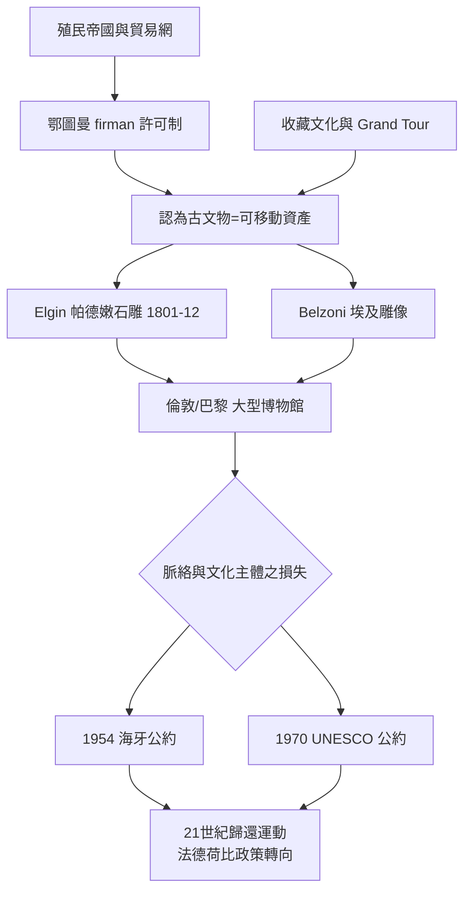

# 1.2 尋寶獵人與掠奪式挖掘

十九世紀上半，如果一位英國貴族想為自己添一件希臘雕像，他可以雇一支船隊與一群工人，到愛琴海的某個島嶼，把一座神廟的柱廊整批運回倫敦。這種行為在當時是合法的，甚至被視為個人成就；後人把它稱為掠奪式考古。

## 為什麼偉大的文物可以被搬走

要理解十八至十九世紀的掠奪式考古，得先放下今日的道德視角，看當時的三個結構。

第一，殖民帝國的政治與貿易網。鄂圖曼帝國自 1517 年統治埃及，也長期控制希臘地區；那裡的古代遺址與遺物，在鄂圖曼的行政結構中只是「土地之下的石頭」。大使、商人與旅行者可以向鄂圖曼官員申請 firman（許可令），取得挖掘與運輸文物的權限，而許可的標準從寬。英、法、德在鄂圖曼與埃及的領事館、外交官與探險家，正是這個網路的重要節點。帕德嫩神廟的石雕（Elgin Marbles）就是在 1801 至 1812 年間，由英國大使額爾金伯爵（Lord Elgin）取得許可拆取運回英國的；埃及的羅塞塔石碑，則在 1801 年英法交戰後由英國從法國戰利品中取得（詳見 2.1）。

第二，收藏文化的經濟結構。拿破崙時代前後，藝術品成為一種投資資產；古代文物因稀缺而具有時代意義，與古錢幣、繪畫一樣成為收藏對象。博物館的成立（大英博物館 1753、羅浮宮 1793、柏林舊博物館 1830）一方面讓古物有了制度性的家，另一方面也催生了對這些遺物的競爭性需求，倫敦與巴黎之間出現規模化的古物交易市場。

第三，歐洲的自我想像。拿破崙 1798 年遠征埃及時，隨軍帶有一百多位學者，並設立埃及研究院；法軍把壁畫描摹、把石柱拆走，是一種政治宣示：古代文明屬於「我們這個繼承者」。“Grand Tour”文化使歐洲年輕貴族把義大利與愛琴海當作必訪之地，文物則成為他們帶回家中的紀念品。民族主義的興起，使古文明成為國族敘事的素材，也成為各強國展開競爭的對象。

## 最著名的案例：額爾金與帕德嫩

帕德嫩神廟的大理石雕，由額爾金伯爵在 1801 年至 1812 年間拆下約一半，以船運送英國。他當時的理由是「以保存希臘古文明之精華為目的」。1816 年，英國政府以約三萬五千英鎊的代價把石雕博物館化，由大英博物館永久收藏。

希臘在十九世紀獨立之後就一直要求歸還。從 1816 年到二十一世紀初，這一辯論持续兩百餘年：支持歸還者強調原址脈絡與文化主權，反對者則以「環球博物館」為理由，認為人類文明之精華應集中展示於世界各地。2020 年代初，主權與歸還運動呼聲重新高漲，這一官司的本質，是「文化遺產屬地，還是人類共用？」的哲學問題，也約束著博物館對「文物移動」的原則。

## 這場掠奪的代價

掠奪式考古的深層代價，是在「文物」與「脈絡」之間做取捨，可以概括為三種損失：

1. 位置之損失。一件雕像原本位於廟宇何處，是否曾被移動，這些資訊一旦搬離便難以補回。
2. 同群之損失。一個遺址或一座墓所遺出之生物（青銅、陶、石、紙草）原本是一個整體資訊場；被分散到多個博物館後，同一時間層的密度與彼此關係都被拆散。
3. 文化主體之損失。当地人民被剝離了自己文化的文物，原住地的敘事權被轉移到歐洲的陳列櫃裡。

## 補救的開始

二十世紀後半，民族自決與文化主權的呼籲開始形成法律框架：

* 1954 年《海牙公約》：規範武裝衝突時文化財產之保護。
* 1970 年聯合國教科文組織公約：關於禁止與防止非法進出口文化財產之國際規則。
* 1995 年 UNIDROIT 公約：贓物歸還之法律依據。
* 2002 年許多西方大型博物館共同發表聲明，反對普遍性之歸還要求，此爭至今未落。
* 2019 年法國由 Felwine Sarr 與 Bénédicte Savoy 提出之報告，主張法國應將殖民時期取得之非洲文物返還，德、荷、比也自此開始歸還之政策轉向。

## 小結

掠奪式考古是一個矛盾的遺產：它一方面把無數古代文物集中到倫敦、巴黎與柏林，造就了博物館的黃金時代，另一方面在搬走文物的同時，拆掉了脈絡與在地記憶。考古學要從「尋寶」轉進「科學」，必須先放棄「帶回文物就好」的思維。這一步的轉捩，是下一位主角：1799 年一位法國士兵偶然挖到的一塊石頭，讓「讀懂文物」第一次成為可能。

那就是羅塞塔石碑的時代。
