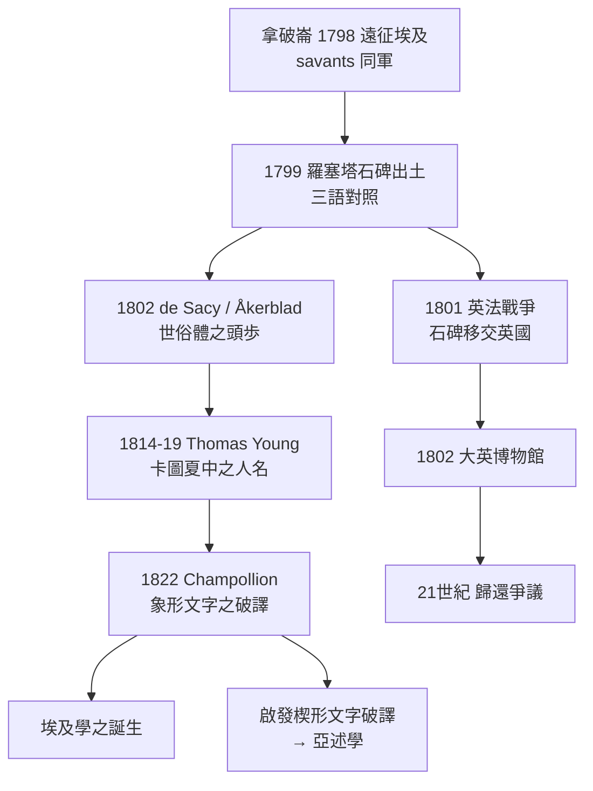

# 2.1 羅塞塔石碑：戰火中發現的天書鑰匙

1799 年 7 月，尼羅河三角洲西端的羅塞塔港鎮（Rashid，歐洲人稱 Rosetta）。拿破崙遠征埃及的部隊正在這一海岸要塞修築防禦工事，皮埃爾-法蘭索瓦·蒲沙爾（Pierre-François Bouchard）軍官的士兵們挖出了一塊黑色花崗岩，上面密密麻麻刻著三種文字。

沒有人當場知道它的價值，但軍中的學者團第一時間把它視為珍寶。這塊石頭，就是後來以「羅塞塔石碑」（Rosetta Stone）之名聞躍全球的破譯之鑰。

## 為什麼法國會帶著一百多位學者去打仗

要理解這塊石碑之所以「被發現」，得先理解它背後的政治工程。

1798 年拿破崙遠征埃及，目標是切斷英國與其印度殖民地之間的海上交通線，並建立法國在中東的影響。但他除了一支 3 萬多人的軍隊，還帶著一百五十餘位學者（savants）：數學家、地理學家、博物學家、化學家、古物學者——這是歐洲史上第一次，把「科學調查」當作軍事征服的一部分。抵達開羅後，他們成立埃及研究院（Institut d'Égypte），下設數學、物理、政治經濟、文學與藝術四組，並著手進行大規模的地理測量、動植物調查，與古蹟調查與描述（Description de l'Égypte，1809 至 1829 年間陸續出版，是歐洲人第一次系統性描述埃及文明）。

羅塞塔石碑正是在這個軍事－學術混合結構中「被發現」的：蒲沙爾雖是軍官，但其同事尼古拉-雅克·康特（Nicolas-Jacques Conté）等學者立即著手研究；石碑上三種文字被辨識為「象形文字（Hieroglyphic）」「世俗體（Demotic）」「古希臘文」。

石碑本身於公元前 196 年由托勒密五世時代孟菲斯的神職人員刻立，內容是贊揚法老在宗教與行政上的敕令。之所以刻三種文字，是托勒密王朝（源自希臘的馬其頓王室）統治下的現實：象形文字供神廟與神職人員，世俗體敘利亞—埃及語之日常政令，希臘文供希臘裔統治階層閱讀。

這一「三語對照」的結構，正是破譯的機會：只要希臘文可以讀通，就能用同一文本對照出象形文與世俗體的讀法。

## 石碑的命運：從戰利品到英國國家寶藏

拿破崙的埃及戰事在軍事上並不成功。1801 年 9 月，英軍攻克亞歷山卓，法軍依《亞歷山卓投降條約》交出所獲古物，羅塞塔石碑由此轉入英國之手；1802 年運抵倫敦，先存於英國古物學會，同年起在大英博物館展出至今，是該館參觀人次最多的展品之一。

石碑的歸屬問題至今仍是國際文化政治的敏感議題：埃及學界多次要求歸還，而大英博物館以「屬全人類文明之共同財富」為理由拒絕。這一爭議觸及一個全球性的問題：文物的歸屬，依「發現土地」的文化主權，還是依「博物館做為全人類展示場」的理念？我們會在 10.2 再次回到這個問題。

## 學者與石碑：十八世紀至十九世紀破譯之基礎

羅塞塔石碑不是唯一的破譯依據，它只是最完整的一把。1801 至瓦特 Jean-François Champollion 之成就之間，其實有一段將近二十年的接力：

* 帕里斯的語言學家希爾維特·德·薩西（Silvestre de Sacy）與瑞典外交官阿克布拉德（Johan David Åkerblad）在 1802 年前後於世俗體段落中辨認出一些人名與若干字符，奠定了第一步。
* 托馬斯·楊（Thomas Young，英國多領域科學家）在 1814 至 1819 年間，以「王名圈」（cartouche，橢圓框內為法老名字）為切入點，在世俗體與象形文兩部分辨識出 Ptolmys（托勒密）等名字的部分讀音；但他仍認為象形文字基本上是表意符號，未走到底。
* 真正完成破譯的是讓-弗朗索瓦·商博良（Jean-François Champollion）：他反覆比對羅塞塔石碑、腓尼基之菲萊方尖碑（ Philae obelisk）等實物與其手稿，確認象形文字同時具有表音與表意的雙重結構；1822 年 9 月 27 日在巴黎向銘文學院（Académie des inscriptions et belles-lettres）宣讀《致達西耶先生的信》（Lettre à M. Dacier），正式宣布破譯成功。本書之 2.2 專門述此故事。

## 石碑上為何有三千年的「死語言」

埃及象形文字之所以從羅馬晚期到十九世紀一直無人能讀，有其因果鏈。公元四世紀，基督教成為羅馬帝國國教，狄奧多西一世下令關閉異教神廟（391 年左右），神廟的僧侶與其教育系統斷絹，最後一代說寫象形文字的人消失；象形文自此成為「"]))
象圣经之神秘符號」，阿拉伯統治後又加上語言的隔閡，只被普遍誤解為一種純粹的象徵系統。羅塞塔石碑的價值不在於它是唯一（其實同期出土之菲萊方尖碑、德諾得特石碑均為輔助），而在於它提供了足夠長的對平行文本，可以由三國語互核，故亦揭示出「名字有拼音」這一與「純表意」假設相克的線索。

## 羅塞塔之後：一門嶄新學科的誕生

羅塞塔石碑造成的效果可以歸納成幾個方向：

1. 埃及學（Egyptology）正式成為一門學科：巴黎成為�義點，商博良任盧浮宮之埃及收藏館主任，並留下《埃及語法》（1836）與《埃及語字典》（全套在商博良死後出版）。十九世紀後半，柏林之萊普修斯（Richard Lepsius）、布魯格施（Heinrich Brugsch）等把埃及學機構化，編纂正規字典與語法。
2. 文化評估之重新壞認：文字被讀通後，埃及與希臘兩大古代文明第一次可以被並列比較；拉美西斯二世之名（希臘史上之 Sesôstris 之傳說原型）等問題，開始可以由原始文獻而非古典轉述來檢驗。
3. 與美索不達米亞同理路之開啟：象形文字既然可讀，那麼近東之楔形文字也應可讀。這一信念推動了 1830 至 1850 年代之交歐洲學者（格羅特芬德、羅林森與其「四國對解」）解讀楔形文字，亞述學隨之誕生。

## 小結

羅塞塔石碑是考古學史上第一次的「非文物的考古發現」——它不是一件金銀寶藏，而是讀懂無數文物的鑰匙。這一個關鍵點，代表考古學從此走到「解讀文明」的端正工作上，也走向了與語文學、歷史學、民族學、哲學的合流。

下一節，我們看商博良如何以該石碑 + 其他實物，正式解讀象形文字。

